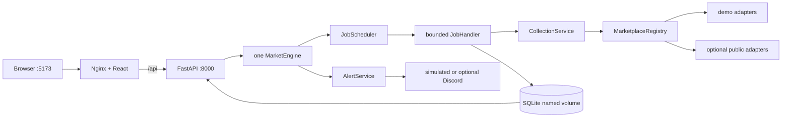
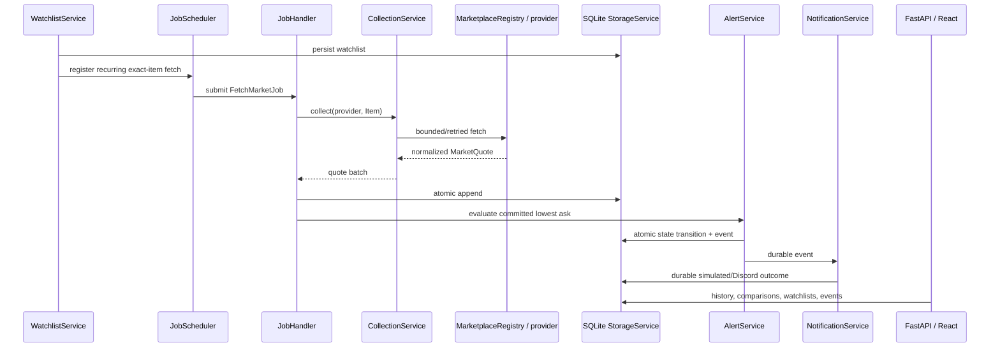

# Price Oracle

Price Oracle is a self-hosted Counter-Strike 2 marketplace monitor. It schedules marketplace
collection, stores exact `Decimal` observations in SQLite, compares compatible prices, evaluates
durable threshold alerts, and records notification outcomes.

## Quick start — no API keys required

Prerequisites: Docker Engine with Docker Compose v2. No `.env`, secret files, marketplace account,
Steam session, API subscription, or Discord webhook is needed.

```bash
git clone <repository-url>
cd price-oracle
docker compose up --build -d
```

Open <http://127.0.0.1:5173>. The API is available at <http://127.0.0.1:8000>, and its health
endpoint is:

```bash
curl --fail http://127.0.0.1:8000/api/health
# {"status":"ok"}
```

The default is **offline demo mode**. The page says `SIMULATED DATA`, uses only bundled fixtures,
and makes no marketplace requests. A sample watchlist and alert are seeded idempotently. The real
scheduler and worker run collection through `MarketplaceRegistry` and `CollectionService`; quotes,
alert state, events, and simulated delivery outcomes are written to real SQLite storage.

Useful commands:

```bash
docker compose ps
docker compose logs -f api frontend
docker compose restart api
docker compose down                  # preserves data
docker compose down --volumes        # deletes demo data; destructive
```

The named `price-oracle-data` volume survives ordinary stop, restart, container recreation, and
`docker compose down`. Only use `down --volumes` when you intentionally want a clean demo database.

## Practical Docker smoke test

Run the complete isolated demonstration from the repository root:

```bash
python3 scripts/smoke_test.py --mode demo
```

The script creates a uniquely named Compose project on ports 15173/18000, builds and starts both
containers, and verifies:

1. API health and frontend-to-API proxying.
2. Explicit demo mode and simulated provider labels.
3. Persistent sample watchlist restoration.
4. Scheduler → `JobHandler` → `CollectionService` → demo marketplace execution.
5. Two normalized lowest asks committed to SQLite.
6. A real `PricingService` spread calculation.
7. Durable threshold event creation and simulated notification success.
8. API/engine container restart and retained watchlist/event state.
9. Graceful shutdown and removal of only the isolated smoke-test volume.

Every stage prints `PASS`; any failure returns a nonzero exit status and prints container logs. Use
`--keep` to retain the isolated stack for inspection. The smoke test never calls a live provider or
touches the normal application volume.

## Operating modes

| Mode | Setting | Network behavior | Data |
|---|---|---|---|
| Offline demo (default) | `CS2_OPERATING_MODE=demo` | No marketplace or remote-catalog calls | Deterministic fixtures, labelled simulated |
| Public marketplaces | `CS2_OPERATING_MODE=public` | Best-effort requests to explicitly enabled providers | Live observations, never replaced by demo values |

Demo providers are named `demo-market-a` and `demo-market-b`; live providers use their real names.
The Docker default database is `/var/lib/price-oracle/demo.sqlite3`. Keep public observations in a
different file so the two modes remain operationally isolated:

```bash
CS2_OPERATING_MODE=public \
CS2_DATABASE_PATH=/var/lib/price-oracle/public.sqlite3 \
docker compose up --build -d
```

Provider failures remain visible in logs and affect their own jobs. Price Oracle never silently
falls back from unavailable live data to simulated prices.

## Docker architecture



FastAPI owns exactly one in-process engine and scheduler. Uvicorn is fixed to one worker; do not
scale the API service horizontally against this SQLite volume. The frontend container only serves
static assets and proxies `/api`.

## End-to-end data flow



## Public provider assessment

No live request was made while validating this change. Provider contract tests use saved
representative payloads and `httpx.MockTransport`.

| Provider / endpoint | Authentication and cost | Limits and caching | Data and limitations | V1 recommendation |
|---|---|---|---|---|
| Steam Community Market `GET /market/priceoverview/` ([official Web API overview](https://partner.steamgames.com/doc/webapi_overview)) | No key observed; this community endpoint is outside the formally documented Steam Web API market-price interface | No official rate limit; adapter uses one connection, 60-second item cache, 2-second request spacing, timeout, and bounded retry | Exact `appid=730` item; lowest ask, optional median and volume. Wallet prices are not withdrawable cash. Access may return 403/429/HTML. | Implemented as best-effort public mode; never mandatory |
| [Skinport `GET /v1/items`](https://docs.skinport.com/items) | Officially no authorization; public/free access | 8 requests per 5 minutes, response cached 5 minutes, `Accept-Encoding: br` required | One catalog response covers many exact names; min/mean/median/max/suggested prices and quantity. Aggregate minimum is not a guaranteed executable transaction. | Best documented keyless V1 source; implemented |
| [Skinport `GET /v1/sales/history`](https://docs.skinport.com/sales/history) | Officially no authorization; public/free access | 8 requests per 5 minutes, cached 5 minutes, Brotli required | 24h/7d/30d/90d sale aggregates and volume; these are historical statistics, not live asks. | Recommended later; not implemented in this change |
| [CSFloat `GET /api/v1/listings`](https://docs.csfloat.com/) | Official examples show listing reads without a key; account/write operations require an API key | No dependable anonymous limit is published; use conservative spacing and caching | Exact active buy-now listings in integer minor units; listing-level `INDIVIDUAL_LISTING`, not aggregate lowest ask | Implemented as an optional keyless provider; key can enhance access |

Steam request parameters are `appid=730`, the exact `market_hash_name`, configured country, and
Steam currency ID. Names are sent without canonicalization, so wear, StatTrak™, Souvenir, and other
variants never merge. The adapter safely parses common dot/comma localized formats into `Decimal`,
keeps configured currency explicit, distinguishes lowest ask from the separately retained median,
and preserves optional volume. HTTP 429, 403/5xx, timeout, invalid JSON, `success=false`, and missing
price fields remain distinct failures or unavailable data; missing values are not invented.

## Configuration and optional credentials

The application runs without copying `.env.example`. All settings use the `CS2_` prefix; see the
Docker-oriented [`.env.example`](.env.example) and local-Python
[`backend/.env.example`](backend/.env.example) templates.

| Variable | Default in Compose | Required? | Purpose |
|---|---:|---|---|
| `CS2_OPERATING_MODE` | `demo` | No | `demo` or `public` |
| `CS2_DATABASE_PATH` | `/var/lib/price-oracle/demo.sqlite3` | No | SQLite file inside the persistent volume |
| `CS2_DEMO_SEED_ENABLED` | `true` | No | Idempotent sample watchlist/alert |
| `CS2_STEAM_ENABLED` | `true` | No | Enable Steam only in public mode |
| `CS2_SKINPORT_ENABLED` | `true` | No | Enable Skinport only in public mode |
| `CS2_CSFLOAT_ENABLED` | `true` | No | Enable CSFloat only in public mode |
| `CS2_CSFLOAT_API_KEY` | unset | No | Optional CSFloat authorization |
| `CS2_DISCORD_WEBHOOK_URL` | unset | No | Optional public-mode Discord delivery |
| `CS2_WORKER_COUNT` | `2` | No | Bounded collection workers |
| `CS2_JOB_QUEUE_CAPACITY` | `100` | No | Pending job bound |

Missing credentials never create empty authorization headers. An invalid optional CSFloat setting
disables CSFloat, and an invalid Discord destination disables Discord without preventing the
remaining application from starting. Actual authentication rejection is reported for that provider.
Secrets are represented with Pydantic `SecretStr` and are never returned by APIs or logged.

For optional Docker Secrets, copy [`compose.secrets.yaml.example`](compose.secrets.yaml.example),
create only the files you need under the ignored `secrets/` directory, then run:

```bash
docker compose -f compose.yaml -f compose.secrets.yaml up --build -d
```

The base Compose file has no secret mounts, so nonexistent secret files cannot block keyless startup.

## API and frontend

The React page uses the engine-backed API through Nginx's same-origin proxy. Important routes:

- `GET /api/health` and `GET /api/status`
- `GET /api/items/search?q=redline`
- `GET /api/items/{market_hash_name}/quotes`
- `GET /api/items/{market_hash_name}/history`
- `GET /api/items/{market_hash_name}/comparison`
- watchlist CRUD under `/api/watchlists`
- alert rules/events under `/api/alerts` and `/api/alerts/events`
- `GET /api/notifications/{event_id}`

OpenAPI documentation is available at <http://127.0.0.1:8000/docs>.

The legacy two-provider `/api/prices/compare` contract remains available in public mode when both
Steam and Skinport are enabled. The dashboard uses stored engine observations instead, so its values
have passed through collection and persistence rather than bypassing the engine.

## Source map

| File | Responsibility |
|---|---|
| [`compose.yaml`](compose.yaml) | Keyless API/frontend deployment, health checks, persistent volume |
| [`Dockerfile`](Dockerfile) | Non-root single-worker API image |
| [`frontend/Dockerfile`](frontend/Dockerfile) | Reproducible React build and Nginx runtime |
| [`backend/engine/config/settings.py`](backend/engine/config/settings.py) | Typed environment/dotenv/Docker Secret settings |
| [`backend/engine/bootstrap.py`](backend/engine/bootstrap.py) | One explicit composition root and provider selection |
| [`backend/engine/demo.py`](backend/engine/demo.py) | Network-free catalog, providers, and seed configuration |
| [`backend/engine/marketplaces/steam.py`](backend/engine/marketplaces/steam.py) | Steam request, cache, failure mapping, localized normalization |
| [`backend/engine/marketplaces/skinport.py`](backend/engine/marketplaces/skinport.py) | Cached Skinport catalog adapter |
| [`backend/engine/marketplaces/csfloat.py`](backend/engine/marketplaces/csfloat.py) | Optional listing adapter |
| [`backend/engine/api/routes.py`](backend/engine/api/routes.py) | Engine-backed management and observation API |
| [`scripts/smoke_test.py`](scripts/smoke_test.py) | Isolated full-Compose practical test |

## Local development and tests

Python 3.12+ and Node.js 20+ are supported.

```bash
cd backend
python3 -m venv .venv
. .venv/bin/activate
python -m pip install -r requirements.txt
python -m pytest -q

cd ../frontend
npm ci
npm run build

cd ..
docker compose config
docker compose build
python3 scripts/smoke_test.py --mode demo
```

Validation performed on 2026-10-24:

- Backend: **411 passed** (provider calls mocked; one third-party TestClient deprecation warning).
- Frontend TypeScript and Vite production build: passed; `npm ci` reported 0 vulnerabilities.
- `docker compose config`: passed.
- API and frontend images: built successfully.
- Isolated live Compose smoke test: every stage passed, including restart persistence and cleanup.
- Live Steam, Skinport, CSFloat, and Discord requests: deliberately not run.

The in-memory [`EventBus`](backend/engine/events/bus.py) retains its isolated tested contract but is
not inserted into the durable quote/alert pipeline; that pipeline uses the existing post-persist
hook. No claim of durable EventBus dispatch is made.

## Troubleshooting and limitations

- Check `docker compose ps` and `docker compose logs --tail=200 api frontend` first.
- A 403/429 or HTML response from Steam means the undocumented public endpoint is restricted; it is
  not evidence that an API key is missing.
- Skinport 406 usually means Brotli negotiation failed; the runtime includes Brotli and sends the
  required header.
- Public providers can be temporarily unavailable. Other scheduled providers continue running.
- The project does not convert currencies, invent fees, equate Steam Wallet and cash value, place
  trades, or present fictional prices as recommendations.
- SQLite is for one self-hosted node. There is no migration framework, authentication/multi-user
  boundary, notification recovery worker, browser automation test, or guaranteed live-provider SLA.
- The browser production bundle and API proxy were exercised by HTTP; automated visual browser
  interaction is not currently configured.

See [`docs/deployment/README.md`](docs/deployment/README.md) for deployment details and module-level
READMEs under [`backend/engine`](backend/engine/README.md) for service contracts.

## License

See [LICENSE](LICENSE).
