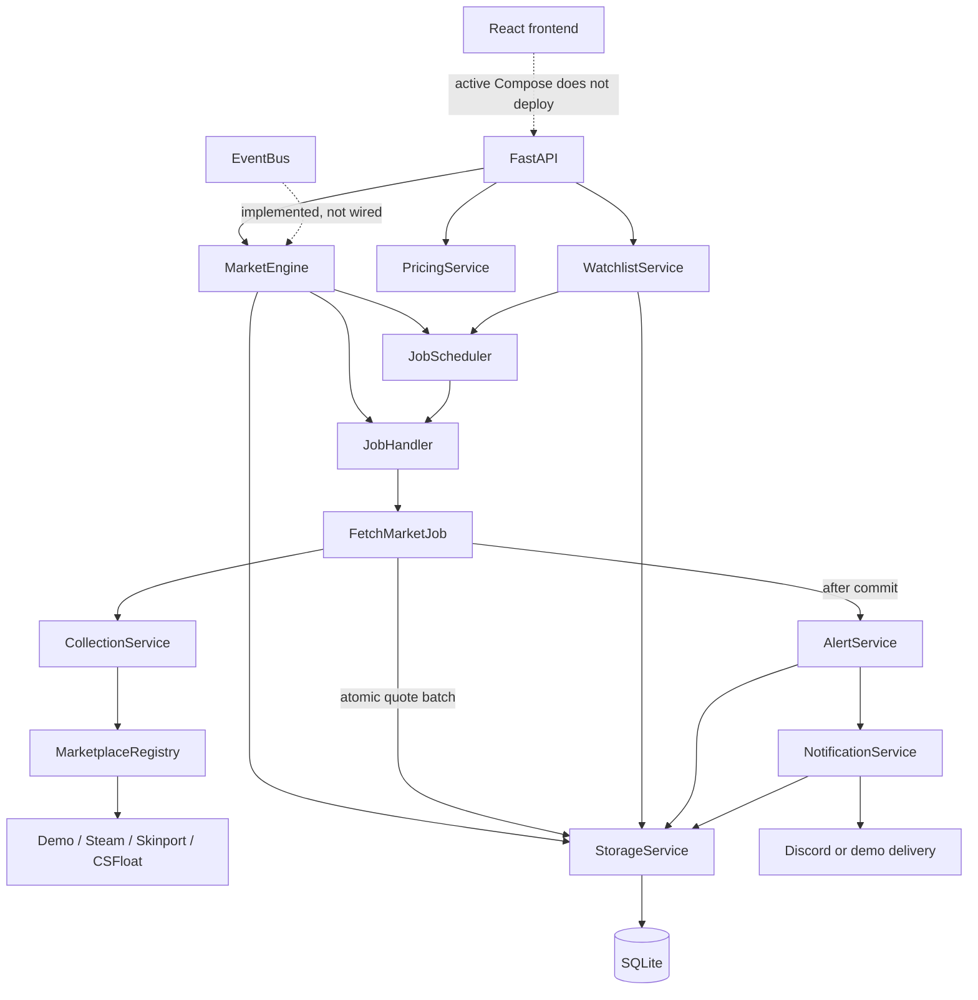
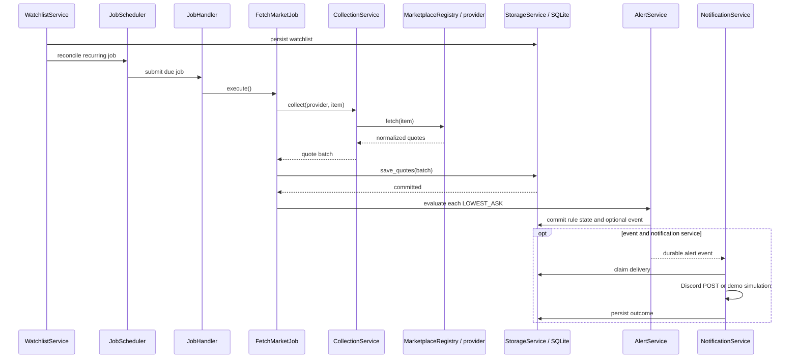

# Price Oracle

Price Oracle is a self-hosted CS2 marketplace monitoring and price-comparison application. Its
engine collects normalized marketplace observations, stores exact prices and history in SQLite,
schedules watchlists, evaluates threshold alerts, and can deliver Discord notifications. A React
frontend and FastAPI transport are also present.

The repository includes a deterministic offline demo that is designed to work without marketplace
credentials or network calls. However, the current `engine` branch has integration regressions that
prevent both the demo and public mode from starting. The affected commands and proposed repairs are
documented under [Current Limitations](#current-limitations); the implemented modules are described
below without presenting the broken runtime as production-ready.

## Quick Start

No working full-application Quick Start exists at the current revision. The intended credential-free
Docker workflow is:

```bash
git clone https://github.com/maciejL03/price-oracle.git
cd price-oracle
docker compose up --build -d
```

No API keys are required for the offline demo, and no `.env` file should be needed for its defaults.
At present, the image builds but the only Compose service enters a restart loop because
[`create_market_engine()`](backend/engine/bootstrap.py) references an unimported
`CollectionPolicy`. In addition, [`compose.yaml`](compose.yaml) defines only the headless engine;
it does not define or publish the API and frontend services expected by the demo and smoke test.

Do not treat a successful `docker compose up` exit code as a successful installation. Check the
container state and logs as shown below.

## Accessing Price Oracle

The active Compose configuration publishes **no host ports**, so there is currently no browser,
API, documentation, or health-check URL reachable through `docker compose up`.

| Component | Configured listener | Host address in active Compose | Purpose |
| --- | ---: | --- | --- |
| Engine daemon | None | Not exposed | Scheduling, collection, persistence, alerts, notifications |
| FastAPI image | Container `8000` | Not included in Compose | API; its current import also fails |
| Frontend image | Container `8080` | Not included in Compose | Nginx-served React application |
| Vite development server | `127.0.0.1:5173` | `http://localhost:5173` when run separately | Frontend development; proxies `/api` to port `8000` |

FastAPI is configured to provide `/api/health`, `/api/status`, Swagger UI at `/docs`, and OpenAPI
at `/openapi.json` once its current import errors are repaired. The root Dockerfile listens on
container port `8000`, but [`compose.yaml`](compose.yaml) does not publish that port. The frontend
Nginx configuration listens on container port `8080` and proxies `/api` to a Compose service named
`api`, which the active Compose file does not define.

`CS2_API_PORT` and `CS2_FRONTEND_PORT` appear in the example environment files, but the active
Compose file does not reference them. They therefore cannot currently change a published port.

## Verify Your Installation

Inspect both running and failed/restarting containers:

```bash
docker compose config
docker compose ps -a
docker compose logs --tail=200 price-oracle-engine
```

On the current revision, the relevant log output is expected to resemble this illustrative excerpt:

```text
NameError: name 'CollectionPolicy' is not defined
```

That is a known repository defect, not a missing credential. A healthy future demo should also make
the following checks pass:

```bash
curl --fail http://127.0.0.1:8000/api/health
curl --fail http://127.0.0.1:8000/api/status
python3 scripts/smoke_test.py
```

The smoke script is real, isolated, and removes only the temporary Compose project and volume it
creates. It is not usable with the active Compose definition because it expects `api` and `frontend`
services. When restored, it verifies API health, frontend proxying, engine startup, SQLite access,
scheduled demo collection, price comparison, alert delivery, and persistence across an API restart.
All demo prices are deterministic simulations and must not be interpreted as live marketplace data.

For interactive diagnosis, follow all engine logs with:

```bash
docker compose logs -f price-oracle-engine
```

## Configuration

[`EngineSettings`](backend/engine/config/settings.py) reads `CS2_` environment variables, a local
`.env`, and matching files in `/run/secrets`. Explicit environment and dotenv values take precedence
over Docker Secrets. The current Compose service optionally reads `backend/.env`, so use
[`backend/.env.example`](backend/.env.example) as its reference. The root
[`env example`](.env.example) describes the intended full-stack deployment, including two port
variables that are not wired into the active Compose file.

| Setting | Purpose | Required | Default |
| --- | --- | ---: | --- |
| `CS2_OPERATING_MODE` | Select `demo` simulations or `public` providers | No | `demo` |
| `CS2_DEMO_SEED_ENABLED` | Seed the demo watchlist and alert rule | No | `true` |
| `CS2_DATABASE_PATH` | SQLite database path | No | `data/engine.sqlite3`; Compose overrides it with `/data/engine.sqlite3` |
| `CS2_WORKER_COUNT` | Bounded job-worker count | No | `5` |
| `CS2_JOB_QUEUE_CAPACITY` | Maximum queued jobs | No | `100` |
| `CS2_QUOTE_MAX_AGE_SECONDS` | Quote freshness window for pricing and alerts | No | `300` |
| `CS2_STEAM_ENABLED` | Intended public-mode Steam toggle | No | `true`; currently not honored by bootstrap |
| `CS2_SKINPORT_ENABLED` | Intended public-mode Skinport toggle | No | `true`; currently not honored by bootstrap |
| `CS2_CSFLOAT_ENABLED` | Enable CSFloat in public mode | No | `true` |
| `CS2_CSFLOAT_API_KEY` | Optional CSFloat authorization value | No | Unset |
| `CS2_DISCORD_WEBHOOK_URL` | Optional Discord alert destination | No | Unset |
| `CS2_CORS_ORIGINS` | JSON list of allowed browser origins | No | Local Vite origins on port `5173` |

Demo mode is intended to replace all marketplace I/O and Discord delivery with deterministic local
implementations. Public-mode Steam and Skinport reads are keyless; CSFloat listing reads may be
attempted without a key, but provider availability and access policy are external constraints.
Discord is optional. Once bootstrap is repaired, an absent optional credential should disable only
that integration, not basic engine startup.

For Docker Secrets, copy [`compose.secrets.yaml.example`](compose.secrets.yaml.example), retain only
the credentials in use, and mount files named `CS2_CSFLOAT_API_KEY` and/or
`CS2_DISCORD_WEBHOOK_URL`. Never commit those files or credential values.

## Features

The following capabilities have concrete service, storage, and test implementations. Their
top-level runtime composition is currently blocked by the defects listed above.

- **Price collection:** asynchronous marketplace adapters normalize prices into immutable
  `MarketQuote` observations; shared concurrency, spacing, retry, and backoff policies bound calls.
- **Pricing and comparisons:** `PricingService` compares only exact-item, same-currency, same-type,
  fresh quotes. Results are pre-fee and do not imply profit.
- **History and persistence:** SQLAlchemy stores decimal prices, UTC timestamps, watchlists, alert
  state/events, and notification outcomes in SQLite with WAL and foreign-key enforcement.
- **Watchlists and scheduling:** persisted watchlists reconcile into independent, non-overlapping
  recurring jobs; shared item/provider pairs use one schedule at the shortest requested interval.
- **Alerts:** durable above/below rules operate on `LOWEST_ASK` observations and trigger only on an
  inactive-to-active edge, rearming after a newer non-matching observation.
- **Notifications:** optional Discord webhooks use bounded retries and durable delivery state;
  offline demo delivery is simulated and stored without network access.
- **API and UI:** FastAPI routes cover status, search, comparisons, history, watchlists, alerts, and
  notification state. The React UI displays engine mode, search, stored comparisons, provider and
  watchlist summaries, and alert-event counts; it does not manage watchlists or rules.
- **Events:** a typed, awaited, in-memory `EventBus` is implemented and tested, but it is not wired
  into production composition. Alerts use a direct post-persistence callback instead.

### Marketplace support

| Provider | Observation | Credentials | Status |
| --- | --- | --- | --- |
| `demo-market-a`, `demo-market-b` | Deterministic `LOWEST_ASK` | None | Offline/test providers; intended demo default |
| Steam | Aggregate `LOWEST_ASK` | None | Public adapter implemented; live access is best-effort and not authorized-smoke-tested |
| Skinport | Aggregate `LOWEST_ASK` | None | Public adapter implemented with a cached item index; live access is best-effort |
| CSFloat | Individual buy-now listings | Optional API key | Adapter implemented; listings are stored and priceable but cannot fire lowest-ask rules |

The older adapters under `backend/app/adapters` are not the active engine integrations. New work
should target [`backend/engine/marketplaces`](backend/engine/marketplaces/README.md).

## Architecture

This diagram shows the implemented source architecture. Dashed boundaries identify components that
exist but are not connected by the active Compose deployment or runtime composition.



`MarketEngine` owns startup and shutdown ordering. The FastAPI lifespan is designed to own exactly
one engine, while the daemon entry point owns one headless engine. Do not run both processes against
the same writable database: each would restore the same watchlists into an independent scheduler.

Detailed module documentation: [engine lifecycle](backend/engine/README.md),
[API](backend/engine/api/README.md), [jobs](backend/engine/jobs/README.md),
[services](backend/engine/services/README.md), [storage](backend/engine/storage/README.md),
[watchlists](backend/engine/watchlists/README.md), [alerts](backend/engine/alerts/README.md),
[notifications](backend/engine/notifications/README.md), and
[events](backend/engine/events/README.md).

## How Data Flows

A watchlist mutation is persisted before schedules are reconciled. When a schedule is due, the
handler executes a one-shot fetch, and alert evaluation begins only after the quote batch commits.



The scheduler is completion-relative, so a slow run does not overlap its next run. `JobHandler`
also suppresses duplicate queued/running job keys. `EventBus` is not part of this path.

## Project Structure

| Path | Main entry | Responsibility |
| --- | --- | --- |
| [`compose.yaml`](compose.yaml) | `price-oracle-engine` | Current engine-only Compose deployment; no ports |
| [`Dockerfile`](Dockerfile) | `uvicorn app.main:app` | Standalone API image, not used by active Compose |
| [`frontend/Dockerfile`](frontend/Dockerfile) | Nginx on `8080` | Production frontend image, not used by active Compose |
| [`backend/engine/bootstrap.py`](backend/engine/bootstrap.py) | `create_market_engine()` | Dependency composition and quote-to-alert hook |
| [`backend/engine/market_engine.py`](backend/engine/market_engine.py) | `MarketEngine` | Ordered lifecycle, rollback, and cleanup |
| [`backend/engine/api/app.py`](backend/engine/api/app.py) | `create_app()` | FastAPI factory, lifespan, CORS, error mapping |
| [`backend/engine/api/routes.py`](backend/engine/api/routes.py) | `router` | Engine HTTP routes |
| [`backend/engine/jobs`](backend/engine/jobs/README.md) | `EngineJob`, `JobHandler`, `JobScheduler` | Bounded asynchronous work and recurrence |
| [`backend/engine/services`](backend/engine/services/README.md) | collection, comparison, pricing | Provider policy and quote ranking |
| [`backend/engine/marketplaces`](backend/engine/marketplaces/README.md) | marketplace adapters and registry | External data normalization |
| [`backend/engine/storage/service.py`](backend/engine/storage/service.py) | `StorageService` | Public SQLAlchemy/SQLite persistence boundary |
| [`backend/engine/watchlists/service.py`](backend/engine/watchlists/service.py) | `WatchlistService` | Durable monitoring configuration and job reconciliation |
| [`backend/engine/alerts/service.py`](backend/engine/alerts/service.py) | `AlertService` | Durable threshold evaluation |
| [`backend/engine/notifications/service.py`](backend/engine/notifications/service.py) | `NotificationService` | Discord and simulated delivery orchestration |
| [`backend/engine/events/bus.py`](backend/engine/events/bus.py) | `EventBus` | Optional typed in-process dispatch; currently unwired |
| [`frontend/src/api/client.ts`](frontend/src/api/client.ts) | browser API functions | Same-origin `/api` client |
| [`scripts/smoke_test.py`](scripts/smoke_test.py) | Docker smoke runner | Intended isolated full-stack verification |

Domain-model details are in [`backend/engine/models/README.md`](backend/engine/models/README.md), and
all settings are described in [`backend/engine/config/README.md`](backend/engine/config/README.md).

## Development

The Dockerfiles establish Python 3.12 and Node 22 as the project runtimes. A local backend setup is:

```bash
python3 -m venv .venv
source .venv/bin/activate
python -m pip install --upgrade pip
python -m pip install -r backend/requirements.txt
cd backend
python -m uvicorn app.main:app --reload --port 8000
```

That backend command is the configured development entry point, but it currently stops during route
import; see [Current Limitations](#current-limitations). When repaired, it owns one `MarketEngine`
through the FastAPI lifespan and exposes the API on `http://127.0.0.1:8000`.

In a second terminal, install and start the frontend:

```bash
npm --prefix frontend ci
npm --prefix frontend run dev
```

Vite serves `http://localhost:5173` and proxies `/api` to `http://127.0.0.1:8000`. Its port is fixed
in [`frontend/vite.config.ts`](frontend/vite.config.ts); `CS2_FRONTEND_PORT` applies only to the
intended Docker publishing layer, which is currently absent. Demo-mode defaults require no `.env`.

## Testing

Install `backend/requirements.txt` in the active Python environment, then run:

```bash
cd backend
python -m pytest
```

The suite currently stops during collection because `engine.api.routes` references
`SystemStatusResponse` without importing it. No current passing-test count is claimed.

Useful narrower commands are:

```bash
# Engine integration coverage
cd backend
python -m pytest tests/test_engine_integration.py

# Credential-free demo coverage
python -m pytest tests/test_demo_mode.py

# Frontend TypeScript check and production build (no frontend test/lint script exists)
cd ..
npm --prefix frontend ci
npm --prefix frontend run build

# Intended isolated Docker integration smoke test
python3 scripts/smoke_test.py
```

The frontend production build succeeds in its Docker build stage. The backend and smoke commands do
not currently pass for the integration reasons already noted. Provider unit tests use mocked HTTP
responses; the project does not claim authorized live marketplace verification.

## Deployment

The active [`compose.yaml`](compose.yaml) has one service, `price-oracle-engine`, built from
[`backend/Dockerfile`](backend/Dockerfile). It runs `python -m engine` as an unprivileged user,
restarts unless stopped, and receives a 20-second stop grace period. The named
`price-oracle-data` volume is mounted at `/data`, with SQLite forced to `/data/engine.sqlite3`.

```bash
docker compose up --build -d
docker compose ps -a
docker compose logs -f price-oracle-engine
docker compose restart price-oracle-engine
docker compose stop
docker compose down
```

`docker compose down` retains the database volume. Adding `--volumes` deletes the persistent
database and should be used only when data loss is intentional. Shutdown handles `SIGINT` and
`SIGTERM`, stops the scheduler, drains/cancels bounded workers, closes owned HTTP resources, and
disposes storage.

The daemon has no HTTP health check. Container state and logs are the only active deployment checks.
It is also currently unusable because of the bootstrap error. See the
[detailed deployment guide](docs/deployment/README.md) for the engine-only ownership, secrets,
backup, permissions, and SQLite guidance; its historical validation results predate the current
merge regression.

## Extending Price Oracle

- Add a marketplace by implementing the async
  [`Marketplace`](backend/engine/marketplaces/base.py) protocol and registering it in
  [`create_market_engine()`](backend/engine/bootstrap.py).
- Add a job by subclassing [`EngineJob`](backend/engine/jobs/base.py) and submitting it through
  `JobHandler`; use `JobScheduler` only when it must recur.
- Add an API route and transport schema in
  [`backend/engine/api`](backend/engine/api/README.md), keeping business behavior in engine services.
- Add storage behavior through [`StorageService`](backend/engine/storage/service.py), with ORM models
  kept private to the storage package.
- Add compatibility or ranking behavior to [`PricingService`](backend/engine/services/pricing.py)
  without adding provider I/O there.
- Add alert conditions through the alert models/service and an atomic storage transition; current
  rules support only above/below `LOWEST_ASK` edges.
- Add an event by subclassing [`EngineEvent`](backend/engine/events/models.py) and registering an
  async subscriber with `EventBus`; explicitly wire publication because bootstrap currently does not.
- Add a notification destination behind a focused delivery service and durable outcome model rather
  than coupling it to collection.

Read the linked module README before changing a boundary; each documents contracts, failure modes,
and extension rules in more detail.

## Design Decisions

- **Python and asyncio** suit provider HTTP, SQLite, webhook, and scheduling workloads while giving
  lifecycle code one cancellation model.
- **A modular monolith** keeps one deployable process and explicit module boundaries; distributed
  scheduling and a separate queue are deferred until multi-node operation is required.
- **A bounded worker pool** makes concurrency, memory pressure, duplicate suppression, and shutdown
  behavior explicit instead of creating an unbounded task per fetch.
- **Independent recurring jobs** prevent one slow provider/item pair from blocking every schedule,
  while completion-relative recurrence prevents overlap and catch-up storms.
- **Marketplace abstraction plus `CollectionService`** separates response normalization from shared
  admission, retry, spacing, and backoff policy.
- **SQLAlchemy and SQLite** provide precise durable local storage behind one service boundary. WAL
  supports concurrent reads; multiple writer processes and automated schema migrations are deferred.
- **Explicit dependency injection** makes clocks, clients, providers, and storage replaceable in
  tests without a framework or global registry.
- **Separate pricing, alert, and notification services** isolate pure comparison, transactional
  trigger state, and unreliable external delivery.
- **A lightweight EventBus** supports optional awaited in-process reactions without pretending to
  be a durable broker; the current core flow remains direct and transactional.
- **FastAPI** provides typed validation, lifespan ownership, and generated API documentation, while
  **Docker Compose** is intended to package one API-owned engine plus the frontend and persistent
  data. The active Compose file has regressed to the older engine-only shape.

## Current Limitations

- **Quick Start is broken:** `price-oracle-engine` restarts with an unimported `CollectionPolicy` in
  `bootstrap.py`. Importing FastAPI separately fails first on an unimported
  `SystemStatusResponse`; the route module has additional missing schema/catalog names and an
  incorrect search variable.
- **Bootstrap has further merge damage:** it references `csfloat`, `SimulatedNotificationService`,
  and `validate_discord_webhook_url` without valid definitions/imports in that module, overwrites the
  demo catalog with the network catalog, and does not honor the Steam/Skinport enable settings.
- **Compose is not full-stack:** only the headless daemon exists, with no published ports or health
  check. The frontend proxy and smoke test expect services named `api` and `frontend`.
- **Proposed repair:** restore a coherent demo/public branch in `create_market_engine()`, import all
  API schemas and `ItemCatalog`, fix `search_items()` to use its injected catalog, and restore the
  `api`/`frontend` Compose services with loopback host mappings and health checks. Then rerun the
  backend suite and isolated smoke test before advertising the localhost URLs as working.
- Live provider behavior depends on third-party availability, rate limits, and access policy; only
  mocked compatibility is covered in the repository.
- There is no authentication or authorization. If the management API is restored, it must be
  network-restricted.
- The frontend is primarily observational; watchlist/rule creation, history browsing, and delivery
  management remain API-only.
- CSFloat produces `INDIVIDUAL_LISTING` observations, while implemented alerts accept only
  `LOWEST_ASK`.
- `EventBus` is in-memory, synchronous-with-the-publisher, non-durable, and currently unwired.
- SQLite is designed for one engine owner. Multiple API workers, daemon/API co-ownership, or Compose
  replicas against one database can create duplicate schedulers and are unsupported.
- There is no automated schema migration, durable event bus, notification recovery worker, currency
  conversion, fee/profit model, forecasting, or trading functionality.
