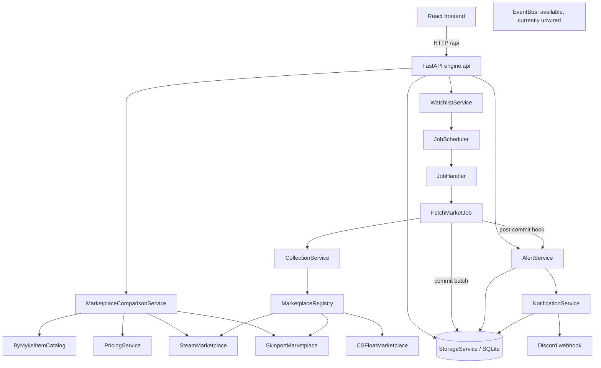
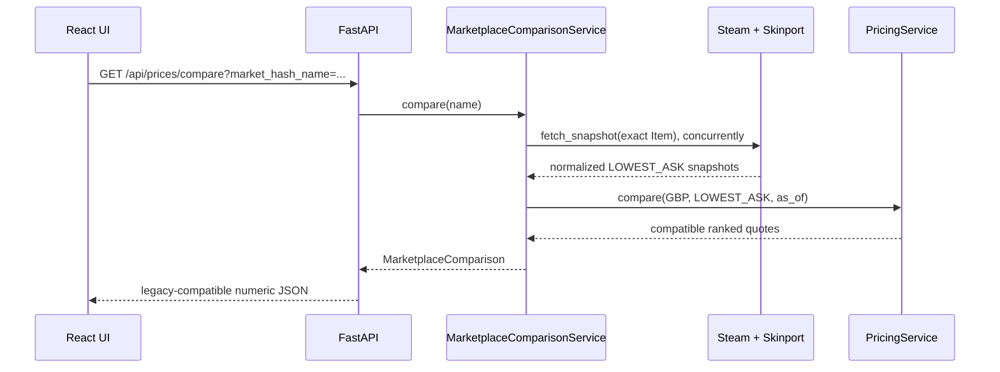
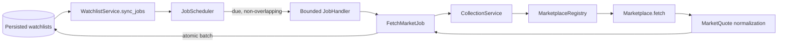
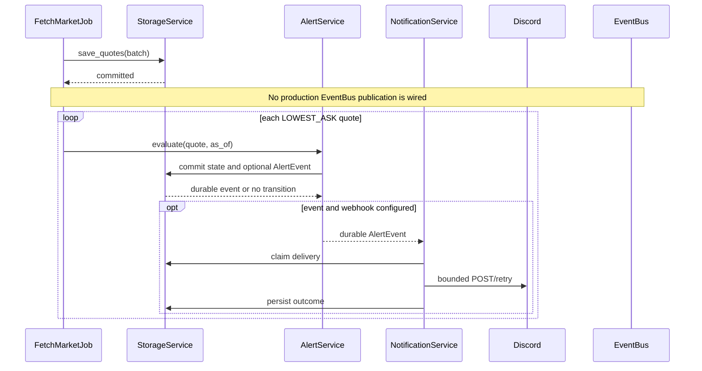
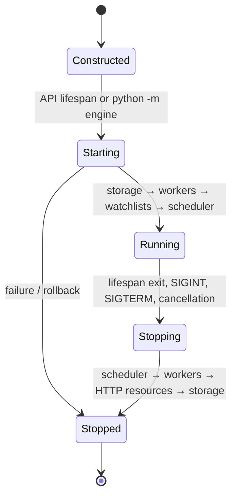

# Price Oracle

Price Oracle is a self-hosted Counter-Strike 2 market monitor and price-comparison application.
It combines a React comparison UI, a FastAPI transport, asynchronous marketplace adapters,
persistent watchlists, scheduled collection, exact-price SQLite storage, threshold alerts, and
optional Discord notifications.

The project is suitable for local development and controlled self-hosted testing. External
provider compatibility is covered with mocked responses, not authorized live tests. It is not a
trading system and does not provide currency conversion, fee/profit calculations, forecasting,
multi-user authorization, or exactly-once webhook delivery.

## Current capabilities and boundaries

- The frontend searches the ByMykel catalog and compares current Steam and Skinport lowest asks.
- FastAPI preserves those frontend contracts and exposes stored quotes, history, marketplaces,
  watchlist management, lowest-ask alert rules, and notification-delivery status.
- A single FastAPI lifespan owns a single `MarketEngine`; no engine is created per request.
- The standalone daemon restores watchlists, runs non-overlapping recurring fetches, evaluates
  alerts after quote commits, and optionally delivers Discord notifications.
- Steam and Skinport emit `LOWEST_ASK`; CSFloat emits `INDIVIDUAL_LISTING`. CSFloat observations
  are stored and priceable but cannot trigger the implemented lowest-ask alert rules.
- The React UI does not yet expose history, watchlists, alerts, or notification state even though
  the backend routes exist.
- Docker Compose runs the engine daemon only. Run the API separately when using the web UI, and do
  not point both processes at the same writable database.
- `EventBus` is a tested, in-memory utility but has no production publisher or subscriber wiring.

## Architecture



The database is the durable source of truth. The job post-persistence hook—not EventBus—currently
connects stored lowest asks to alert evaluation and notification delivery.

## Frontend request flow



Search follows the same transport boundary through `MarketplaceComparisonService.search()` and
`ByMykelItemCatalog`. Marketplace and catalog clients are long-lived engine-owned resources.

## Market collection



Fetch identity is the marketplace plus exact Steam market hash name. Shared watchlist entries use
one schedule at the shortest requested interval. Queue capacity, worker concurrency, retries,
provider admission, cancellation, and shutdown are bounded.

## Events, alerts, and notifications



Rules are strict above/below comparisons on exact item, marketplace, currency, and
`LOWEST_ASK` semantics. They trigger only on inactive-to-active edges, rearm after a newer false
observation, and preserve state across restarts. Notification claims suppress concurrent duplicate
calls but cannot make SQLite and Discord one transaction; a crash may leave a `pending` record.

`EventBus.publish()` dispatches exact event types serially in registration order. Independent
publish calls may run concurrently; subscriber failures are collected into an `ExceptionGroup`,
cancellation propagates immediately, and no background task or durable queue exists.

## Application lifecycle



Use one ownership mode per database:

- `uvicorn app.main:app --workers 1` starts the API and one engine in the FastAPI lifespan.
- `python -m engine` starts the engine-only daemon.
- Docker Compose uses the daemon mode and exposes no HTTP port.

Running multiple ASGI workers, a daemon plus API, or multiple Compose replicas against the same
database would create independent schedulers for the same persisted watchlists and is unsupported.

## API/frontend compatibility matrix

| Feature | Endpoint and request | Response shape | Implementation | Coverage | Status |
|---|---|---|---|---|---|
| Health | `GET /api/health` | `{"status":"ok"}` | `MarketEngine.running` | API test | Working |
| Item search | `GET /api/items/search?q=&limit=` | `{items:[{market_hash_name,name,image}]}` | Catalog via comparison service | API + mocked catalog | Working; UI uses it |
| Price comparison | `GET /api/prices/compare?market_hash_name=` | Steam/Skinport fields plus `cheaper`, `difference`, `percentage` | Live snapshots + `PricingService` | API + mocked providers | Working; UI uses it |
| Marketplaces | `GET /api/marketplaces` | `{marketplaces:[...]}` | Registry | API integration | Working; no UI |
| Latest stored quotes | `GET /api/items/{name}/quotes` with optional provider/currency/type | `{quotes:[...]}` with decimal strings and UTC timestamps | Storage | API/storage tests | Working; no UI |
| Price history | `GET /api/items/{name}/history` with filters/range/limit | `{quotes:[...]}` | Storage | API/storage tests | Working; no UI |
| Watchlists | `POST/GET /api/watchlists`, `PATCH/DELETE /api/watchlists/{id}` | Watchlist aggregate | Watchlist service | API + restart integration | Working; no UI |
| Watchlist items | `PUT .../items`, `DELETE .../items/{name}` | Updated watchlist | Watchlist service | API/service tests | Working; no UI |
| Alert rules | `POST/GET /api/alerts`, `DELETE /api/alerts/{id}` | Lowest-ask rule with decimal threshold | Alert service | API + alert integration | Working; no UI; CSFloat rules cannot fire |
| Notification state | `GET /api/notifications/{event_id}` | Claimed delivery state | Storage | service/storage tests | Working; no event-list route or UI |

There is no authentication or authorization. Management endpoints must be network-restricted.
CORS defaults to the local Vite origins and is configurable with `CS2_CORS_ORIGINS` using the
Pydantic Settings list format.

## Source code map

| Source | Main entry | Responsibility | Important dependencies |
|---|---|---|---|
| [`backend/app/main.py`](backend/app/main.py) | `app` | ASGI compatibility entry point | `engine.api.create_app` |
| [`backend/engine/api/app.py`](backend/engine/api/app.py) | `create_app()` | FastAPI factory, lifespan, CORS, storage errors | Bootstrap, `MarketEngine` |
| [`backend/engine/api/routes.py`](backend/engine/api/routes.py) | `router` | Frontend-compatible and engine-native HTTP routes | Engine services |
| [`backend/engine/bootstrap.py`](backend/engine/bootstrap.py) | `create_market_engine()` | Composition root and post-commit integration | All engine services |
| [`backend/engine/market_engine.py`](backend/engine/market_engine.py) | `MarketEngine` | Ordered lifecycle and cleanup | Storage, jobs, owned clients |
| [`backend/engine/runtime.py`](backend/engine/runtime.py) | `run_market_engine()`, `run()` | Signal-aware daemon/embedding lifecycle | `asyncio`, engine |
| [`backend/engine/catalog.py`](backend/engine/catalog.py) | `ByMykelItemCatalog` | Cached canonical item lookup | `httpx`, JSON cache |
| [`backend/engine/models/quote.py`](backend/engine/models/quote.py) | `MarketQuote`, `QuoteType` | Precise normalized observations | Pydantic, `Decimal` |
| [`backend/engine/marketplaces/registry.py`](backend/engine/marketplaces/registry.py) | `MarketplaceRegistry` | Explicit provider registration/lookup | Marketplace protocol |
| [`backend/engine/marketplaces/csfloat.py`](backend/engine/marketplaces/csfloat.py) | `CSFloatMarketplace` | CSFloat individual listings | `httpx` |
| [`backend/engine/marketplaces/steam.py`](backend/engine/marketplaces/steam.py) | `SteamMarketplace` | Steam aggregate snapshot | `httpx` |
| [`backend/engine/marketplaces/skinport.py`](backend/engine/marketplaces/skinport.py) | `SkinportMarketplace` | Cached Skinport aggregate snapshot | `httpx`, Brotli |
| [`backend/engine/services/collection.py`](backend/engine/services/collection.py) | `CollectionService` | Provider admission and retries | Registry, `asyncio` |
| [`backend/engine/services/pricing.py`](backend/engine/services/pricing.py) | `PricingService` | Strict compatibility/freshness/ranking | Domain models |
| [`backend/engine/services/comparison.py`](backend/engine/services/comparison.py) | `MarketplaceComparisonService` | Frontend comparison orchestration | Catalog, providers, pricing |
| [`backend/engine/jobs/handler.py`](backend/engine/jobs/handler.py) | `JobHandler` | Bounded workers, queue, deduplication | `asyncio` |
| [`backend/engine/jobs/scheduler.py`](backend/engine/jobs/scheduler.py) | `JobScheduler` | Completion-relative recurrence | Job handler |
| [`backend/engine/jobs/fetch_market.py`](backend/engine/jobs/fetch_market.py) | `FetchMarketJob` | Collect, commit, post-commit callback | Collection, storage |
| [`backend/engine/storage/service.py`](backend/engine/storage/service.py) | `StorageService` | Public persistence boundary | SQLAlchemy, SQLite |
| [`backend/engine/watchlists/service.py`](backend/engine/watchlists/service.py) | `WatchlistService` | Durable monitoring configuration | Storage, scheduler, registry |
| [`backend/engine/alerts/service.py`](backend/engine/alerts/service.py) | `AlertService` | Durable edge-trigger evaluation | Storage protocol |
| [`backend/engine/notifications/service.py`](backend/engine/notifications/service.py) | `NotificationService` | Discord retry and durable outcomes | `httpx`, storage |
| [`backend/engine/events/bus.py`](backend/engine/events/bus.py) | `EventBus` | Typed in-process dispatch; currently unwired | `asyncio` |
| [`frontend/src/api/client.ts`](frontend/src/api/client.ts) | `searchItems()`, `comparePrices()` | Browser HTTP client | Fetch API |
| [`compose.yaml`](compose.yaml) | `price-oracle-engine` | Engine-only deployment | [`backend/Dockerfile`](backend/Dockerfile) |

## Module documentation

- [Engine lifecycle](backend/engine/README.md)
- [Engine API](backend/engine/api/README.md)
- [Configuration](backend/engine/config/README.md)
- [Domain models](backend/engine/models/README.md)
- [Marketplace adapters](backend/engine/marketplaces/README.md)
- [Collection, comparison, and pricing](backend/engine/services/README.md)
- [Jobs and scheduling](backend/engine/jobs/README.md)
- [Storage](backend/engine/storage/README.md)
- [Watchlists](backend/engine/watchlists/README.md)
- [Alerts](backend/engine/alerts/README.md)
- [Notifications](backend/engine/notifications/README.md)
- [EventBus](backend/engine/events/README.md)
- [Docker deployment](docs/deployment/README.md)

## Design decisions

- **Python asyncio:** network, SQLite, webhook, and scheduling work is I/O-bound; cancellation also
  gives lifecycle code one shutdown model.
- **Bounded `JobHandler`:** fixed workers and a bounded queue make load and memory behavior
  explicit. A task-per-fetch design would be unbounded.
- **Completion-relative `JobScheduler`:** recurring jobs do not overlap or accumulate missed runs.
  A distributed scheduler is deferred because deployment is intentionally single-process.
- **Explicit marketplace registration:** composition determines available providers and resource
  ownership. Runtime module discovery and global mutable registries are unnecessary.
- **Shared `CollectionService`:** provider concurrency, spacing, backoff, and `Retry-After` state
  apply across all fetch jobs without leaking those policies into adapters.
- **One `StorageService`:** ORM/session details remain private, and consistency-sensitive alert and
  notification transitions have a single transactional owner. A repository framework or write
  queue would add layers without solving a current problem.
- **SQLite in WAL mode:** it is simple and durable for one self-hosted node with concurrent reads.
  Multi-writer scaling and schema migrations are deferred.
- **Dependency injection:** clocks, clients, providers, policies, and storage can be replaced in
  deterministic tests without a DI framework.
- **Separate pricing, alert, and notification services:** compatibility/ranking, durable trigger
  state, and external delivery remain independently testable and failure-isolated.
- **Thin FastAPI transport:** routes validate/map HTTP contracts and delegate business behavior.
  The existing frontend response shapes remain stable.
- **Lightweight EventBus:** direct awaited dispatch is adequate for optional in-process reactions.
  It is not wired without a concrete consumer and does not pretend to be durable.
- **Docker Compose:** one non-root daemon plus a named SQLite volume matches the supported ownership
  model. Redis, Celery, and a second scheduler are not justified.

1. API health and frontend-to-API proxying.
2. Explicit demo mode and simulated provider labels.
3. Persistent sample watchlist restoration.
4. Scheduler → `JobHandler` → `CollectionService` → demo marketplace execution.
5. Two normalized lowest asks committed to SQLite.
6. A real `PricingService` spread calculation.
7. Durable threshold event creation and simulated notification success.
8. API/engine container restart and retained watchlist/event state.
9. Graceful shutdown and removal of only the isolated smoke-test volume.

Requirements: Python 3.12+, Node.js 20+, and optionally Docker with Compose.

```bash
cd backend
python3.12 -m venv .venv
source .venv/bin/activate
python -m pip install -r requirements.txt
cp .env.example .env

# API plus one engine (needed by the frontend)
python -m uvicorn app.main:app --reload --port 8000 --workers 1
```

In another terminal:

```bash
cd frontend
npm ci
npm run dev
```

Open `http://localhost:5173`. Vite proxies `/api` to `127.0.0.1:8000`.

For the engine-only daemon, stop the API if it uses the same database, then run:

```bash
cd backend
source .venv/bin/activate
python -m engine
```

Configuration uses `CS2_` environment variables, `backend/.env`, or prefixed Docker Secret
filenames. See [`backend/.env.example`](backend/.env.example) and the
[configuration guide](backend/engine/config/README.md). Logs go to stdout/stderr. For storage
errors, verify parent-directory permissions and that no second scheduler process owns the database.

## Docker deployment

Compose runs only the daemon and persists `/data/engine.sqlite3` in `price-oracle-data`:

```bash
cp backend/.env.example backend/.env
docker compose config
docker compose build
docker compose up -d
docker compose logs -f price-oracle-engine
docker compose stop
```

The image runs as the unprivileged `price-oracle` user. `init: true` handles child reaping,
`stop_grace_period: 20s` permits the configured job drain, and normal `docker compose down`
preserves the volume. `docker compose down --volumes` deletes the database.

For Docker Secrets, copy [`compose.secrets.yaml.example`](compose.secrets.yaml.example), create only
the referenced ignored secret files, and run both Compose files. Credentials are neither copied
into the image nor stored in notification rows. See the [deployment guide](docs/deployment/README.md).

Operational limitations: no health endpoint is exposed by the daemon container, no API/frontend is
served, one replica is supported, and database upgrades have no migration framework.

## Testing and verified results

```bash
cd backend
.venv/bin/python -m pytest -q
.venv/bin/python -m compileall -q app engine tests

cd ../frontend
npm ci
npm run build
npm audit --audit-level=low

cd ..
docker compose config
docker compose build
python3 scripts/smoke_test.py --mode demo
```

Audit results on 2026-10-22:

- Backend: **406 passed**, no failures/skips; one upstream FastAPI/Starlette `TestClient` warning.
- Python syntax/import validation: passed.
- Frontend strict TypeScript and Vite production build: passed; no frontend source changed.
- `npm audit`: zero known vulnerabilities.
- `pip-audit` against the isolated installed environment: no known vulnerabilities.
- Base and Docker-Secrets Compose configuration: passed.
- Image build: passed.
- Container smoke: non-root startup, SQLite creation/persistence across restart, and clean SIGTERM
  shutdown passed with external collection disabled.

Tests use temporary SQLite databases, fake marketplaces, and mocked HTTP/Discord transports. The
critical test covers collection → quote commit → alert evaluation → durable event → mocked Discord
delivery → durable delivery result, including restart rearming. No test contacted Steam, Skinport,
CSFloat, Discord, or the catalog. There is no configured Python linter or static type checker.

## Extending the project

- **Marketplace:** implement the `Marketplace` protocol, normalize exact `MarketQuote` semantics,
  map provider errors, register it in bootstrap, and add mocked contract tests.
- **Engine job:** subclass `EngineJob`, choose a stable collision key, implement one execution, and
  submit it through `JobHandler`; keep recurrence in `JobScheduler`.
- **Storage operation:** add private ORM mapping only when needed, expose a typed
  `StorageService` method, and define the transaction/upgrade implications.
- **API endpoint:** add transport schemas and a thin route that delegates to an engine service;
  preserve decimal and timestamp representations and add contract tests.
- **Event:** add an immutable `EngineEvent`, subscribe on an injected bus, and publish only after
  durable state commits. Decide explicitly whether subscriber failure should fail the caller.
- **Alert condition:** update enum, validation, storage constraints, transition logic, API schemas,
  and equality/rearming tests together.
- **Notification destination:** define credential validation, HTTP ownership, retry categories,
  durable outcome fields, secret-safe logs, and channel-specific tests.

## Legacy and unused code

The following code is retained for review; it is not on the active application path:

| Path | Previous responsibility | Active replacement | Evidence / removal status |
|---|---|---|---|
| `backend/app/api`, `adapters`, `domain`, `ports`, `services` | Original comparison backend | `backend/engine/api`, `catalog`, `marketplaces`, `services` | `app/main.py` imports only `engine.api`; retain until live compatibility smoke testing |
| [`Dockerfile`](Dockerfile) and `backend/requirements-runtime.txt` | Earlier engine-only image/runtime | [`backend/Dockerfile`](backend/Dockerfile) and `backend/requirements-engine.txt` | Not referenced by Compose; safe-removal candidate after deployment review |
| [`backend/engine/engine.py`](backend/engine/engine.py) | `OracleEngine` placeholder import | `MarketEngine` | Compatibility alias; retain while external imports are unknown |

No legacy files were deleted in this audit.

## Remaining limitations

- External marketplace behavior and rate limits have not been validated with authorized live calls.
- Steam Community Market `priceoverview` is not a formally documented public Web API; its contract
  can change or be rate-limited.
- CSFloat listing observations cannot trigger lowest-ask alerts.
- The API has no user authentication/authorization, and the frontend exposes only comparison.
- Notification failures/pending claims have no recovery worker or operator interface.
- EventBus is in-memory, unwired, non-durable, and not exactly-once.
- SQLite schema creation uses `create_all`; existing deployments have no automated migrations.
- Python dependencies use compatible ranges rather than a lockfile.
- Frontend has no automated component/browser test suite; its current automated gate is strict
  TypeScript compilation plus production bundling.

## License

See [LICENSE](LICENSE).
