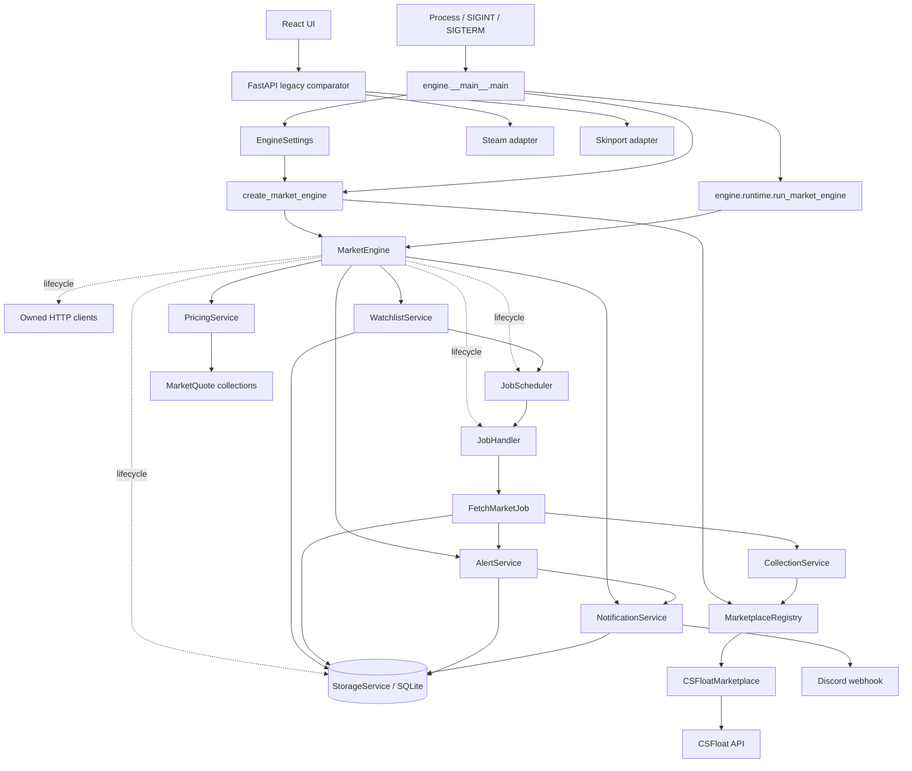
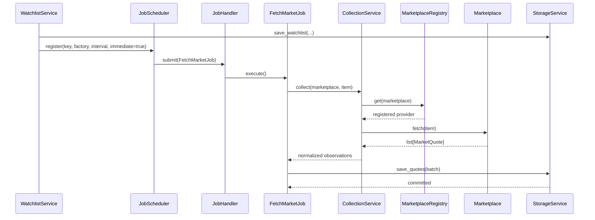
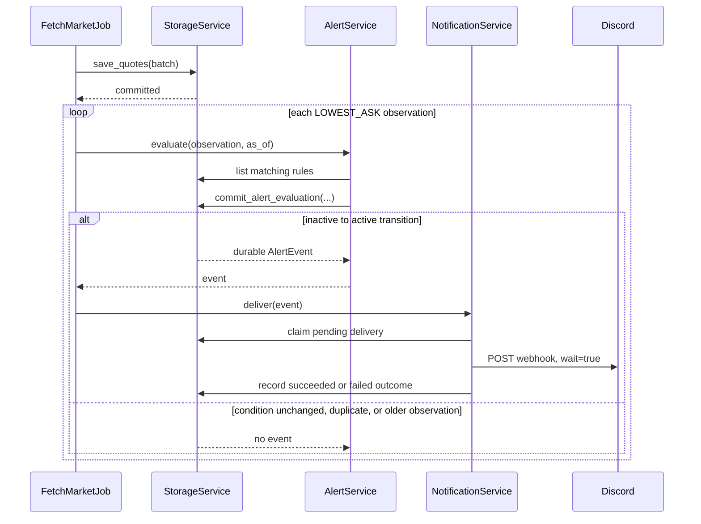
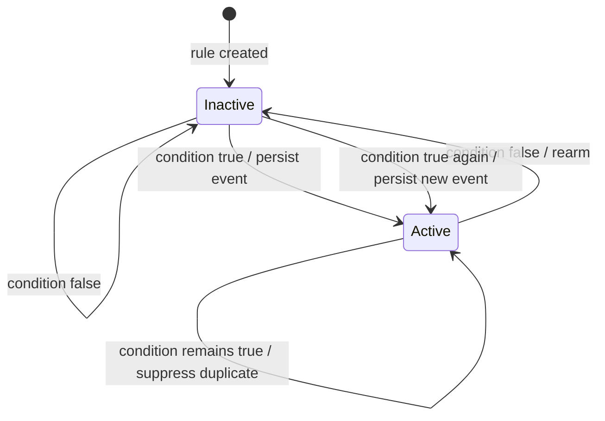
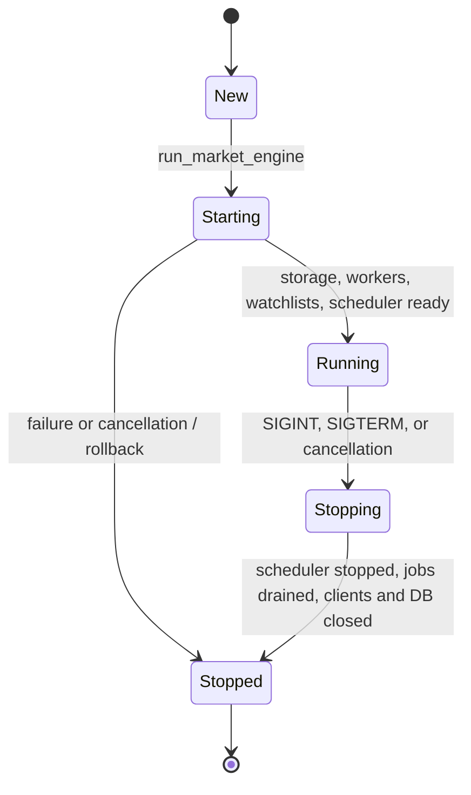

# Price Oracle

Price Oracle is a self-hosted Counter-Strike 2 marketplace monitoring engine. It runs recurring,
non-overlapping collection jobs, normalizes marketplace observations, stores exact prices in
SQLite, compares compatible quotes, evaluates durable threshold alerts, and can deliver alert
events to Discord.

The repository also contains an earlier Steam/Skinport comparison web application. That web app is
still usable, but it is a separate stack: it does not start or manage the monitoring engine.

## Contents

- [Project overview](#project-overview)
- [Architecture](#architecture)
- [Execution flow](#execution-flow)
- [Alerts and notifications](#alert-and-notification-flow)
- [Engine lifecycle](#engine-lifecycle)
- [Source code map](#source-code-map)
- [Module documentation](#module-documentation)
- [Architectural decisions](#architectural-decisions)
- [Local development](#local-development)
- [Docker deployment](#docker-deployment)
- [Testing](#testing)
- [Extending the engine](#extending-the-engine)
- [Current limitations](#current-limitations)

## Project overview

### V1 capabilities

- A fixed-size asynchronous worker pool with a bounded queue and stable-key duplicate suppression.
- Completion-relative recurring scheduling, so slow jobs do not overlap or accumulate missed runs.
- Persistent watchlists restored from SQLite when the process starts.
- Explicit marketplace registration and an implemented CSFloat listing adapter.
- Provider-specific concurrency, request-spacing, retry, backoff, and `Retry-After` controls.
- Append-only quote history with lossless `Decimal` storage and UTC timestamps.
- Strict pricing comparisons by exact item identity, currency, quote type, and freshness.
- Durable above/below threshold alert rules with edge-triggering and restart-safe rearming.
- Claimed, retried, and recorded Discord webhook delivery.
- Ordered startup, partial-start rollback, signal-aware shutdown, bounded job draining, and resource
  cleanup.
- A non-root Docker image and Compose deployment with a persistent SQLite volume.

### Marketplace status

| Integration | Location | Monitoring-engine status |
|---|---|---|
| CSFloat | [`engine/marketplaces/csfloat.py`](backend/engine/marketplaces/csfloat.py) | Registered by default; emits exact `INDIVIDUAL_LISTING` quotes |
| Steam Community Market | [`app/adapters/steam_client.py`](backend/app/adapters/steam_client.py) | Legacy web comparator only; not an engine `Marketplace` |
| Skinport | [`app/adapters/skinport_client.py`](backend/app/adapters/skinport_client.py) | Legacy web comparator only; not an engine `Marketplace` |
| ByMykel catalog | [`app/adapters/bymykel_catalog.py`](backend/app/adapters/bymykel_catalog.py) | Legacy web search only |

The distinction matters for alerts: V1 alert rules require native `LOWEST_ASK` observations.
CSFloat currently produces individual listings, so its quotes are persisted and priceable but do
not trigger threshold alerts. The alert and notification pipeline is operational for an injected
marketplace that provides genuine lowest-ask quotes, as covered by integration tests.

### Intentionally out of scope

V1 does not perform currency conversion, fee/profit calculations, trading, forecasting, account
management, or multi-user authorization. It has no engine management HTTP API or CLI, no durable
event-dispatch worker, no pending-notification recovery lease, and no database migration framework.
The React interface displays the separate live Steam/Skinport comparator rather than engine state.
A self-hosted Counter-Strike 2 marketplace monitoring engine with a React price-comparison UI.

## Architecture

The process entry point loads settings and delegates construction to one composition root. The
lifecycle object starts and stops dependencies; business behavior remains in focused services.



Solid arrows represent operational calls or construction. Dotted lifecycle arrows identify
components whose start/stop or resource ownership is coordinated by `MarketEngine`. The legacy web
application is shown to make the repository boundary explicit; it has no dependency on the engine.

## Execution flow

A watchlist mutation is persisted first. `WatchlistService` then reconciles the unique desired
marketplace/item schedules. When a schedule becomes due, all execution passes through the bounded
handler.



`JobHandler` prevents another job with the same stable key from being queued or running. Queue-full
recurring submissions retain their already-created job and retry on a later scheduler tick.
Marketplace failures reach the handler boundary, are logged, and do not terminate its workers or
the scheduler.

Pricing is deliberately separate from collection. Call `PricingService.compare()` with stored or
newly collected `MarketQuote` values and explicitly choose an item, currency, quote type, and
evaluation time. Incompatible or stale observations are returned with exclusion reasons instead of
being silently mixed.

## Alert and notification flow

After a quote batch commits, bootstrap evaluates each native `LOWEST_ASK` observation. Alert state
is updated atomically with event creation. Notification delivery begins only after the event is
durable.





Discord delivery is at-most-one claimed attempt sequence per event ID, not exactly-once external
delivery. Timeout, network, HTTP 429, and HTTP 5xx outcomes receive bounded inline retries. A crash
after Discord accepts a message but before SQLite records success leaves a durable `pending` claim;
V1 suppresses automatic redelivery to avoid knowingly duplicating the message.

## Engine lifecycle

Run the engine with `python -m engine`. The process registers handlers for `SIGINT` and `SIGTERM`,
starts the composed engine, waits without polling, and invokes ordered cleanup for a signal,
cancellation, or normal return.



Startup order:

1. `EngineSettings` validates before I/O begins.
2. `create_market_engine()` registers enabled marketplaces and constructs dependencies.
3. `StorageService.initialize()` creates/configures SQLite and its tables.
4. `JobHandler.start()` creates the fixed worker pool.
5. `WatchlistService.sync_jobs()` restores recurring definitions from SQLite.
6. `JobScheduler.start()` enables recurring submission.

Shutdown reverses the active dependencies: stop scheduling, drain accepted jobs up to the configured
timeout, cancel/discard remaining work if necessary, close owned HTTP clients, and dispose storage.
Cleanup continues after an individual closer fails and reports the collected failures. Engine
instances are intentionally single-use; construct a fresh instance after shutdown.

## Source code map

| Source | Main interface | Responsibility | Principal dependencies |
|---|---|---|---|
| [`engine/__main__.py`](backend/engine/__main__.py) | `main()` | Executable configuration and process exit status | Settings, bootstrap, runtime |
| [`engine/runtime.py`](backend/engine/runtime.py) | `run_market_engine()` | Signals, process wait, guaranteed engine stop | `asyncio`, `MarketEngine` |
| [`engine/bootstrap.py`](backend/engine/bootstrap.py) | `create_market_engine()` | Explicit dependency composition and post-persist integration | All engine services |
| [`engine/market_engine.py`](backend/engine/market_engine.py) | `MarketEngine` | Thin ordered lifecycle, rollback, cleanup | Storage, jobs, owned resources |
| [`engine/config/settings.py`](backend/engine/config/settings.py) | `EngineSettings` | Environment, dotenv, and Docker Secret validation | Pydantic Settings |
| [`engine/models/item.py`](backend/engine/models/item.py) | `Item` | Exact market-hash item identity | Pydantic |
| [`engine/models/quote.py`](backend/engine/models/quote.py) | `MarketQuote`, `QuoteType` | Precise normalized observations | `Decimal`, Pydantic |
| [`engine/marketplaces/base.py`](backend/engine/marketplaces/base.py) | `Marketplace` | Structural provider contract | Domain models |
| [`engine/marketplaces/registry.py`](backend/engine/marketplaces/registry.py) | `MarketplaceRegistry` | Explicit registration and lookup | Marketplace contract |
| [`engine/marketplaces/csfloat.py`](backend/engine/marketplaces/csfloat.py) | `CSFloatMarketplace` | CSFloat request/error mapping and normalization | `httpx`, domain models |
| [`engine/services/collection.py`](backend/engine/services/collection.py) | `CollectionService`, `CollectionPolicy` | Provider admission, retry, and collection | Registry, `asyncio` |
| [`engine/services/pricing.py`](backend/engine/services/pricing.py) | `PricingService` | Strict compatibility, freshness, ranking, spread | Domain models |
| [`engine/jobs/base.py`](backend/engine/jobs/base.py) | `EngineJob` | Independently executable job contract | None |
| [`engine/jobs/handler.py`](backend/engine/jobs/handler.py) | `JobHandler` | Bounded queue, workers, deduplication, draining | `asyncio` |
| [`engine/jobs/scheduler.py`](backend/engine/jobs/scheduler.py) | `JobScheduler` | Non-overlapping recurring submission | Job handler |
| [`engine/jobs/fetch_market.py`](backend/engine/jobs/fetch_market.py) | `FetchMarketJob` | One collect/persist/post-persist operation | Collection, storage |
| [`engine/storage/service.py`](backend/engine/storage/service.py) | `StorageService` | Public persistence and database lifecycle | SQLAlchemy, SQLite |
| [`engine/storage/models.py`](backend/engine/storage/models.py) | Private ORM records | Table mappings and lossless conversions | Engine domain models |
| [`engine/watchlists/service.py`](backend/engine/watchlists/service.py) | `WatchlistService` | Persistent configuration and schedule reconciliation | Storage, scheduler, registry |
| [`engine/alerts/service.py`](backend/engine/alerts/service.py) | `AlertService` | Fresh lowest-ask threshold evaluation | Alert storage protocol |
| [`engine/notifications/service.py`](backend/engine/notifications/service.py) | `NotificationService` | Discord delivery, retry, and durable outcomes | `httpx`, notification storage |
| [`app/main.py`](backend/app/main.py) | FastAPI `app` | Separate legacy comparison API | Legacy adapters/services |
| [`frontend/src/App.tsx`](frontend/src/App.tsx) | React `App` | Separate Steam/Skinport comparison UI | FastAPI comparator endpoints |
| [`compose.yaml`](compose.yaml) | `price-oracle-engine` service | Container lifecycle and persistent volume | [`backend/Dockerfile`](backend/Dockerfile) |
frontend/              React UI (unchanged)
    └── api/           HTTP client only

backend/
    ├── engine/        Engine services, storage, marketplaces, jobs, and API
    │   └── api/       FastAPI routes and HTTP schemas
    └── app/main.py    Compatibility ASGI entry point
```

| Layer | Responsibility |
|-------|----------------|
| **engine** | Collection, pricing, storage, watchlists, alerts, notifications, and lifecycle |
| **engine/catalog** | Canonical item metadata and deterministic search |
| **engine/marketplaces** | CSFloat, Steam, and Skinport provider normalization |
| **engine/api** | Thin FastAPI transport and website-contract adapters |

## Module documentation

| Module | Public input/output and behavior | Detailed documentation |
|---|---|---|
| Engine lifecycle | Receives composed services; exposes state and service references; owns ordering only | [Engine README](backend/engine/README.md) |
| Configuration | Loads typed `CS2_` settings; returns validated `EngineSettings`; performs no startup I/O | [Configuration README](backend/engine/config/README.md) |
| Domain models | Accepts exact identities, precise prices, currencies, timestamps, and semantics; returns immutable Pydantic values | [Models README](backend/engine/models/README.md) |
| Marketplaces | Accepts an `Item`; returns normalized quotes or provider-neutral errors; owns provider HTTP behavior | [Marketplace README](backend/engine/marketplaces/README.md) |
| Jobs | Accepts independent `EngineJob` objects and recurring factories; bounds, deduplicates, and executes work | [Jobs README](backend/engine/jobs/README.md) |
| Collection and pricing | Collects through the registry; independently ranks explicitly compatible quote groups | [Services README](backend/engine/services/README.md) |
| Storage | Accepts domain objects; returns validated domain objects; keeps sessions and ORM details private | [Storage README](backend/engine/storage/README.md) |
| Watchlists | Accepts persistent monitoring configuration; produces reconciled recurring fetch definitions | [Watchlist README](backend/engine/watchlists/README.md) |
| Alerts | Accepts fresh lowest asks; returns only newly committed edge-trigger events | [Alerts README](backend/engine/alerts/README.md) |
| Notifications | Accepts durable events; returns durable success/failure/pending outcomes | [Notifications README](backend/engine/notifications/README.md) |

## Architectural decisions

### Python asyncio

Marketplace requests, SQLite operations, webhook delivery, and scheduler waits are I/O-bound.
`asyncio` permits them to share one process without a thread per job. Cancellation also provides a
consistent shutdown mechanism. CPU-heavy analytics would need a separate process or executor.

### Bounded worker pools

A fixed number of workers makes concurrency explicit, while the bounded queue applies predictable
backpressure. Creating one task per observation would allow memory and connection demand to grow
without limit. Queue capacity applies to waiting jobs; running jobs occupy worker slots instead.

### Independent scheduled jobs

Each `EngineJob` represents one execution. The scheduler owns recurrence, and a factory creates a
fresh instance each time. This keeps business work free from timing state and makes one-off and
recurring work use the same execution and duplicate-prevention path.

### Marketplace-specific implementations

External payloads, credentials, pagination, and error meanings differ by provider. Adapters own
those details and emit the shared `MarketQuote` model. Generic services therefore do not contain
CSFloat conditionals or silently reinterpret provider fields.

### Explicit MarketplaceRegistry

Registration is deliberate and validated at composition time. A registry gives jobs stable lookup
by identifier, rejects accidental replacement, and avoids hidden module discovery or global
singletons. Adding a provider requires an explicit bootstrap decision.

### CollectionService

Collection is the shared boundary for provider concurrency, spacing, and retry policy. Keeping
these controls in one long-lived service means concurrent jobs respect the same provider quota.
Adapters remain responsible for request construction and error classification.

### One StorageService and SQLite

One public persistence boundary keeps ORM models and sessions private and gives cross-feature
transactions a clear owner. Every operation receives its own async session. SQLite is appropriate
for a single-node self-hosted V1: it is operationally simple, durable, and supports concurrent
readers in WAL mode. It remains a single-writer database and is not a substitute for a distributed
coordination service. Schema evolution currently uses `create_all`, not migrations.

### Dependency injection

Constructors receive registries, services, clients, clocks, and policies. This makes ownership
visible and lets tests use fake marketplaces, controlled clocks, mocked HTTP transports, and
temporary databases without external APIs or credentials. No dependency-injection framework or
global engine singleton is required.

### Separate pricing, alert, and notification services

Pricing ranks observations without persistence or side effects. Alerts decide whether a durable
state transition occurred. Notifications deliver an already-durable event. Separating these rules
prevents a webhook failure from changing price semantics and prevents notification code from
re-evaluating market conditions.

### Thin MarketEngine orchestration

`MarketEngine` owns lifecycle state and cleanup, not business methods. Applications can use its
public service references while focused modules remain testable independently. Process-specific
signal handling lives one layer above it in `runtime.py`.

## Local development

### Requirements

- Python 3.12+
- Node.js 20+ for the optional legacy frontend
- Docker with Compose for container deployment

### Engine setup

From the repository root:

```bash
cd backend
python3.12 -m venv .venv
source .venv/bin/activate
python -m pip install --upgrade pip
python -m pip install -r requirements.txt
cp .env.example .env
python -m engine
```

On Windows, activate with `.venv\Scripts\activate` and run the same Python module. Stop with
Ctrl+C. The default database is `backend/data/engine.sqlite3` when the process is launched from
`backend/`.

A fresh database has no watchlists, so the process starts successfully but schedules no collection
until an embedding application stores one through `WatchlistService` or `StorageService`. V1 does
not yet expose watchlist management over HTTP or a CLI.

Configuration is read from explicit arguments, `CS2_` environment variables, `.env`, Docker
Secrets, then defaults. Common settings are documented in
[`backend/.env.example`](backend/.env.example). All positive worker, queue, timeout, polling, and
freshness values are validated before startup.

[`backend/requirements-engine.txt`](backend/requirements-engine.txt) contains only engine runtime
dependencies and is used by the container. The broader `requirements.txt` also installs the legacy
FastAPI application and test tooling for development.

### Working with fake marketplaces

Implement the structural contract and inject the instance into bootstrap:

```python
from engine.bootstrap import create_market_engine


class FakeMarketplace:
    name = "fake"

    async def fetch(self, item):
        return []


engine = create_market_engine(marketplaces=[FakeMarketplace()])
```

See [`test_engine_integration.py`](backend/tests/test_engine_integration.py) for complete examples
using fake lowest-ask marketplaces, temporary SQLite databases, restart restoration, and mocked
Discord delivery.

### Legacy comparison web app

The earlier UI can still be run separately:

```bash
# terminal 1
cd backend
source .venv/bin/activate
uvicorn app.main:app --reload --port 8000

# terminal 2
cd frontend
npm ci
npm run dev
```

Open `http://localhost:5173`. These routes fetch current Steam and Skinport data directly and do
not read engine SQLite data or control the engine process.

### Debugging

The process logs lifecycle events, fetch starts/commits, and job failures to stdout/stderr. Increase
component-specific verbosity through normal Python logging configuration when embedding the engine.
For storage issues, confirm the database parent is writable and inspect whether another process is
holding SQLite's single writer beyond `CS2_DATABASE_BUSY_TIMEOUT_SECONDS`.

## Docker deployment

The Compose service runs only the monitoring engine; it does not publish an HTTP port.

```bash
cp backend/.env.example backend/.env
docker compose build
docker compose up -d
docker compose logs -f price-oracle-engine
```

Compose overrides `CS2_DATABASE_PATH` to `/data/engine.sqlite3` and mounts the named
`price-oracle-data` volume at `/data`. Normal `docker compose down` preserves that volume. Running
`docker compose down --volumes` deletes the persistent database and is destructive.

The image runs as an unprivileged `price-oracle` user. Compose uses an init process, forwards stop
signals, and allows 20 seconds for shutdown. The engine first stops the scheduler and then gives
accepted work its configured drain timeout (10 seconds by default) before HTTP and database
resources close.

### Providing secrets

For a simple single-host setup, put values in the ignored `backend/.env` file:

```dotenv
CS2_CSFLOAT_API_KEY=replace-with-real-key
CS2_DISCORD_WEBHOOK_URL=https://discord.com/api/webhooks/id/token
```

Do not commit that file. To use Compose secrets instead, create an ignored `secrets/` directory and
an override file such as:

```yaml
services:
  price-oracle-engine:
    secrets:
      - CS2_CSFLOAT_API_KEY
      - CS2_DISCORD_WEBHOOK_URL

secrets:
  CS2_CSFLOAT_API_KEY:
    file: ./secrets/csfloat_api_key
  CS2_DISCORD_WEBHOOK_URL:
    file: ./secrets/discord_webhook_url
```

The target filenames retain the `CS2_` prefix expected by `EngineSettings` and are mounted under
`/run/secrets`. Environment and `.env` values take precedence if both are supplied.

Useful operational commands:

```bash
docker compose ps
docker compose logs --tail=200 price-oracle-engine
docker compose restart price-oracle-engine
docker compose stop
```

## Testing

### Layout

All Python tests live under [`backend/tests`](backend/tests):

- Domain and service unit tests cover validation, precision, compatibility, retries, state
  transitions, and error boundaries.
- Job-system tests cover worker limits, bounded queues, duplicate work, recurring scheduling,
  cancellation, and shutdown policy.
- Marketplace tests use fake providers and `httpx.MockTransport`; they never call live APIs.
- Storage, alert, and notification tests use temporary SQLite files.
- `test_market_engine.py`, `test_engine_runtime.py`, and `test_engine_integration.py` cover composed
  startup, restoration, collection, pricing, alert delivery, restart behavior, cleanup, and
  orphan-task prevention.

Run the backend suite:

```bash
cd backend
.venv/bin/python -m pytest -q
```

Run only composed integration and process tests:

```bash
.venv/bin/python -m pytest -q \
  tests/test_market_engine.py \
  tests/test_engine_runtime.py \
  tests/test_engine_integration.py
```

Run frontend type checking and bundling:

```bash
cd frontend
npm ci
npm run build
npm audit
```

Validate deployment configuration and image construction:

```bash
docker compose config
docker compose build
```

### Verification results

On 2026-10-21 with Python 3.12.3 and Node 24.22.0:

- Backend baseline before Module 15 changes: **369 passed**.
- Final backend suite: **374 passed** in 3.99 seconds with no failures or skips.
- New runtime/integration tests: **5 passed**, including five consecutive stability runs.
- Frontend `tsc -b` and Vite production build: **passed**.
- Frontend production and development dependency audit after patch-level lock updates:
  **0 vulnerabilities**.
- `docker compose config`: **passed**.
- Clean Docker image build using engine-only runtime dependencies: **passed**.
- Container lifecycle check: started as the unprivileged user, created persistent SQLite storage,
  handled `SIGTERM`, and logged orderly shutdown: **passed**.

The repository has no configured Python linter or static type checker, so no such command is
claimed. The frontend build performs strict TypeScript checking.

### Covered error cases

Tests cover invalid configuration; marketplace timeout, authentication, rate limiting, malformed
data, and unavailability; retry exhaustion; storage rollback and lock timeout; scheduler and queue
rejection; duplicate jobs; alert persistence rollback; notification claim/completion failures;
partial startup; shutdown failure, timeout, and cancellation; and provider/client cleanup.

No test makes a live Steam, Skinport, CSFloat, Discord, or catalog request. Mocked contract coverage
does not prove that an external provider has kept an undocumented response shape unchanged.

## Extending the engine

### Add a marketplace

1. Implement a stable lowercase `name` and `async fetch(Item) -> list[MarketQuote]` following
   [`Marketplace`](backend/engine/marketplaces/base.py).
2. Normalize money with `Decimal`, retain currency and quote semantics, and verify exact item
   identity.
3. Map provider failures to [`engine/errors.py`](backend/engine/errors.py); keep retry policy in
   `CollectionService`.
4. Register the instance explicitly in [`bootstrap.py`](backend/engine/bootstrap.py), including
   owned-client cleanup when applicable.
5. Add mocked adapter tests and a fake-provider integration test.

### Implement a new EngineJob

Subclass [`EngineJob`](backend/engine/jobs/base.py), define a stable collision-boundary `key`, and
implement one asynchronous `execute()` call. Submit it through `JobHandler`; do not create an
unbounded task or recurrence loop inside the job.

### Register recurring jobs

Call `JobScheduler.register()` with the exact job key, a factory that creates a fresh instance, a
positive interval, and an explicit immediate-run choice. Persistent recurring work should follow
the `WatchlistService` pattern: save configuration first, reconstruct definitions at startup, and
let unregistering prevent future submissions without cancelling already accepted work.

### Add persistence functionality

Keep new ORM records private in [`storage/models.py`](backend/engine/storage/models.py), add typed
domain-facing methods to `StorageService`, and use one transaction for each consistency boundary.
Do not expose SQLAlchemy sessions. A production schema change should also introduce a migration
strategy because `create_all` cannot evolve existing tables.

### Add pricing logic

Extend `PricingService` with explicit inputs and observable exclusion reasons. Preserve original
quotes, `Decimal` precision, exact item variants, currency boundaries, and quote-type semantics.
Currency conversion and fees should be separate verified steps rather than hidden adjustments.

### Add an alert condition

Extend `AlertCondition`, its evaluation logic, Pydantic validation, SQLite constraints and
serialization together. Preserve atomic state transition/event insertion and define equality,
rearming, freshness, and out-of-order behavior in tests.

### Add a notification mechanism

Add a channel-specific sender behind a narrow storage/delivery boundary. Define credential
validation, client ownership, retry classification, idempotency, sanitized persisted failures, and
secret-safe logging. The current `NotificationDelivery` channel literal and SQLite constraint must
be extended consistently; do not make `AlertService` depend on transport details.

## Current limitations

- CSFloat is the only engine marketplace and produces individual listings, so no concrete default
  integration currently drives lowest-ask alerts.
- Steam and Skinport are implemented only in the separate direct-comparison web stack.
- Watchlists and alert rules have public Python services but no management API or CLI.
- Discord is the only notification channel and has one configured destination per process.
- Pending or failed notification deliveries have no recovery worker or operator UI.
- SQLite targets a single self-hosted node and has no migration tooling.
- The engine process has logs but no HTTP health/readiness endpoint or metrics exporter.
- The container runs the monitoring engine only; the legacy FastAPI/React application is not part
  of the Compose service.
- Marketplace integrations are validated against mocked responses, not live-provider contract
  tests.
Engine settings live in `backend/engine/config/settings.py` and use the `CS2_` environment prefix:

| Variable | Default | Description |
|----------|---------|-------------|
| `CS2_STEAM_COUNTRY` | `GB` | Steam market region |
| `CS2_STEAM_CURRENCY` | `GBP` | Steam market currency |
| `CS2_SKINPORT_CURRENCY` | `GBP` | Skinport currency |
| `CS2_CACHE_DIR` | `.cache` | Catalog and marketplace cache directory |
| `CS2_CATALOG_CACHE_TTL_SECONDS` | `86400` | ByMykel cache TTL |
| `CS2_SKINPORT_CACHE_TTL_SECONDS` | `300` | Skinport cache TTL |

See the [engine API README](backend/engine/api/README.md) for lifecycle ownership, full routes,
contracts, engine integration, and migration status.

## License

See [LICENSE](LICENSE).
