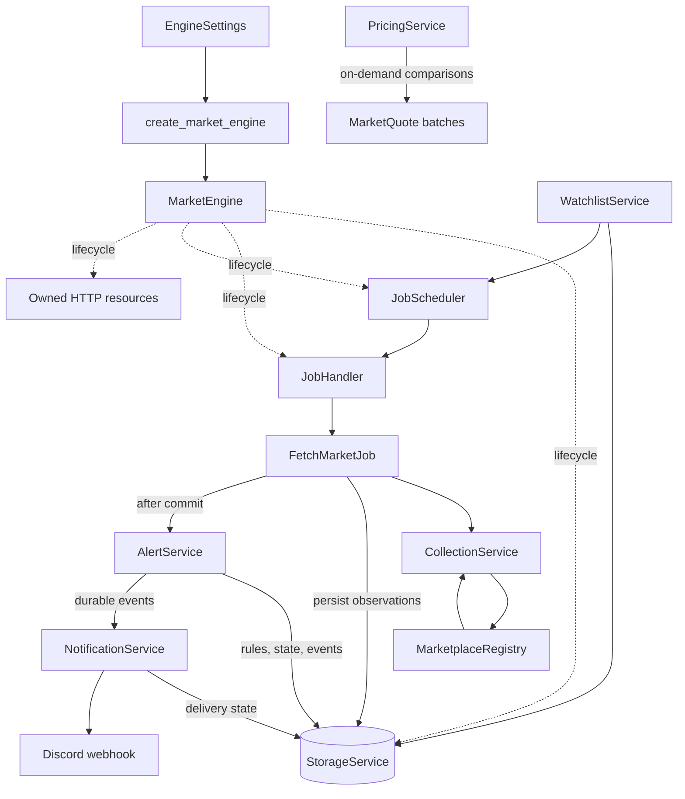
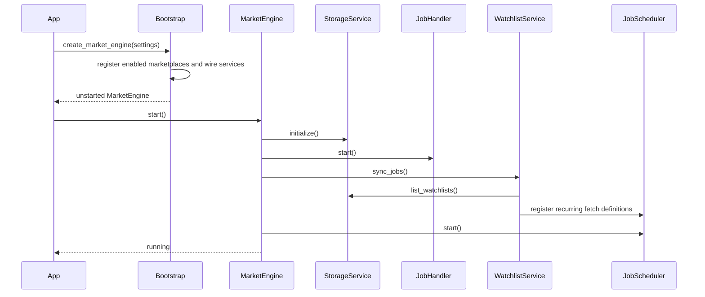
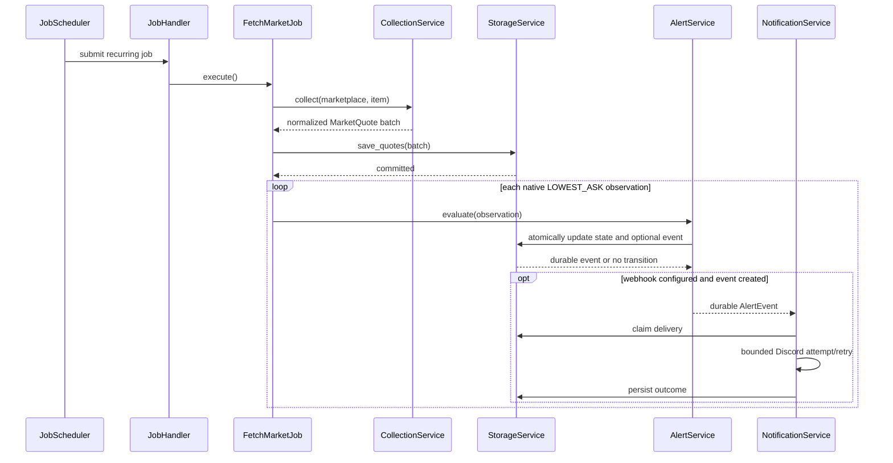
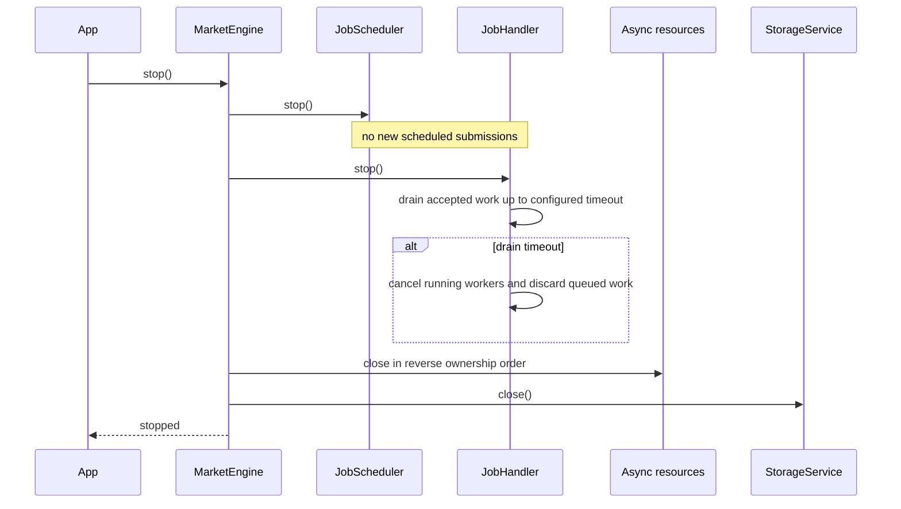

# Market engine lifecycle

`MarketEngine` is the thin lifecycle boundary for the self-hosted CS2 market engine. It owns
startup and shutdown ordering while collection, persistence, scheduling, pricing, alerts, and
notifications remain in their existing focused services.

The composition root is [`bootstrap.py`](bootstrap.py). It loads validated settings, constructs
dependencies explicitly, registers enabled marketplaces, and returns an unstarted engine. There
is no global engine instance or dependency-injection framework.

## Architecture



`MarketEngine` exposes references to its composed services for application/API layers;
it does not duplicate their business methods.

## Source files and responsibilities

| Source | Responsibility |
|---|---|
| [`market_engine.py`](market_engine.py) | Lifecycle state, ordered startup, rollback, graceful shutdown, and owned-resource cleanup |
| [`bootstrap.py`](bootstrap.py) | Settings-driven construction, marketplace registration, and explicit dependency wiring |
| [`engine.py`](engine.py) | Compatibility alias for the former empty `OracleEngine` placeholder |
| [`config/settings.py`](config/settings.py) | Validated worker, SQLite, scheduler, freshness, marketplace, and notification configuration |
| [`storage/service.py`](storage/service.py) | Quotes, watchlists, alert state/events, notification outcomes, and database lifecycle |
| [`marketplaces/registry.py`](marketplaces/registry.py) | Registered marketplace lookup and validation |
| [`services/collection.py`](services/collection.py) | Marketplace request admission, retry, and normalized collection |
| [`services/pricing.py`](services/pricing.py) | Deterministic quote compatibility and price comparison |
| [`jobs/handler.py`](jobs/handler.py) | Bounded queue, worker pool, duplicate suppression, and drain/cancel shutdown policy |
| [`jobs/scheduler.py`](jobs/scheduler.py) | Non-overlapping recurring job submission |
| [`jobs/fetch_market.py`](jobs/fetch_market.py) | One fetch, atomic batch persistence, and the post-persistence integration hook |
| [`watchlists/service.py`](watchlists/service.py) | Persistent watchlist mutations and recurring schedule reconciliation |
| [`alerts/service.py`](alerts/service.py) | Durable edge-trigger evaluation for native lowest-ask observations |
| [`notifications/service.py`](notifications/service.py) | Claimed, retried, and durably recorded Discord delivery |
| [`../tests/test_market_engine.py`](../tests/test_market_engine.py) | Lifecycle and end-to-end integration coverage |

## Dependency wiring

Use the composition root rather than constructing globals:

```python
from engine.bootstrap import create_market_engine

engine = create_market_engine()
async with engine:
    # API/application code can use engine.watchlists, engine.pricing, etc.
    ...
```

`create_market_engine()` performs no database I/O and starts no tasks. By default it constructs
CSFloat only when `CS2_CSFLOAT_ENABLED` is true. Tests and self-hosted extensions can inject an
iterable of marketplace implementations; marketplace resources passed to bootstrap are transferred
to the engine and closed at shutdown.

`NotificationService` is constructed only when `CS2_DISCORD_WEBHOOK_URL` is configured. Without a
webhook, alert events remain durable but no external delivery is attempted. A supplied notification
HTTP client is also transferred to the engine and closed during shutdown.

## Startup sequence

Settings validation and dependency construction happen in bootstrap before `start()`.



Restored jobs use `run_immediately=True`, but cannot submit until the handler exists and the
scheduler is activated. This prevents fetching before persistence and dependencies are ready.

If startup fails or is cancelled, the engine rolls back every component already initialized,
closes owned async resources, disposes storage, marks itself stopped, and reports the failed stage.
A failed engine instance is terminal; construct a fresh engine to retry startup.

## Market processing flow



The post-persistence hook is deliberately small: quote storage commits before alert processing.
Failures propagate to `JobHandler`, which logs that job failure and continues running other and
future jobs. No event bus or second worker system is introduced.

Alert semantics remain strict. CSFloat currently emits `INDIVIDUAL_LISTING`, while alerts accept
only marketplace-native `LOWEST_ASK` observations. Individual listings are persisted and can be
priced, but are never relabelled as lowest asks. The alert/notification path is active for a
marketplace that supplies `LOWEST_ASK`, as demonstrated by the fake marketplace integration test.

## Shutdown sequence



Shutdown continues through all components even when one cleanup operation fails. Failures are
logged and returned together in `EngineShutdownError`. Cancelling `stop()` does not abandon its
cleanup task: shutdown finishes, then cancellation propagates to the caller. `JobHandler` remains
the sole authority for draining or cancelling accepted jobs.

## Lifecycle behavior and errors

- The lifecycle lock serializes concurrent `start()` and `stop()` calls.
- Only a new engine may start. Duplicate starts and restart after stop raise
  `EngineLifecycleError`.
- `stop()` is safe before start and repeated calls after stop are no-ops.
- `EngineStartupError` reports the startup stage and retains the original exception as its cause.
- Startup rollback and shutdown attempt every applicable cleanup step and log individual failures.
- Recurring job exceptions are isolated inside `JobHandler`; one failure does not terminate a
  worker, scheduler, or engine.
- Credentials are `SecretStr` values, are never placed in lifecycle logs, and Discord tokens are
  redacted from the standard HTTP client logger.

## Design decisions

- Lifecycle coordination is a class; object construction is a function. This keeps engine state out
  of bootstrap and business operations out of `MarketEngine`.
- Watchlists are persisted as whole aggregates through the existing `StorageService`, matching the
  `WatchlistStorage` protocol without adding another persistence subsystem.
- `FetchMarketJob` gained one optional post-commit callback rather than concrete alert or
  notification dependencies. Bootstrap supplies the integration and isolated job tests can omit it.
- Notification delivery is inline with the fetch job because the existing service already owns
  bounded retry behavior. There is no unsupported durable retry scheduler.
- Engine instances are single-use because `StorageService` and owned HTTP resources have terminal
  close lifecycles. Explicit rejection is safer than partially rebuilding dependencies.

## Tests

From `backend/` with dependencies installed:

```bash
.venv/bin/python -m pytest -q tests/test_market_engine.py
.venv/bin/python -m pytest -q
```

The integration suite uses fake marketplaces, `httpx.MockTransport`, and temporary SQLite files.
It covers dependency order, registry composition, handler and scheduler activation, persistent
watchlist restoration, fetch-and-persist, alert/event/delivery integration, recurring job failure
isolation, partial-start cleanup, graceful active-work shutdown, cancellation, terminal/repeated
lifecycle calls, owned-resource closure, and orphan-task checks. It performs no live API calls.
The complete backend suite passes **369 tests** after lifecycle integration.

## Known limitations

- CSFloat data is currently individual-listing data and therefore does not drive lowest-ask alerts.
- Discord is the only notification channel, and absent credentials intentionally disable delivery.
- Notification retries are bounded and inline. There is no recovery lease for a delivery left
  `pending` by process termination.
- There is no durable event-dispatch worker. An alert event committed immediately before a process
  or notification-integration failure remains queryable but is not automatically redelivered.
- The engine has no API-server lifespan wiring yet; callers must invoke `start()`/`stop()` or use
  the async context manager.
- SQLite tables are created with SQLAlchemy `create_all`; schema migration tooling is not yet part
  of this repository.
- Marketplace enablement currently covers the one concrete engine marketplace, CSFloat.
