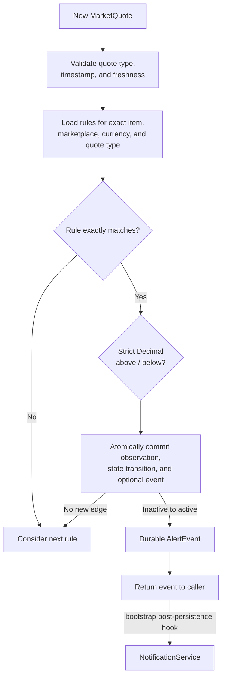
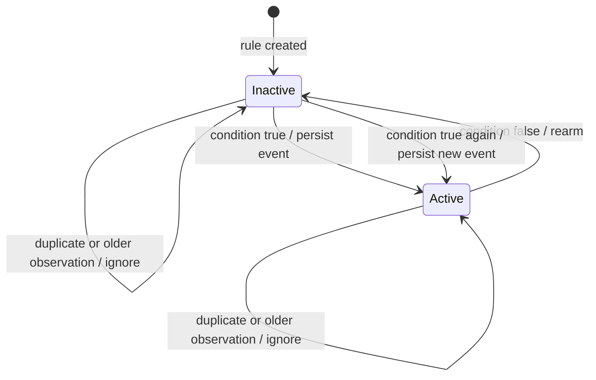

# AlertService

`AlertService` evaluates fresh marketplace observations against durable user-defined price
thresholds. It creates an event only when a rule changes from inactive to active, persists that
event and the new state atomically, and returns the committed event to its caller. It does not send
notifications.

The module solves four narrow problems: strict `Decimal` threshold comparison, exact observation
compatibility, durable edge-trigger state, and duplicate prevention across concurrent evaluations
and process restarts. It does not perform price ranking, fee calculation, opportunity detection, or
prediction.

## Evaluation flow



## Edge-trigger lifecycle



## Source files

- [`models.py`](models.py) defines the immutable alert domain models.
- [`service.py`](service.py) defines the service and its injected persistence protocol.
- [`__init__.py`](__init__.py) exposes the supported public API.
- [`../storage/service.py`](../storage/service.py) implements the durable storage contract.
- [`../storage/models.py`](../storage/models.py) contains the private SQLAlchemy mappings.
- [`../../tests/test_alert_service.py`](../../tests/test_alert_service.py) contains synthetic service,
  persistence, restart, and concurrency tests.
- [`../models/quote.py`](../models/quote.py) and
  [`../services/pricing.py`](../services/pricing.py) provide the existing quote and pricing
  semantics consumed by this module.

## Public interface

The package exports:

| Class | Purpose |
|---|---|
| `AlertCondition` | String enum containing `BELOW` and `ABOVE` |
| `AlertRule` | Immutable rule configuration for one exact observation series |
| `AlertEvent` | Immutable snapshot of a durable inactive-to-active transition |
| `AlertStorage` | Structural async persistence protocol used for dependency injection |
| `AlertService` | Rule management and observation evaluation service |

`AlertRule` contains a UUID, `Item`, marketplace, currency, quote type, condition, and positive
`Decimal` threshold. `AlertEvent` contains its own UUID, the rule UUID, the triggering
`MarketQuote`, condition and threshold snapshots, and a UTC `triggered_at` timestamp.

```python
from datetime import timedelta

from engine.alerts import AlertService

alerts = AlertService(storage, max_quote_age=timedelta(minutes=5))
await alerts.create_rule(rule)
rules = await alerts.list_rules()
events = await alerts.evaluate(quote, as_of=evaluation_time)
deleted = await alerts.delete_rule(rule.id)
```

The service methods are asynchronous because every successful evaluation may update durable state.
`evaluate()` returns a tuple. Every returned event has committed successfully before the method
returns.

## Storage responsibilities

`StorageService` owns three alert tables in addition to quote history:

| Table | Responsibility |
|---|---|
| `alert_rules` | Validated rule configuration and observation-selector index |
| `alert_rule_states` | Current active flag and latest processed observation timestamp |
| `alert_events` | Append-only event snapshots; retained if their rule is deleted |

The injected `AlertStorage` contract requires `save_alert_rule()`, `list_alert_rules()`,
`delete_alert_rule()`, and `commit_alert_evaluation()`. `StorageService` also exposes
`list_alert_events()` for reading durable events.

Rule creation stores an initially inactive state in the same transaction. Rule deletion removes the
rule and state while retaining historical events. A duplicate rule or event identifier is a storage
failure, not an overwrite.

`commit_alert_evaluation()` is the concurrency boundary. A conditional database update accepts only
an observation newer than the state's `last_observed_at`. For an inactive-to-active edge, that update
and the event insert occur in one transaction. If insertion or commit fails, neither the event nor
the state change survives. SQLite's write serialization plus the conditional predicate ensures that
concurrent evaluations cannot both claim the same transition.

## Evaluation rules

V1 deliberately supports only `QuoteType.LOWEST_ASK`. Individual-listing streams do not establish
whether another low listing remains available, and median prices are aggregate statistics rather
than asks. A lowest-ask event records what the marketplace reported; it is not a guarantee that the
offer remains purchasable.

For each observation:

1. The value must be a normalized `MarketQuote` with `LOWEST_ASK` semantics.
2. The caller supplies an aware `as_of`; both timestamps are compared in UTC.
3. Future observations are rejected. Age equal to `max_quote_age` is accepted; older observations
   are rejected.
4. Item identity, marketplace, currency, and quote type must all match exactly. No currency
   conversion or cross-currency comparison occurs.
5. `BELOW` uses `price < threshold`; `ABOVE` uses `price > threshold`. Equality is inactive.
6. Monetary values remain `Decimal`; they are neither converted to float nor rounded.
7. An observation at or before the rule's last processed timestamp is ignored. This makes repeated
   delivery idempotent and prevents late observations from rolling state backward.

Filtering happens in storage and is checked again by the service before comparison. An observation
with no compatible rules returns an empty tuple.

## Duplicate prevention examples

For a `BELOW 15 GBP` rule:

| Observed price | Previous state | New state | Event |
|---:|---|---|---|
| `20` | inactive | inactive | none |
| `14` | inactive | active | created |
| `13` | active | active | none |
| `17` | active | inactive | none; rule rearmed |
| `14` | inactive | active | created |

For an `ABOVE 50 GBP` rule, `50` is inactive, `50.0001` triggers, and subsequent higher prices are
suppressed until a newer observation at or below `50` rearms the rule.

## Error handling

- Invalid rule fields raise Pydantic `ValidationError` with the offending field identified.
- Wrong service argument types raise `TypeError`.
- Naive, future, stale, or unsupported observations raise `ValueError`.
- Database and constraint failures raise `StorageError`; prolonged SQLite contention raises
  `StorageBusyError` through the existing storage translation.
- Persistence failures propagate. No alert event is silently discarded or returned before commit.
- No broad exception handler catches cancellation, so task cancellation propagates normally.

## Design decisions and alternatives

`AlertService` consumes `MarketQuote` directly. This preserves the existing normalized domain model
and avoids copying `PricingService` ranking logic. A caller may pass an eligible quote obtained from
a `PriceComparison`, as covered by the tests.

Three public data concepts are sufficient: condition, rule, and event. State is private persistence
data rather than a fourth public domain model. Rules use caller-supplied UUIDs so external APIs can
choose identifiers before persistence; event UUID creation is injected for deterministic tests.

A read-state-then-write-event design was rejected because two workers could observe inactive state
and both emit an event. An in-memory lock was also rejected because it would not survive restarts or
coordinate multiple processes. The small atomic storage operation keeps concurrency policy at the
durability boundary without introducing an event-processing framework.

## Testing

From `backend/`:

```bash
.venv/bin/python -m pytest -q tests/test_alert_service.py
.venv/bin/python -m pytest -q
```

The alert module has **37 passing tests**. The complete backend suite has **411 passing tests**.
Tests use synthetic market data and temporary SQLite databases; they make no marketplace or
notification calls and require no credentials. Coverage includes both conditions, equality,
precision, all compatibility dimensions, invalid configuration, freshness, duplicate suppression,
rearming, retriggering, independent rules, rollback, restart restoration, same-rule concurrency,
and compatibility with the pricing result model.

## Known limitations and future integrations

- There is no user/account model or notification destination on a rule. The current self-hosted
  caller owns that association externally.
- Rules can be created, listed, and deleted; editing, enable/disable, and ownership filtering are not
  implemented. A changed threshold should currently be represented by a new rule.
- Only marketplace `LOWEST_ASK` observations are supported.
- Equal-timestamp observations are treated as duplicate deliveries. A future ingestion sequence ID
  would be needed to order distinct updates that share a timestamp.
- `MarketEngine` passes returned events to `NotificationService` when a webhook is configured.
  There is no separate durable event dispatcher, acknowledgement UI, or dead-letter handling.
- Tables are created through the repository's existing `create_all` lifecycle. Deployments that later
  adopt schema migrations must add these tables to that migration system.
- No fee adjustment, currency conversion, marketplace availability check, advanced opportunity
  detection, statistical prediction, or AI signal is performed.
