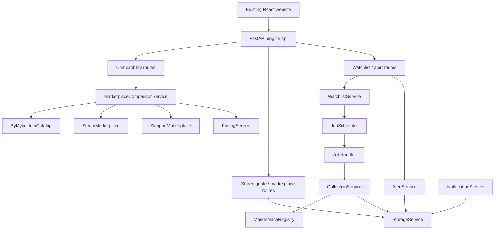
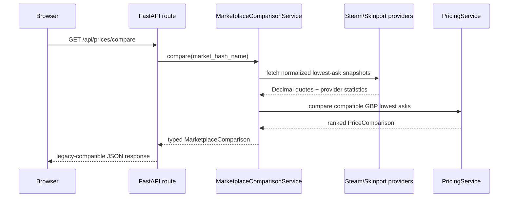

# Engine API

`engine.api` is the single HTTP transport layer for the self-hosted Price Oracle engine. It keeps
the existing website's two public contracts stable while delegating validation, collection,
persistence, comparisons, watchlists, alerts, and delivery-state reads to engine services. Route
handlers do not query SQL, schedule jobs, normalize marketplace payloads, or deliver notifications.

## Architecture



The ASGI compatibility entry point is [`app/main.py`](../../app/main.py). The implementation is
kept in this package: [`app.py`](app.py), [`dependencies.py`](dependencies.py),
[`routes.py`](routes.py), and [`schemas.py`](schemas.py).

## Lifecycle and dependency injection

`create_app()` creates exactly one `MarketEngine` per FastAPI application lifespan. It calls
`create_market_engine()` from [`../bootstrap.py`](../bootstrap.py), starts it before serving, and
stops it when the process shuts down. Dependencies retrieve that already-running instance from
`request.app.state`; no request constructs an engine, scheduler, database session, or provider
client.

Run one ASGI worker for a deployment/database. A second process would create another scheduler and
could schedule the same persisted watchlists. A separate read-only process is possible only if it
does not mutate watchlists or start an engine.



## Routes

### Existing website contracts

| Method and path | Request | Response | Engine source |
|---|---|---|---|
| `GET /api/health` | none | `{"status":"ok"}` | `MarketEngine.running` |
| `GET /api/items/search` | `q` (1–120 chars), `limit` (1–50; default 20) | `{"items":[{"market_hash_name","name","image"}]}` | `MarketplaceComparisonService.search()` → `ByMykelItemCatalog` |
| `GET /api/prices/compare` | `market_hash_name` (1–200 chars) | Existing Steam/Skinport comparison shape | `MarketplaceComparisonService.compare()` → providers + `PricingService` |

The comparison response retains the existing numeric JSON fields, names, nullability, and
semantics: Steam `lowest_price`, `median_price`, `volume`, and `source`; Skinport `min_price`,
statistics, page URLs, and quantity; then `cheaper`, `difference`, and `percentage`. Provider
money is parsed as `Decimal`; the final compatibility adapter emits the established numeric fields.
`difference` and `percentage` are calculated from `PricingService`'s ranked lowest-ask quotes,
not by a route-local pricing implementation.

`404` means the catalog item or Skinport observation is missing. Normalized catalog and marketplace
failures become `502` with a safe message. FastAPI validates malformed query values with `422`.

### Engine-native routes

| Method and path | Contract / service |
|---|---|
| `GET /api/marketplaces` | Registered marketplace names from `MarketplaceRegistry` |
| `GET /api/items/{market_hash_name}/quotes` | Latest stored series; optional `marketplace`, `currency`, `quote_type` |
| `GET /api/items/{market_hash_name}/history` | Chronological stored observations; optional quote filters, aware `observed_from`/`observed_to`, `limit` ≤ 10,000 |
| `POST`, `GET /api/watchlists` | Create/list `WatchlistService` watchlists |
| `PATCH`, `DELETE /api/watchlists/{id}` | Change interval/delete a watchlist |
| `PUT /api/watchlists/{id}/items` | Add/merge an item and its marketplace set |
| `DELETE /api/watchlists/{id}/items/{market_hash_name}` | Remove an item association |
| `POST`, `GET /api/alerts` | Create/list threshold rules through `AlertService` |
| `DELETE /api/alerts/{id}` | Delete an alert rule |
| `GET /api/notifications/{event_id}` | Durable `NotificationDelivery` state from `StorageService` |

Quote and alert threshold fields are serialized as decimal strings to avoid JSON binary-float loss.
Quote timestamps are timezone-aware UTC values. Alert creation accepts its threshold as a decimal
string, generates the rule UUID server-side, and creates only `lowest_ask` rules because that is
the supported `AlertService` semantic.

Watchlist mutations use the existing `WatchlistService`, which persists configuration and then
reconciles the already-owned scheduler. They do not start a scheduler or issue an immediate HTTP
fetch in the request handler. No authentication exists in the prior application or this migration;
these management endpoints must be network-restricted until an authentication/ownership model is
added.

Alert creation verifies that the marketplace is registered. CSFloat is registered but emits only
`INDIVIDUAL_LISTING` observations, so a CSFloat rule can be stored but cannot trigger the current
`LOWEST_ASK`-only alert evaluator. Steam, Skinport, and injected providers that genuinely emit
lowest asks can drive those rules through scheduled watchlist collection.

## Marketplace migration

The engine now owns the catalog and providers needed for the existing frontend:

- [`../catalog.py`](../catalog.py): ByMykel catalog cache, canonical item resolution, and the
  legacy exact/prefix/contains ordering.
- [`../marketplaces/steam.py`](../marketplaces/steam.py): Steam aggregate lowest-ask snapshot.
- [`../marketplaces/skinport.py`](../marketplaces/skinport.py): cached Skinport aggregate snapshot.
- [`../services/comparison.py`](../services/comparison.py): provider orchestration and use of
  [`PricingService`](../services/pricing.py) for comparison ranking.

These sources use shared long-lived `httpx.AsyncClient` instances and close them through the
`MarketEngine` lifecycle. File-cache work is sent to a worker thread so route requests do not block
the event loop. Steam and Skinport are registered alongside CSFloat when the default engine is
bootstrapped; they produce `LOWEST_ASK` quotes, whereas CSFloat retains its
`INDIVIDUAL_LISTING` semantics.

The legacy `app.adapters`, `app.services`, `app.domain`, and `app.api` modules remain on disk but
are no longer mounted by `app.main`. They must not be deleted until deployment smoke testing has
verified production provider behavior and the retained response contract. The next cleanup can
remove those unmounted modules in a separately reviewed change.

## Error handling and security

- Request schemas and FastAPI query validation return `422` for malformed input.
- Alert creation rejects malformed or unregistered marketplace identifiers with `422` before
  persistence.
- Missing resources return `404`; marketplace errors return `502`; SQLite contention returns
  `503`; other storage failures produce a non-sensitive `500` response.
- Marketplace clients translate network/provider errors and do not expose credentials.
- CORS origins are configured through `EngineSettings.cors_origins` (`CS2_CORS_ORIGINS`).
- This package has no EventBus import, WebSocket, or Server-Sent Event dependency.

## Configuration

All settings use the `CS2_` prefix in [`../config/settings.py`](../config/settings.py). Existing
defaults preserve GBP and app ID 730. New compatibility configuration includes catalog URL/cache
TTL, Steam country/currency/app ID, Skinport URL/cache TTL, request timeout, user agent, and CORS
origins. The existing CSFloat and Discord secret settings remain `SecretStr` values.

## Tests

From `backend/`, with dependencies installed:

```bash
python -m pytest -q tests/test_engine_api.py
python -m pytest -q
```

Audit result: **406 passed, 1 warning** in the complete backend suite. The warning is FastAPI's
upstream deprecation notice for Starlette `TestClient`/`httpx`; it does not affect API behavior.
The frontend TypeScript/Vite build also completed successfully without frontend source changes.

No live marketplace credentials or production requests were used in tests. A production smoke test
is still required for Steam, Skinport, catalog availability, and deployment CORS settings.
