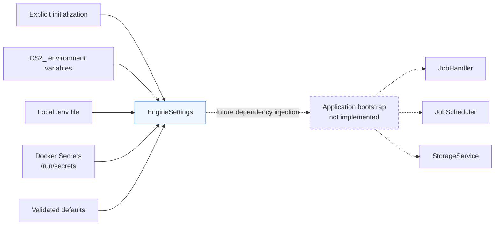

# Engine configuration

## Overview

The `engine.config` package loads and validates the small set of startup values used by the
implemented engine infrastructure. [`EngineSettings`](settings.py) currently configures the
`JobHandler` worker pool and shutdown behavior plus the SQLite storage path and busy timeout.

The package owns configuration parsing and validation only. It does not start the application,
create jobs, connect to a database, select marketplaces, or expose a global settings instance.
Future application bootstrap code should construct one settings object and explicitly pass its
values to the components it creates.

## Architecture



The dashed edges describe the intended integration boundary. This module does not implement
application bootstrap.

## File structure

```text
backend/
├── .env.example
├── engine/
│   └── config/
│       ├── __init__.py
│       ├── settings.py
│       └── README.md
└── tests/
    ├── conftest.py
    ├── test_settings.py
    └── test_configuration_sources.py
```

- [`settings.py`](settings.py) defines the settings model and its source configuration.
- [`__init__.py`](__init__.py) exposes `EngineSettings` as the package's public API.
- [`.env.example`](../../.env.example) lists safe values and the supported variable names.
- [`conftest.py`](../../tests/conftest.py) isolates tests from developer and CI environment values.
- [`test_settings.py`](../../tests/test_settings.py) covers the model and `JobHandler` injection.
- [`test_configuration_sources.py`](../../tests/test_configuration_sources.py) covers external
  sources, precedence, conversion, and failure cases.

## Public class and fields

[`EngineSettings`](settings.py#L10) is a Pydantic `BaseSettings` model. Construct it once during
startup or directly in a test:

```python
from engine.config import EngineSettings

settings = EngineSettings()
```

| Field | Type | Default | Responsibility |
|---|---|---:|---|
| `worker_count` | `int` | `5` | Maximum number of jobs the handler can execute concurrently |
| `job_queue_capacity` | `int` | `100` | Maximum number of jobs waiting for a worker |
| `job_shutdown_timeout_seconds` | `float` | `10.0` | Maximum graceful-drain time before handler cancellation |
| `database_path` | `Path` | `data/engine.sqlite3` | File used for durable engine storage |
| `database_busy_timeout_seconds` | `float` | `5.0` | Bounded wait for SQLite lock contention |

Numeric fields must be greater than zero. Invalid explicit values or values from an external
source raise Pydantic's `ValidationError`; they are never replaced with a default.

The class adds no custom loading methods. Pydantic supplies construction, validation,
`model_dump()`, and source handling. The module creates no object at import time.

## Configuration sources

The effective precedence, from highest to lowest, is:

1. Explicit `EngineSettings(...)` keyword arguments.
2. Environment variables.
3. Values in the configured `.env` file.
4. Files in the Docker secrets directory.
5. Field defaults.

This is the standard source order provided by the installed `pydantic-settings` version; the
module does not customize it. The precedence is also exercised end to end in
[`test_configuration_sources.py`](../../tests/test_configuration_sources.py).

### Environment variables

Environment variables use the `CS2_` prefix:

```bash
export CS2_WORKER_COUNT=8
export CS2_JOB_QUEUE_CAPACITY=250
export CS2_JOB_SHUTDOWN_TIMEOUT_SECONDS=15
export CS2_DATABASE_PATH=data/engine.sqlite3
export CS2_DATABASE_BUSY_TIMEOUT_SECONDS=5
```

Pydantic converts these strings to the declared numeric types before applying the positive-value
constraints.

### Local `.env`

By default, Pydantic looks for `.env` in the process's current working directory. For the documented
backend workflow, copy [`.env.example`](../../.env.example) to `backend/.env` and run commands from
`backend/`. Actual `.env` files are ignored by the repository's `.gitignore`.

Unknown dotenv entries are ignored so this model can coexist with the legacy application settings
while those modules remain separate. Explicitly invalid supported entries still fail validation.

Tests can disable dotenv loading with `_env_file=None` or provide an isolated file:

```python
settings = EngineSettings(_env_file=temporary_env_path, _secrets_dir=None)
```

The underscore-prefixed arguments are Pydantic Settings initialization options, not engine fields.

### Docker Secrets

When `/run/secrets` exists at module import time, it is passed to Pydantic's built-in file-secrets
source. Local development does not require that directory. Tests and alternate deployments can
provide `_secrets_dir=some_path` explicitly.

The environment prefix applies to secret filenames as well as environment variables. For example:

```text
/run/secrets/CS2_WORKER_COUNT
```

with file content `8` sets `worker_count` to `8`. A file named `WORKER_COUNT` is not a match. The
exact mapping is tested in
[`test_docker_secret_filenames_include_environment_prefix`](../../tests/test_configuration_sources.py#L106).

The current model does not own marketplace credentials. `CSFloatMarketplace` accepts an optional
API key directly from its caller, so a future bootstrap layer must decide whether that credential
belongs in `EngineSettings` or in a separate secret boundary. Any credential added here must use a
protected Pydantic type and receive masking tests.

## Design decisions

### Pydantic Settings

Pydantic Settings already provides typed conversion, validation errors, dotenv loading, environment
loading, file secrets, and a documented precedence order. Custom parsers or precedence logic would
duplicate those features and create more failure modes.

### One settings class

The implemented infrastructure values do not justify managers, registries, or separate settings
models. One class keeps construction and testing direct. It can be split later only if components
develop genuinely independent configuration boundaries.

### Explicit dependency injection

There is no module-level `settings` singleton. Callers pass validated values into constructors:

```python
from engine.config import EngineSettings
from engine.jobs import JobHandler
from engine.storage import StorageService

settings = EngineSettings()
handler = JobHandler(
    worker_count=settings.worker_count,
    queue_capacity=settings.job_queue_capacity,
    shutdown_timeout=settings.job_shutdown_timeout_seconds,
)
storage = StorageService(
    settings.database_path,
    busy_timeout_seconds=settings.database_busy_timeout_seconds,
)
```

This keeps imports side-effect free and lets tests construct settings without inheriting a
developer's local configuration.

### Startup validation and Docker Secrets

Configuration is immutable by convention for the lifetime of a startup: construct a new model to
load new values. Invalid values fail before unsafe worker or queue infrastructure is created.
Pydantic's file-secrets source supports Docker mounts without a custom secrets manager and without
making Docker a local-development dependency.

Hot reload, global mutable settings, and custom configuration exceptions were not selected. They
would add lifecycle and error-handling complexity without a current requirement.

## Common scenarios

### Change worker concurrency

Set `CS2_WORKER_COUNT=8` in the environment or local `.env`, then construct `EngineSettings` during
startup. An explicit constructor value still takes precedence, which is useful in tests.

### Run locally without Docker

No action is required. When `/run/secrets` is absent, construction continues with environment,
dotenv, and default values.

### Change the SQLite location

Set `CS2_DATABASE_PATH` to a writable file location. `StorageService.initialize()` creates its
parent directory. Increase `CS2_DATABASE_BUSY_TIMEOUT_SECONDS` only when the engine should wait
longer for another SQLite writer; the timeout remains bounded and is not a retry loop.

### Pass deterministic test configuration

Disable external files and secrets, then provide only the values relevant to the test:

```python
settings = EngineSettings(
    worker_count=1,
    job_queue_capacity=2,
    _env_file=None,
    _secrets_dir=None,
)
```

Environment variables remain a higher concern for integration tests; pytest's `monkeypatch` fixture
should be used to isolate them.

### Receive invalid configuration

`CS2_WORKER_COUNT=0` produces a `ValidationError` identifying `worker_count` and its greater-than-zero
constraint. Construction stops; Pydantic does not fall back to `5`.

### Configure a marketplace credential through this model

No credential is currently represented by `EngineSettings`. If bootstrap configuration takes
ownership of the optional CSFloat API key, add a specifically named `SecretStr` field rather than a
generic API key, pass it explicitly to the adapter, and add tests proving that environment and
prefixed secret-file input work without exposing the value in `repr()` or serialization.

## Testing

The configuration tests validate:

- Defaults, resulting types, positive-value constraints, conversion, and serialization.
- Explicit injection into the existing `JobHandler`.
- Database path and positive busy-timeout configuration consumed by `StorageService`.
- Environment, temporary dotenv, and temporary Docker Secrets sources.
- The complete source-precedence order and the required `CS2_` secret filename prefix.
- Missing secrets directories, invalid external values, and environment isolation.

Run the full backend suite from `backend/`:

```bash
.venv/bin/python -m pytest -q
```

After integration, the full suite completed with **228 passing tests**. The tests
require no Docker daemon, network calls, external database server, or real credentials.

## Extending the module

Add a field only when an implemented component consumes it:

1. Declare its precise type, safe default or required status, and constraints in
   [`EngineSettings`](settings.py).
2. Pass it explicitly from future bootstrap code to the consuming component.
3. Add the corresponding `CS2_` variable to [`.env.example`](../../.env.example).
4. Test valid values, invalid values, conversion, precedence, and secret masking when applicable.
5. Update this README with the actual field and integration path.

Prefer Pydantic's built-in field constraints and settings sources. Add a validator only when a rule
cannot be expressed clearly through the field's type or metadata.
