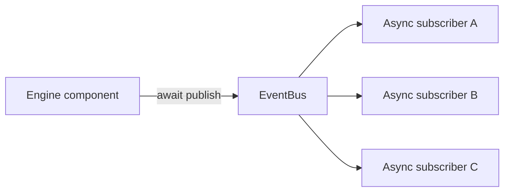
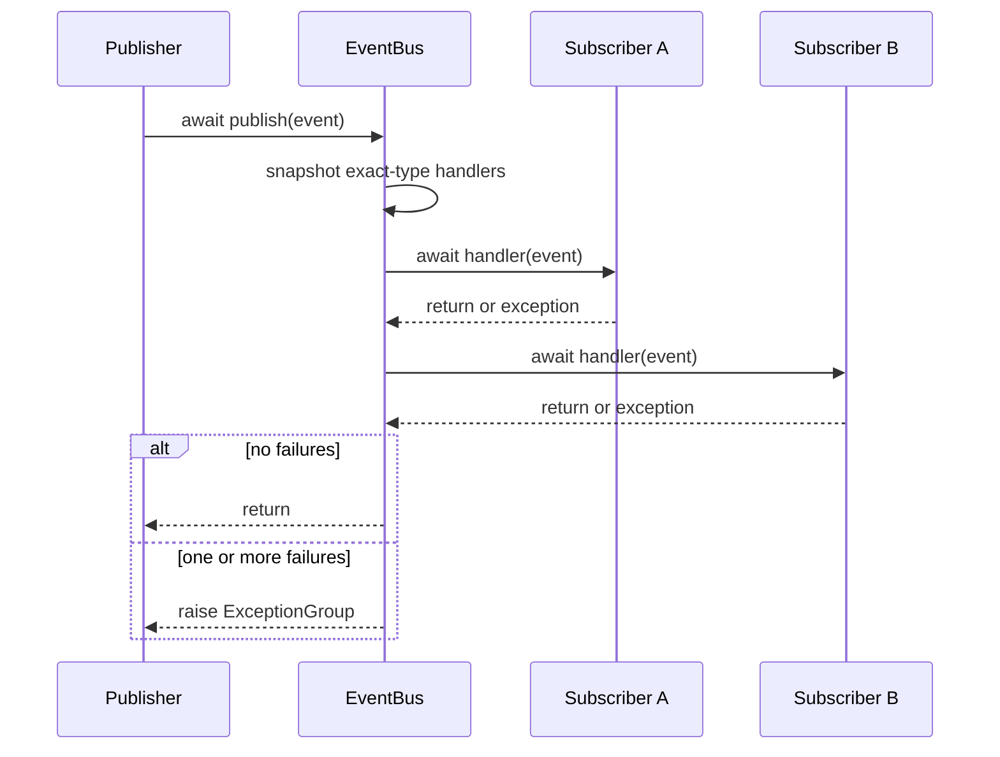

# Engine EventBus

`engine.events` is a small, typed, in-process notification mechanism for facts that have already
happened inside the engine. It lets future components react to committed work without giving a
publisher a direct dependency on every consumer. It is not a replacement for `StorageService`.

## Shape



The public API is [`EventBus`](bus.py) and the immutable event values in
[`models.py`](models.py):

```python
from engine.events import EventBus, MarketQuoteStored

bus = EventBus()

async def record_for_analysis(event: MarketQuoteStored) -> None:
    await analysis.observe(event.quote)

bus.subscribe(MarketQuoteStored, record_for_analysis)

# Only after StorageService.save_quotes(...) has returned successfully:
await bus.publish(MarketQuoteStored(occurred_at=committed_at, quote=quote))
```

[`EventBus.subscribe()`](bus.py#L30) returns `True` when it adds a handler and `False` for a
duplicate registration. [`EventBus.unsubscribe()`](bus.py#L43) similarly returns whether it removed
one. [`EventBus.publish()`](bus.py#L60) awaits dispatch. A handler is registered for one exact event
type; subscribing to `EngineEvent` is not a wildcard subscription.

## Events

[`EngineEvent`](models.py#L12) requires an explicit timezone-aware occurrence timestamp and
normalizes it to UTC. [`MarketQuoteStored`](models.py#L26) carries the immutable normalized
[`MarketQuote`](../models/quote.py) that was successfully stored. Storage currently does not expose
quote-record IDs, so passing the existing immutable domain value is the smallest useful payload for
an immediate consumer; it is not a copy of an ORM record.

No alert, notification, or job events are introduced prematurely. Their durable states already have
clear ownership in the respective services, but they should be added when a consumer needs them.

## Dispatch lifecycle



Handlers run serially in subscription order. `publish()` performs no task creation, queueing, or
background dispatch, so a slow handler delays its publisher. Multiple publishers can run
concurrently, but there is no ordering guarantee between different `publish()` calls. Subscription
changes while a handler is running are visible only to the next publication because each dispatch
uses a handler snapshot.

A handler can publish another event. Since it awaits the nested `publish()`, nested delivery is
depth-first: the outer handler resumes only after the nested event completes.

## Failure and cancellation

Every non-cancellation subscriber exception is logged with the event type and handler identity.
The bus keeps invoking the remaining handlers, then raises an `ExceptionGroup` containing every
failure to the publisher. This makes post-commit failures visible without silently corrupting the
bus. Callers decide whether that failure should fail their enclosing job or be handled elsewhere.

`asyncio.CancelledError` is never converted, logged as a handler failure, or suppressed. It
propagates immediately and later handlers do not run. There are no bus-owned tasks to drain or stop.

## Persistence boundary

The database remains the source of truth. Publish a `MarketQuoteStored` only after
[`StorageService.save_quotes()`](../storage/service.py#L102) returns, which means its transaction
has committed. Likewise, future alert events belong after
[`StorageService.commit_alert_evaluation()`](../storage/service.py#L398), and notification outcome
events belong after [`NotificationService.deliver()`](../notifications/service.py#L151) has persisted
its final delivery state.

The EventBus is in-memory: process termination can lose an undispatched event, and subscriber
failure has no automatic retry. It intentionally excludes transactional outboxes, event sourcing,
database queues, Redis, RabbitMQ, and Kafka. Those would add durability and operational contracts
that the engine does not yet need.

## Tests

From `backend/`:

```bash
python -m pytest -q tests/test_event_bus.py
python -m pytest -q
```

The isolated tests cover registration, duplicate prevention, removal, typed dispatch, payloads,
ordering, concurrent and nested publishing, handler snapshots, exceptions, cancellation, independent
instances, and the absence of EventBus background tasks.

The focused EventBus tests and the complete **406-test** backend suite passed on 2026-10-22 using
Python 3.12 and the dependencies declared in `requirements.txt`.

No production service currently owns an `EventBus` or publishes `MarketQuoteStored`; the examples
and integration points below are explicit extension guidance, not claims of active event flow.

## Safe future integration points

- `FetchMarketJob.execute()` after `StorageService.save_quotes()` commits, publishing one event per
  stored quote.
- `AlertService.evaluate()` after it receives a committed `AlertEvent` from storage.
- `NotificationService.deliver()` after the final `NotificationDelivery` state is persisted.
- `JobHandler._worker()` only if a concrete consumer needs job outcomes and a minimal job-result
  payload has been agreed.

Integrations should be injected with an `EventBus` instance; do not create a global bus or claim
durable delivery semantics.
