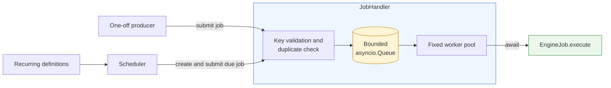
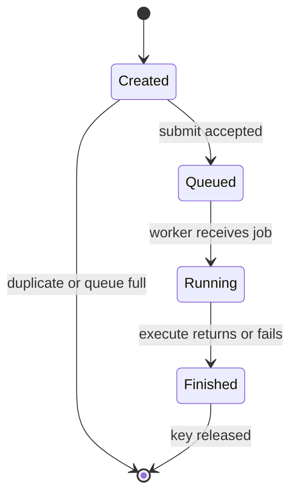
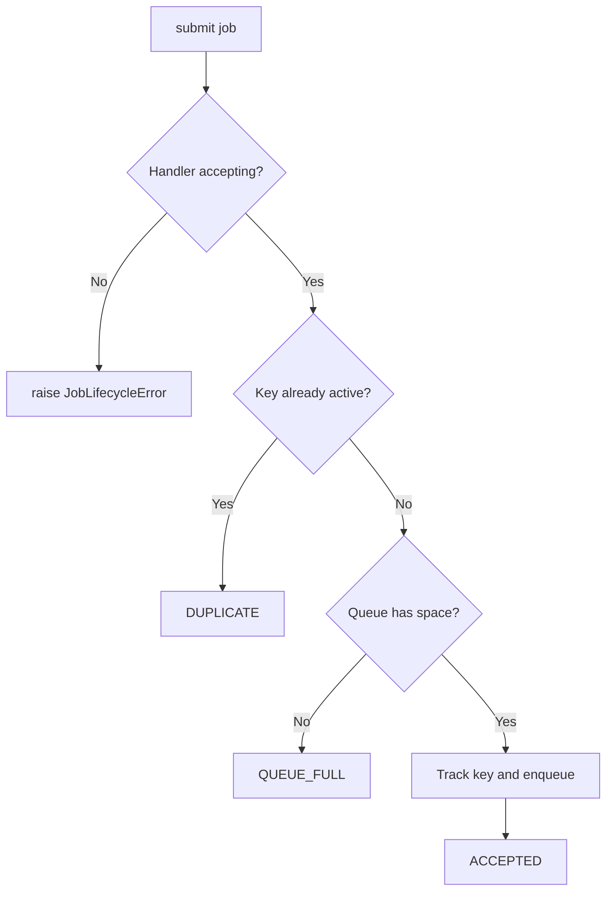
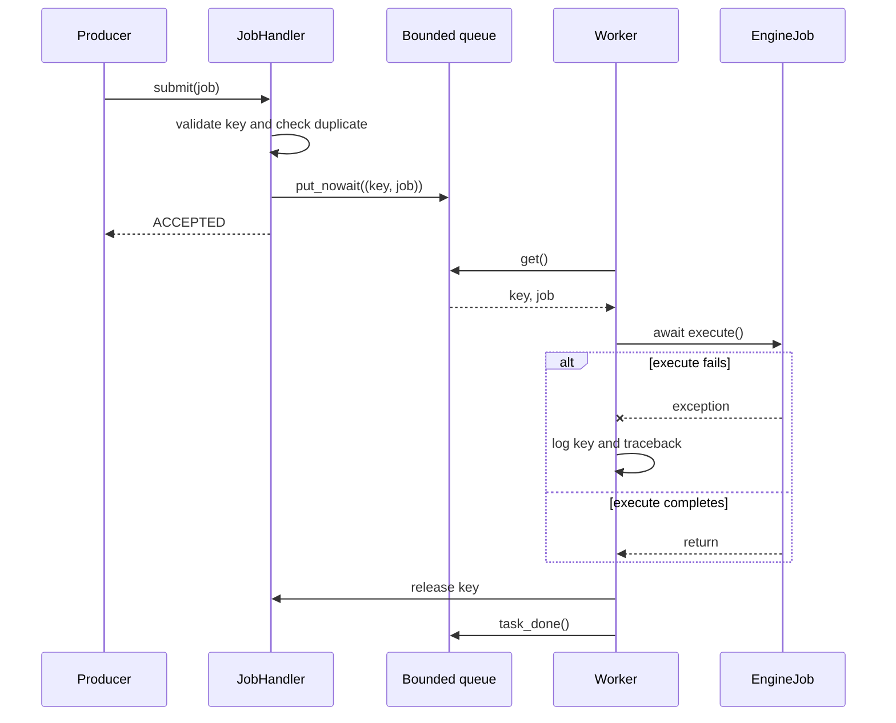
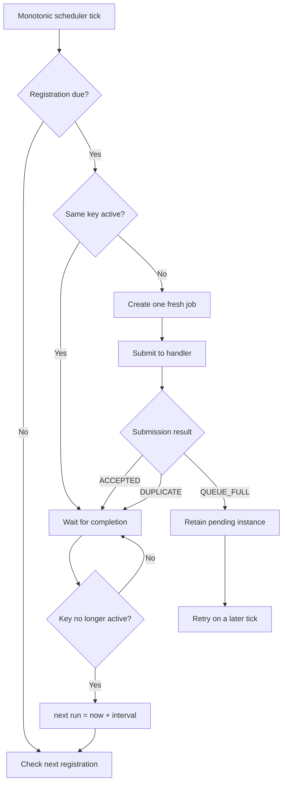
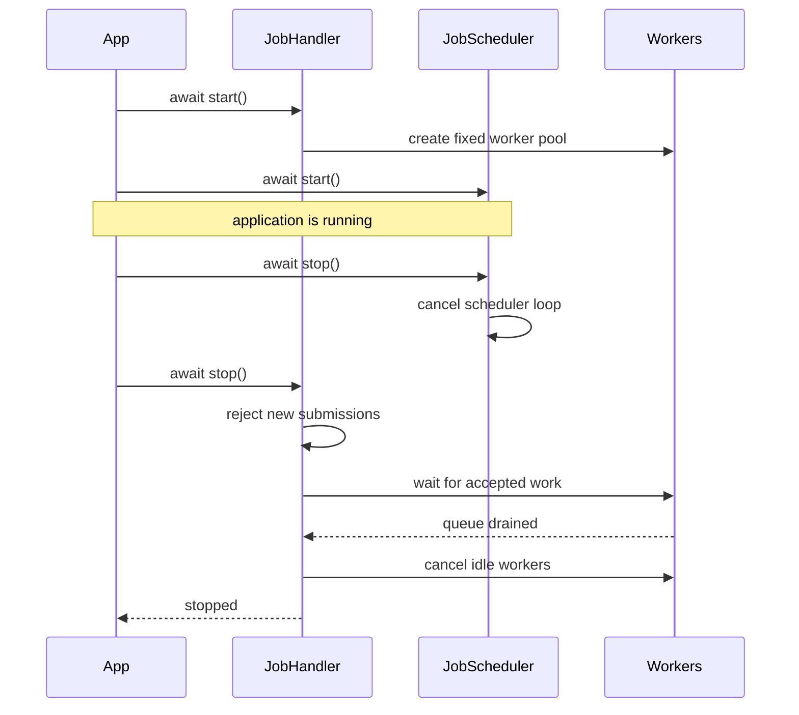

# Async job system

This package is the engine's small, reusable background-work layer. It answers three separate
questions:

- **What runs?** An [`EngineJob`](base.py#L4).
- **How does it run?** A [`JobHandler`](handler.py#L20).
- **When does recurring work run?** A [`JobScheduler`](scheduler.py#L25).

Keeping those responsibilities separate means jobs contain business work without knowing about
queues, workers, intervals, or application startup.

## Architecture at a glance



| Code | Responsibility | Deliberately does not do |
|---|---|---|
| [`base.py`](base.py) | Defines the job contract and stable identity | Scheduling, retries, or shared state |
| [`handler.py`](handler.py) | Bounds, deduplicates, and executes accepted work | Recurring scheduling |
| [`scheduler.py`](scheduler.py) | Tracks recurring definitions and submits due instances | Executes jobs directly |
| [`../errors.py`](../errors.py) | Defines engine and job-system errors | Encodes every possible failure as a custom type |
| [`__init__.py`](__init__.py) | Exposes the small public API | Implementation details |
| [`../../tests/test_job_system.py`](../../tests/test_job_system.py) | Specifies lifecycle, concurrency, timing, and failure behaviour | Marketplace-specific behaviour |

## 1. Jobs: the unit of work

[`EngineJob`](base.py#L4) is an abstract class with only two requirements:

```python
class EngineJob(ABC):
    @property
    @abstractmethod
    def key(self) -> str: ...

    @abstractmethod
    async def execute(self) -> None: ...
```

An application job stays equally small:

```python
class ExampleJob(EngineJob):
    @property
    def key(self) -> str:
        return "example:refresh"

    async def execute(self) -> None:
        await refresh_data()
```

Each instance represents **one execution**. A job must not schedule or repeat itself.

The `key` is a stable identity for equivalent work. The handler uses it to guarantee that two jobs
with the same key cannot be queued or running at the same time. Choose a key that describes the
work's collision boundary, for example `catalog:refresh` or `market:steam:item:123`.



Job failures are contained at the worker boundary. They are logged with the job key and traceback,
the key is released, and the worker continues with the next job. See
[`JobHandler._worker()`](handler.py#L126).

## 2. Handler: bounded execution

[`JobHandler`](handler.py#L20) owns one bounded `asyncio.Queue` and a fixed number of long-running
worker tasks.

```python
handler = JobHandler(
    worker_count=5,
    queue_capacity=100,
    shutdown_timeout=10.0,
)
await handler.start()
```

- `worker_count` limits how many jobs may execute concurrently.
- `queue_capacity` limits how many jobs may wait for a worker.
- `shutdown_timeout` limits how long graceful shutdown waits for accepted work.

Running jobs do **not** occupy queue slots. With one worker and a queue capacity of 100, one job may
be running while another 100 wait. The next unique submission receives `QUEUE_FULL`. This is normal
backpressure, not an out-of-memory condition.

### Submission outcomes

[`submit()`](handler.py#L59) is synchronous and non-blocking. It returns a
[`SubmissionResult`](handler.py#L12):

| Result | Meaning | Suggested caller action |
|---|---|---|
| `ACCEPTED` | The job is now tracked and queued | No further action |
| `DUPLICATE` | The same key is already queued or running | Do not submit another copy |
| `QUEUE_FULL` | Every waiting slot is occupied | Retry later only if the caller's policy requires it |

Submitting before startup or after shutdown begins is a lifecycle error rather than an expected
capacity outcome, so [`JobLifecycleError`](../errors.py#L9) is raised. Invalid configuration and
empty keys raise `ValueError`.



[`is_active(key)`](handler.py#L78) reports whether a key is queued or running. Tracking is cleaned
up after success, failure, self-cancellation, forced shutdown, and queued-job disposal.

### Worker behaviour

Workers are created once in [`start()`](handler.py#L47), rather than creating an unbounded task for
every submission:



The package is designed for use from one asyncio event loop. `submit()` is not a cross-thread API.

## 3. Scheduler: recurring submission

[`JobScheduler`](scheduler.py#L25) receives an existing handler. It stores recurring **definitions**,
not reusable job instances. Each definition has:

- A unique registration key.
- A factory that creates a fresh `EngineJob` for one execution.
- An interval in seconds.
- The next due time, measured with `time.monotonic()`.
- State indicating whether the previous execution is still active.

```python
scheduler = JobScheduler(handler, poll_seconds=0.1)
scheduler.register(
    "example:refresh",
    lambda: ExampleJob(...),
    interval_seconds=300,
    run_immediately=True,
)
await scheduler.start()
```

The factory's job key must equal the registration key. A mismatch is logged as a scheduler failure
instead of silently breaking duplicate protection.

### Recurring execution cycle



Important timing properties:

- The next run is scheduled after completion, not from the previous start time.
- Slow executions therefore do not overlap and do not create a backlog of missed runs.
- A full queue leaves the registration due. The same pending instance is retried later, avoiding
  duplicate factory calls for one intended execution.
- A manually submitted job with the same key takes precedence. The scheduler waits for it to finish,
  then begins the recurring interval.
- `run_immediately=False` is the default; the first execution otherwise waits one interval.

Registration and unregistration may happen while the scheduler is running. Unregistering prevents
future submissions but does not cancel a job that the handler has already accepted.

## Startup and shutdown

Start the handler before the scheduler. Stop them in the reverse order:



Recommended application pattern:

```python
handler = JobHandler()
scheduler = JobScheduler(handler)

await handler.start()
await scheduler.start()
try:
    await run_application()
finally:
    await scheduler.stop()
    await handler.stop()
```

Graceful handler shutdown first stops accepting work, then waits for queued and running jobs. If the
configured timeout expires, it cancels running work, discards work that never started, clears key
tracking, and raises [`JobShutdownTimeout`](../errors.py#L13). The error is raised **after cleanup** so
the caller learns that shutdown was forced without leaving worker or queue state behind.

Async cancellation is preserved: cancelling `stop()` forces worker cleanup and then re-raises
`CancelledError`. A job that raises `CancelledError` by itself is isolated like another job failure;
cancellation directed at a worker during shutdown is propagated so the worker exits.

## Design reasoning

| Decision | Why |
|---|---|
| Fixed workers instead of one task per job | Gives an explicit concurrency limit and prevents task growth under load |
| Bounded queue | Applies predictable backpressure before memory usage grows without limit |
| Stable job keys | Provides duplicate prevention across both one-off and recurring producers |
| Result enum for expected rejection | Lets callers distinguish duplicates from capacity without exception-driven control flow |
| Factory per recurring execution | Prevents accidental reuse of mutable job instances |
| Monotonic clock | Wall-clock changes cannot move recurring deadlines backward or forward |
| Completion-relative intervals | Prevents overlap and missed-run accumulation |
| Scheduler depends on handler | Preserves one execution path and one duplicate-tracking authority |

This module intentionally has no persistence, marketplace logic, singleton state, or dynamic plugin
discovery. Higher-level services are responsible for reconstructing recurring registrations when the
engine starts.

## Tests

The behaviour above is exercised in
[`backend/tests/test_job_system.py`](../../tests/test_job_system.py), including:

- Abstract contract enforcement and concrete execution.
- Worker concurrency, queue capacity, and duplicate prevention.
- Failure and cancellation isolation.
- Graceful, timed-out, and cancelled shutdown.
- Immediate and delayed recurring work with different intervals.
- Completion-relative rescheduling and non-overlap.
- Queue-full retry and manual jobs sharing recurring keys.
- Dynamic registration, restart, and end-to-end integration.

Run the backend suite from `backend/`:

```bash
pytest -q
```
