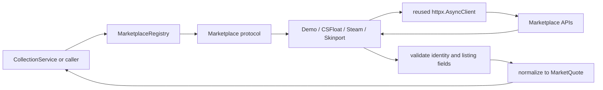

# Marketplace system

The marketplace package defines the shared provider contract and registry, and contains concrete
demo, CSFloat, Steam, and Skinport adapters. Public providers fetch external data and normalize it into the shared
[`MarketQuote`](../models/quote.py) model. Scheduling, retries, persistence, currency conversion,
and pricing decisions remain outside this package.

Demo providers return explicitly simulated lowest asks without I/O. CSFloat provides individual
listings. Steam and Skinport provide aggregate lowest-ask snapshots for
the retained website comparison contract; their extra aggregate fields are kept in their provider
snapshot types rather than added to the generic `MarketQuote` model.

## Architecture



The registry accepts any object that structurally implements the runtime-checkable
[`Marketplace`](base.py) protocol. Concrete providers do not inherit from a framework base class.

## Files

| File | Purpose |
|---|---|
| [`base.py`](base.py) | Runtime-checkable provider protocol |
| [`registry.py`](registry.py) | Explicit provider registration and lookup |
| [`csfloat.py`](csfloat.py) | CSFloat HTTP requests, validation, and normalization |
| [`steam.py`](steam.py) | Steam aggregate lowest-ask snapshot normalization |
| [`skinport.py`](skinport.py) | Cached Skinport aggregate snapshot normalization |
| [`__init__.py`](__init__.py) | Public package exports |
| [`../errors.py`](../errors.py) | Provider-neutral exception hierarchy |
| [`test_marketplace.py`](../../tests/test_marketplace.py) | Structural protocol tests |
| [`test_marketplace_registry.py`](../../tests/test_marketplace_registry.py) | Registry compatibility tests |
| [`test_marketplace_registry_foundation.py`](../../tests/test_marketplace_registry_foundation.py) | Registry contract and validation tests |
| [`test_marketplace_integration.py`](../../tests/test_marketplace_integration.py) | Multiple-provider domain integration tests |
| [`test_csfloat_marketplace.py`](../../tests/test_csfloat_marketplace.py) | Mocked CSFloat HTTP tests |
| [`test_compatibility_marketplaces.py`](../../tests/test_compatibility_marketplaces.py) | Mocked catalog, Steam, and Skinport tests |

## Public API

### `Marketplace`

A provider exposes a stable lowercase `name` and an asynchronous `fetch(Item)` method returning
normalized quotes:

```python
from engine.models import Item, MarketQuote


class ExampleMarketplace:
    name = "example"

    async def fetch(self, item: Item) -> list[MarketQuote]:
        ...
```

Because the protocol is runtime-checkable, the registry can reject incomplete objects before they
are used. It separately verifies that `fetch` is asynchronous.

### `MarketplaceRegistry`

The registry stores ready-to-use instances and never constructs providers:

```python
from engine.marketplaces import MarketplaceRegistry

registry = MarketplaceRegistry()
registry.register(provider)
selected = registry.get(provider.name)
```

- `register(provider)` validates the protocol and name, and never replaces an existing provider.
- `get(name)` returns the registered instance or raises `UnknownMarketplaceError`.
- `list()` returns an immutable provider snapshot in registration order.
- `names` returns the registered identifiers in registration order.

Names must start with a lowercase ASCII letter or digit and may then contain lowercase letters,
digits, dots, underscores, or hyphens. Duplicate registration raises
`DuplicateMarketplaceError`, a specialized `MarketplaceRegistrationError`. Invalid providers and
names also use the registration exception hierarchy; non-string names raise `TypeError`.

Each registry owns independent state. A provider failure does not remove or replace registrations.

### `CSFloatMarketplace`

Construct the adapter once and reuse it:

```python
from engine.marketplaces import CSFloatMarketplace, MarketplaceRegistry
from engine.models import Item

marketplace = CSFloatMarketplace(currency="USD", api_key="configured-secret")
registry = MarketplaceRegistry()
registry.register(marketplace)

quotes = await marketplace.fetch(
    Item(market_hash_name="AK-47 | Redline (Field-Tested)")
)
await marketplace.aclose()
```

`fetch(item)` calls the documented `GET /api/v1/listings` endpoint with the exact Steam market hash
name, `type=buy_now`, `sort_by=lowest_price`, and a page size of 50. Every accepted result becomes
an `INDIVIDUAL_LISTING` quote containing its CSFloat listing ID.

Constructor inputs:

- `currency`: required uppercase ISO-style code. CSFloat prices use minor units without carrying a
  currency field, so deployments must provide it explicitly.
- `api_key`: optional authorization value; adapter exceptions never include it.
- `client`: optional injected `httpx.AsyncClient` for shared pools and tests.
- `timeout`: per-request timeout, defaulting to 10 seconds.
- `base_url`: override for tests or a compatible deployment.

The adapter closes only clients it creates. Injected clients remain caller-owned. Both `aclose()`
and async context management are supported.

## CSFloat normalization

The response may be the documented listing array or the paginated `{data, cursor}` envelope.
Unknown shapes are rejected. Item identity is compared exactly so normal, StatTrak, Souvenir, and
wear variants remain separate. Prices are converted from integer minor units to `Decimal` major
units. The quote timestamp is the UTC response-observation time, not the listing creation time.

## Error handling

| Condition | Exception | Retry classification |
|---|---|---|
| Invalid provider or identifier | `MarketplaceRegistrationError` | Configuration error |
| Duplicate identifier | `DuplicateMarketplaceError` | Configuration error |
| Missing identifier | `UnknownMarketplaceError` | Lookup error |
| HTTP 401 or 403 | `MarketplaceAuthenticationError` | Non-retryable by default |
| HTTP 429 | `MarketplaceRateLimitError` | `ConnectionError`; exposes `retry_after_seconds` |
| Request timeout | `MarketplaceTimeoutError` | `TimeoutError` |
| Network failure or HTTP 5xx | `MarketplaceUnavailableError` | `ConnectionError` |
| Other HTTP or data error | `MarketplaceResponseError` | Non-retryable by default |

Adapters do not retry or sleep. `CollectionService` owns retry and admission policies using this
exception hierarchy. CSFloat publishes no numeric rate limit, so none is assumed here. See the
[official CSFloat API documentation](https://docs.csfloat.com/) and its
[source repository](https://github.com/csfloat/docs).

## Testing

Run from `backend/` using the project environment:

```bash
python -m pytest -q \
  tests/test_marketplace.py \
  tests/test_marketplace_registry.py \
  tests/test_marketplace_registry_foundation.py \
  tests/test_marketplace_integration.py \
  tests/test_csfloat_marketplace.py
python -m pytest -q
```

Tests use fake providers and `httpx.MockTransport`; they require no live API or credentials.

## Extending the system

1. Add one module containing a class with a stable `name` and async `fetch(Item)` method.
2. Reuse or inject one asynchronous HTTP client and define ownership explicitly.
3. Validate identity, money, timestamp, and quote semantics before constructing domain models.
4. Map provider failures to the shared exception hierarchy without embedding retries.
5. Add mocked provider and registry tests, then document provider-specific limitations.

Do not add scheduling, persistence, currency conversion, or pricing comparisons to an adapter.

## Current limitations

- CSFloat returns at most the first 50 matching listings; cursor traversal is intentionally not
  hidden inside one unbounded `fetch()` call.
- `MarketQuote` does not retain CSFloat listing creation time, float value, paint seed, stickers,
  or pagination cursor.
- Currency remains explicit configuration because the response has no ISO currency field.
- The CSFloat integration is validated with mocked responses and makes no live-operability claim.
- Steam and Skinport compatibility providers are also validated only with mocked responses; they
  require production smoke testing and are not a substitute for official provider support.
- Steam's `priceoverview` route is undocumented and best-effort even though it needs no key.
