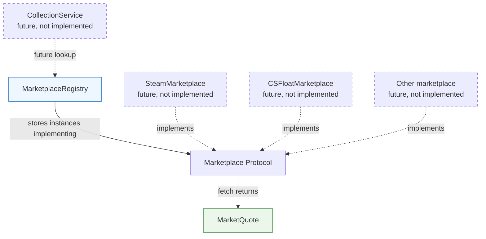

# Marketplace system

## Overview

The `engine.marketplaces` package gives engine services one small interface for retrieving
marketplace data. Provider APIs can use different payloads and price concepts, but every
implementation exposes the same asynchronous operation and returns the shared
[`MarketQuote`](../models/quote.py) model.

This boundary keeps marketplace-specific fetching and normalization out of engine consumers.
Adding a provider requires a new implementation and explicit registration; it does not require a
change to the registry or the shared models.

This module contains infrastructure only. It has no real provider integrations, HTTP requests,
credentials, retries, scheduling, persistence, or application bootstrap.

## Architecture



The dashed components and relationships are future integration points. The implemented registry
does not construct marketplaces or call `fetch()` on them; it only validates, stores, and returns
instances.

## Directory structure

```text
backend/
├── engine/
│   ├── errors.py
│   └── marketplaces/
│       ├── __init__.py
│       ├── base.py
│       ├── registry.py
│       └── README.md
└── tests/
    ├── test_marketplace.py
    ├── test_marketplace_registry.py
    └── test_marketplace_integration.py
```

- [`base.py`](base.py) defines the shared `Marketplace` protocol.
- [`registry.py`](registry.py) implements explicit, instance-based registration and lookup.
- [`__init__.py`](__init__.py) exports the supported package API.
- [`errors.py`](../errors.py) defines duplicate-registration and unknown-marketplace errors.
- [`test_marketplace.py`](../../tests/test_marketplace.py) covers the contract and normalized output.
- [`test_marketplace_registry.py`](../../tests/test_marketplace_registry.py) covers registry behavior
  and validation.
- [`test_marketplace_integration.py`](../../tests/test_marketplace_integration.py) exercises multiple
  fake implementations through the registry.

## Public classes and methods

Consumers should import the public API from the package:

```python
from engine.marketplaces import Marketplace, MarketplaceRegistry
```

### `Marketplace`

[`Marketplace`](base.py) is a runtime-checkable typing `Protocol` with two members:

```python
class Marketplace(Protocol):
    @property
    def name(self) -> str: ...

    async def fetch(self, item: Item) -> list[MarketQuote]: ...
```

- `name` is the stable identifier used by the registry and by quotes produced by the
  implementation. It follows the lowercase identifier format used by `MarketQuote.marketplace`.
- `fetch(item)` receives the existing immutable [`Item`](../models/item.py) model. It fetches and
  internally normalizes provider data, then returns zero or more `MarketQuote` objects.

There is no public `normalize()` operation. Raw provider payloads are implementation details and
must not escape through this contract.

The protocol provides structural typing: a class does not need to inherit from `Marketplace`.
Python type checking describes the full signatures. At registration time the registry can check
that the required members exist and that `fetch` is an async method, but Python cannot enforce the
annotated return type at runtime. Implementations remain responsible for returning valid quotes.

### `MarketplaceRegistry`

[`MarketplaceRegistry`](registry.py) owns a private dictionary for one registry instance. Its
public methods are:

| Method | Input | Output | Behavior |
|---|---|---|---|
| `register(marketplace)` | Ready-to-use `Marketplace` instance | `None` | Validates and stores the instance without replacing an existing registration |
| `get(name)` | Marketplace identifier | `Marketplace` | Returns the registered instance or raises `UnknownMarketplaceError` |
| `list()` | None | `tuple[Marketplace, ...]` | Returns an immutable snapshot in registration order |

Registration checks that the object satisfies the runtime protocol, its name uses the accepted
identifier syntax, and `fetch` is asynchronous. A duplicate name raises
[`DuplicateMarketplaceError`](../errors.py). Invalid objects and non-async fetch methods raise
`TypeError`; malformed names raise `ValueError`.

The registry does not instantiate implementations, mutate them, invoke them, or manage their
dependencies. Separate registry instances have independent state.

## Design decisions

### Shared structural interface

A `Protocol` keeps the boundary explicit without requiring every marketplace or test fake to
inherit from a base class. An abstract base class would enforce nominal inheritance, but it would
not enforce normalized return values or guarantee that an override remains asynchronous. The
protocol combines static signature checking with small, useful runtime registration checks.

The interface contains only the operation currently shared by intended providers. Capabilities,
historical queries, order books, authentication, and provider-specific response types can be added
only when a concrete requirement establishes their semantics.

### Explicit registration and dependency injection

Application bootstrap will construct each implementation with its own dependencies and pass the
ready instance to `register()`. This supports simple test fakes and keeps configuration, HTTP
clients, and credentials out of registry code.

Automatic filesystem scanning, entry points, a global registry, and a dependency injection
framework would add discovery and lifecycle behavior that the engine does not need. Explicit
registration makes the available providers and their construction visible at the composition root.

### One class per concrete marketplace

A future provider class will own its API access and internal normalization in V1. Separate adapter
and normalizer objects would create more coordination surfaces before any real provider has shown
that it needs them. A provider can refactor its internals later without changing this public
contract.

### Shared domain models

`fetch()` receives `Item` and returns `MarketQuote`, reusing the validated models in
[`engine.models`](../models/README.md). This prevents marketplace-specific payload fields from
coupling future services to a provider. `QuoteType`, explicit currency, decimal prices, and aware
timestamps preserve distinctions that consumers need.

### Small dictionary-backed registry

The registry handles identity and lookup only. It deliberately has no provider priorities,
categories, dependency graph, lifecycle hooks, retry policy, rate limits, transactions, or
scheduling behavior. Returning a tuple from `list()` prevents callers from mutating registry state
through the returned collection.

## Common scenarios

### Register and look up a marketplace

```python
registry = MarketplaceRegistry()
steam = FutureSteamMarketplace(http_client, credentials)

registry.register(steam)
selected = registry.get("steam")
quotes = await selected.fetch(item)
```

`FutureSteamMarketplace` is illustrative and is not implemented in this repository. Construction
happens outside the registry so the implementation can receive whatever dependencies it needs.

### Use a fake in a test

```python
class FakeMarketplace:
    name = "fake"

    async def fetch(self, item: Item) -> list[MarketQuote]:
        return []


registry = MarketplaceRegistry()
registry.register(FakeMarketplace())

assert await registry.get("fake").fetch(item) == []
```

No inheritance, network access, credentials, or engine services are required.

### Handle duplicate registration

```python
from engine.errors import DuplicateMarketplaceError

try:
    registry.register(another_steam)
except DuplicateMarketplaceError:
    ...
```

The existing instance remains registered. The registry never silently replaces it.

### Handle an unknown marketplace

```python
from engine.errors import UnknownMarketplaceError

try:
    marketplace = registry.get("missing")
except UnknownMarketplaceError:
    ...
```

An unknown identifier never produces an ambiguous `None` result.

## Testing

The tests use only local fake marketplaces:

- [`test_marketplace.py`](../../tests/test_marketplace.py) verifies structural conformance, the
  stable identifier, asynchronous fetching, normalized domain output, empty results, and an
  incomplete implementation.
- [`test_marketplace_registry.py`](../../tests/test_marketplace_registry.py) verifies registration,
  retrieval, ordering, duplicates, unknown lookups, invalid names, invalid implementations,
  non-async fetching, and independent instances.
- [`test_marketplace_integration.py`](../../tests/test_marketplace_integration.py) registers multiple
  fakes, fetches consistent `MarketQuote` values, isolates a provider failure from registry state,
  and constructs the registry without services or clients.

Run the marketplace tests from `backend/`:

```bash
.venv/bin/python -m pytest -q \
  tests/test_marketplace.py \
  tests/test_marketplace_registry.py \
  tests/test_marketplace_integration.py
```

Run the complete backend suite:

```bash
.venv/bin/python -m pytest -q
```

After this module was implemented, the marketplace run completed with **26 passing tests**, and
the complete backend run completed with **136 passing tests**. Neither run used a network, real
credentials, a database, or marketplace APIs.

## Extending the system

To add a real marketplace in a future module:

1. Create a provider class with a stable lowercase `name`.
2. Accept provider-specific clients and credentials in its constructor.
3. Implement `async fetch(item: Item) -> list[MarketQuote]`.
4. Keep provider response parsing and normalization internal to that class.
5. Set each quote's marketplace identifier, currency, timestamp, and `QuoteType` accurately.
6. Add provider unit tests using representative local payloads, without live API calls.
7. Construct and register the instance explicitly in future application bootstrap.

The registry should not be modified for each new marketplace. Revisit the shared contract only if
multiple implemented providers establish a genuinely shared operation that cannot be represented
by `fetch()`.

## Current limitations

- No concrete marketplaces or application bootstrap are implemented.
- Runtime protocol checks cannot validate the contents of a returned list; Pydantic validates each
  `MarketQuote` when an implementation constructs it.
- The registry is an in-process collection and provides no persistence or cross-process discovery.
- Retry, timeout, rate-limit, authentication, and partial-failure policies belong to future
  provider and collection-service work.
