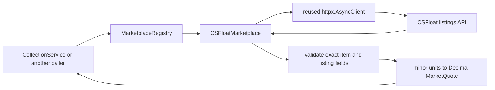
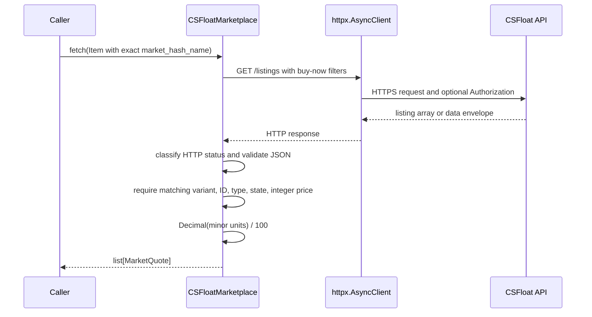

# Marketplace integrations

This package is the engine boundary for reading marketplace data and converting it into the shared
[`MarketQuote`](../models/quote.py) model. It performs provider I/O and normalization only. Job
execution, retry timing, persistence, and pricing decisions remain outside this package.

CSFloat is the only implemented marketplace. Steam support is intentionally deferred because the
useful Community Market price endpoint is not part of Valve's supported Steamworks Web API.

## Architecture



The registry depends on the structural [`Marketplace`](base.py) protocol. A provider needs a stable
lowercase `name` and an asynchronous `fetch(Item)` method; it does not need to inherit from a base
class.

## Files

| File | Purpose |
|---|---|
| [`base.py`](base.py) | Provider protocol used by collection code and the registry |
| [`registry.py`](registry.py) | Provider registration and lookup by stable identifier |
| [`csfloat.py`](csfloat.py) | HTTP requests, response validation, and CSFloat normalization |
| [`__init__.py`](__init__.py) | Public package exports |
| [`../errors.py`](../errors.py) | Provider-neutral marketplace exception hierarchy |
| [`test_csfloat_marketplace.py`](../../tests/test_csfloat_marketplace.py) | CSFloat tests |
| [`test_marketplace_registry.py`](../../tests/test_marketplace_registry.py) | Registry tests |

## Public API

### `MarketplaceRegistry`

- `register(provider)` registers one provider under `provider.name`. Duplicate or invalid names
  raise `MarketplaceRegistrationError`.
- `get(name)` returns the registered instance or raises `UnknownMarketplaceError`.
- `names` returns identifiers in registration order.

### `CSFloatMarketplace`

Construct the provider once and reuse it:

```python
from engine.marketplaces import CSFloatMarketplace, MarketplaceRegistry
from engine.models import Item

marketplace = CSFloatMarketplace(currency="USD", api_key="configured-secret")
registry = MarketplaceRegistry()
registry.register(marketplace)

quotes = await marketplace.fetch(
    Item(market_hash_name="AK-47 | Redline (Field-Tested)")
)
await marketplace.aclose()
```

`fetch(item)` calls the documented `GET /api/v1/listings` endpoint with the exact Steam market hash
name, `type=buy_now`, `sort_by=lowest_price`, and the documented maximum page size of 50. Each
active result becomes an `INDIVIDUAL_LISTING` quote with its CSFloat listing ID.

The constructor accepts:

- `currency`: required uppercase ISO code. CSFloat listing payloads contain prices in minor units
  but no currency field, so the integration deliberately requires the deployment to supply the
  currency rather than silently guessing it.
- `api_key`: optional. When present it is sent verbatim in the documented `Authorization` header
  and is never included in adapter error messages.
- `client`: optional injected `httpx.AsyncClient`, useful for shared connection pools and tests.
- `timeout`: explicit per-request timeout, defaulting to 10 seconds.
- `base_url`: override for testing or a compatible deployment.

The provider owns and closes only clients it creates. Injected clients remain owned by their
caller. `aclose()` and `async with` are both supported.

## Request and normalization flow



The response may use the documented top-level listing array or the paginated `{data, cursor}`
envelope. Unknown shapes are rejected. Item identity is compared exactly, which keeps normal,
StatTrak, Souvenir, and wear variants separate. The quote observation time is the UTC time at which
the response is received; CSFloat's `created_at` describes listing creation and is not substituted
for that value.

## Error handling

| Condition | Exception | Retry classification |
|---|---|---|
| HTTP 401 or 403 | `MarketplaceAuthenticationError` | Non-retryable by default |
| HTTP 429 | `MarketplaceRateLimitError` | `ConnectionError`; exposes `retry_after_seconds` |
| Request timeout | `MarketplaceTimeoutError` | `TimeoutError` |
| Network failure or HTTP 5xx | `MarketplaceUnavailableError` | `ConnectionError` |
| Other HTTP or data error | `MarketplaceResponseError` | Non-retryable by default |

The adapter never retries or sleeps. `CollectionService` owns those policies and can use the
built-in exception ancestry plus `retry_after_seconds` from a 429 response.

CSFloat's public documentation does not publish a numeric rate limit, so no quota is encoded here.
See the [official CSFloat API documentation](https://docs.csfloat.com/) and its
[source repository](https://github.com/csfloat/docs) for the provider contract.

## Adding another marketplace

1. Add one module containing a class with a stable `name` and `async fetch(Item)` method.
2. Inject or internally reuse one asynchronous HTTP client and define clear ownership.
3. Validate provider identity, money, timestamp, and quote semantics before constructing
   `MarketQuote` objects.
4. Map provider failures to the marketplace exception hierarchy without adding retry loops.
5. Add mocked HTTP and registry tests, then document provider-specific limitations here.

Do not add scheduling, persistence, currency conversion, or pricing comparisons to an adapter.

## Testing

From `backend/`, using the project environment:

```bash
python -m pytest -p no:cacheprovider \
  tests/test_marketplace_registry.py tests/test_csfloat_marketplace.py -q
python -m pytest -p no:cacheprovider -q
```

Results after integration on 2026-10-20:

- Marketplace tests: **54 passed**.
- Complete backend suite: **228 passed**.
- Skipped tests: **0**.

All integration tests use `httpx.MockTransport`; no live API or credentials were used.

## Known limitations

- Only CSFloat is implemented; there is no Steam adapter.
- `fetch()` returns at most the first 50 matching listings. Cursor traversal is intentionally left
  to a future bounded collection contract rather than hiding an unbounded number of HTTP requests
  in one fetch operation.
- The shared `MarketQuote` model cannot retain CSFloat listing creation time, float value, paint
  seed, stickers, or pagination cursor. The adapter validates fields needed for quote identity and
  semantics and otherwise leaves marketplace metadata at the boundary.
- Currency is configuration because the listing response does not carry an ISO currency code.
- The integration has not been exercised against the live service and makes no live-operability
  claim.
