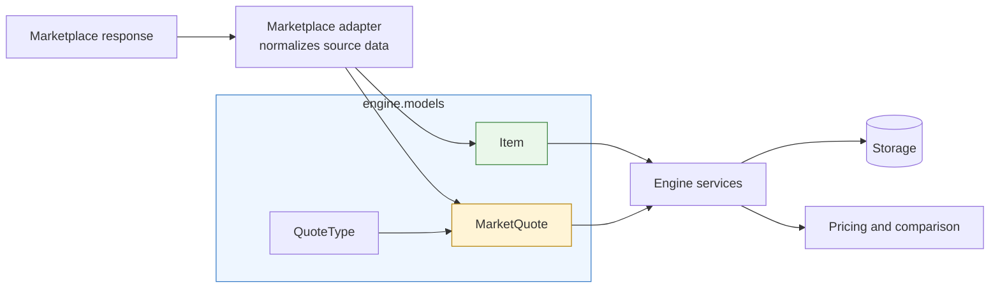
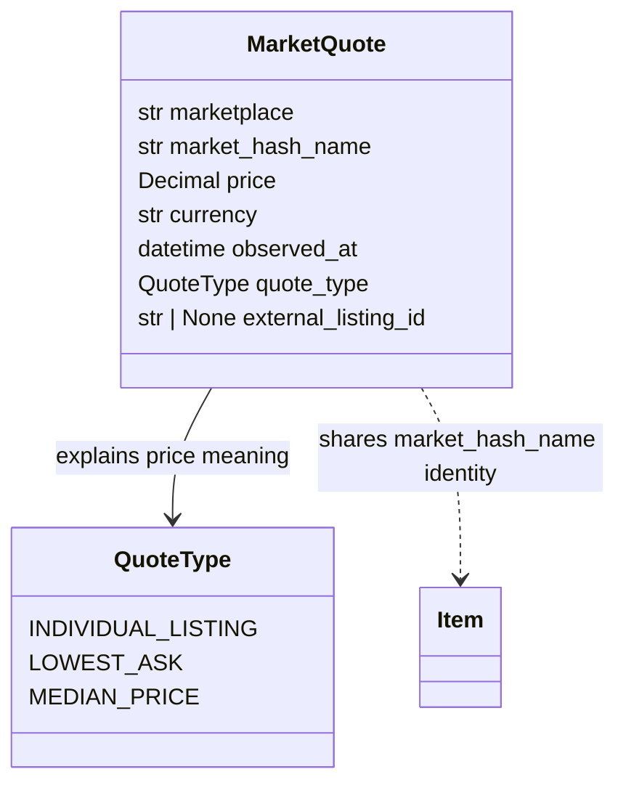
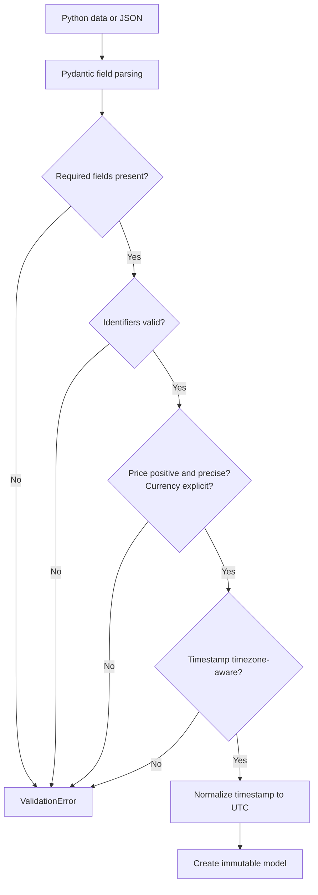
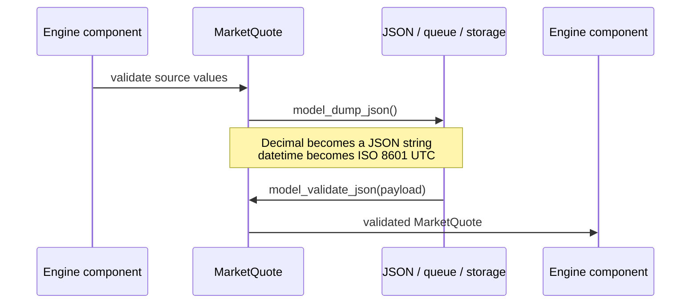

# Domain models

This package defines the small, shared vocabulary used to move item and price data through the
engine. It represents data only: models do not fetch marketplace data, calculate fees, convert
currencies, persist records, or schedule work.

## Architecture at a glance



The adapter, service, storage, and pricing boxes show expected consumers and producers. They are
not implemented by this package. The models remain independent of each of those concerns.

| Code | Responsibility | Deliberately does not do |
|---|---|---|
| [`item.py`](item.py) | Defines canonical CS2 item identity | Parse wear, StatTrak, stickers, patterns, or floats |
| [`quote.py`](quote.py) | Defines normalized monetary observations and their meaning | Convert currencies, add fees, or compare prices |
| [`__init__.py`](__init__.py) | Exposes the supported public API | Export internal validation types |
| [`test_item.py`](../../tests/test_item.py) | Specifies item identity and validation behaviour | Test marketplace-specific catalog payloads |
| [`test_market_quote.py`](../../tests/test_market_quote.py) | Specifies quote validation, semantics, and serialization | Call live APIs or require credentials |

Consumers should import from the package rather than its files:

```python
from engine.models import Item, MarketQuote, QuoteType
```

## `Item`: canonical identity

[`Item`](item.py#L17) has one field:

| Field | Type | Meaning |
|---|---|---|
| `market_hash_name` | `str` | Steam's exact market-facing identifier for a tradable item variant |

The market hash name is the V1 canonical identifier because it already distinguishes the variants
that matter when matching normal listings:

```mermaid
flowchart TD
    Base[AK-47 | Redline] --> FT[AK-47 | Redline<br/>Field-Tested]
    Base --> MW[AK-47 | Redline<br/>Minimal Wear]
    FT --> Normal[Normal]
    FT --> ST[StatTrak]

    Normal -->|different identifier| NID[AK-47 | Redline<br/>Field-Tested]
    ST -->|different identifier| SID[StatTrak AK-47 | Redline<br/>Field-Tested]
```

The real strings include punctuation such as parentheses and the `™` symbol; the diagram shortens
them for readability. Equality is exact and case-sensitive. Two independently constructed `Item`
instances with the same `market_hash_name` compare equal, while wear and StatTrak variants remain
different. These behaviours are covered by the
[`Item` identity tests](../../tests/test_item.py#L13).

The shared [`MarketHashName`](item.py#L14) annotated type rejects:

- Missing identifiers.
- Empty or whitespace-only identifiers.
- Leading or trailing whitespace that could cause a failed marketplace match.
- Non-string values rejected by Pydantic's string validation.

The model does not strip or case-fold the identifier because silently changing canonical identity
could cause two different marketplace records to be compared.

## `MarketQuote`: one price observation

[`MarketQuote`](quote.py#L24) represents one normalized observation made at a particular time.



| Field | Required | Meaning and validation |
|---|---:|---|
| `marketplace` | Yes | Lowercase source identifier such as `steam` or `skinport`; letters, digits, `.`, `_`, and `-` are supported |
| `market_hash_name` | Yes | Exact canonical item identifier, with the same validation used by `Item` |
| `price` | Yes | Finite `Decimal` greater than zero; Python `float` input is rejected |
| `currency` | Yes | Explicit uppercase three-letter code such as `GBP` or `USD` |
| `observed_at` | Yes | Timezone-aware observation timestamp, normalized to UTC |
| `quote_type` | Yes | Meaning of the observed price; see the next section |
| `external_listing_id` | No | Marketplace's listing identifier when the observation refers to a specific listing |

The field constraints are declared next to the model in
[`quote.py`](quote.py#L19), while validation that needs code is kept in the three focused validators
starting at [`MarketQuote.reject_float_price`](quote.py#L37).

### Quote meaning is part of the data

A directly purchasable listing, the lowest current ask, and a market median are not interchangeable.
[`QuoteType`](quote.py#L11) preserves that distinction:

| Type | Meaning | Directly purchasable? |
|---|---|---:|
| `INDIVIDUAL_LISTING` | Price attached to one marketplace listing | Usually yes |
| `LOWEST_ASK` | Lowest asking price observed across active listings | Not necessarily; the underlying listing may change or disappear |
| `MEDIAN_PRICE` | Marketplace-reported median across its sample or time window | No |

Code that compares quotes must decide which types are compatible. The model intentionally does not
make that business decision. The distinction itself is tested in
[`test_different_quote_types_do_not_compare_equal`](../../tests/test_market_quote.py#L96).

## Validation flow



Both models use `extra="forbid"` and `frozen=True`; see [`Item` configuration](item.py#L20) and
[`MarketQuote` configuration](quote.py#L27). This catches misspelled fields at the boundary and
prevents identity or observation data from changing after validation.

### Money

Prices use [`Decimal`](quote.py#L21), not `float`. Marketplace adapters should convert source data
without first losing precision:

```python
from decimal import Decimal

raw_minor_units = 2239
price = Decimal(raw_minor_units) / Decimal(100)
```

If an API parser has already produced a decimal-looking string, pass the string directly. Python
`float` values are rejected because their binary representation may already have lost information.
No currency is assumed, and this package never converts one currency into another.

### Time

`observed_at` answers when the marketplace value was observed, rather than when a later service
stored or processed it. Naive timestamps are rejected; an offset or timezone must be supplied. The
validator then converts the instant to UTC in
[`normalize_observed_at`](quote.py#L44), giving downstream code one consistent comparison basis.

## Constructing models

An adapter can normalize marketplace-style data without placing source-specific fields in the
domain model:

```python
from datetime import UTC, datetime
from decimal import Decimal

from engine.models import Item, MarketQuote, QuoteType

market_hash_name = "AK-47 | Redline (Field-Tested)"

item = Item(market_hash_name=market_hash_name)
quote = MarketQuote(
    marketplace="skinport",
    market_hash_name=item.market_hash_name,
    price=Decimal("22.39"),
    currency="GBP",
    observed_at=datetime.now(UTC),
    quote_type=QuoteType.LOWEST_ASK,
)
```

The representative normalization test is
[`test_representative_marketplace_data_normalizes_without_source_dependencies`](../../tests/test_market_quote.py#L155).

## Serialization

Pydantic supplies serialization and deserialization; there is no separate schema framework.



```python
payload = quote.model_dump_json()
restored = MarketQuote.model_validate_json(payload)

assert restored == quote
```

Encoding `Decimal` as a JSON string prevents an intermediate JSON number from introducing
floating-point rounding. The complete round-trip behaviour is exercised by
[`test_market_quote_json_round_trip_is_lossless`](../../tests/test_market_quote.py#L138).

## Design reasoning

| Decision | Reason |
|---|---|
| Pydantic models | Provides validation, enum handling, comparison, and serialization without custom infrastructure |
| One canonical item field | Avoids duplicated wear or StatTrak state disagreeing with the actual marketplace identifier |
| Shared identifier validation | `Item` and `MarketQuote` cannot apply different rules to the same identity |
| Immutable models | An observation cannot change meaning after being handed to another component |
| `Decimal` and no float input | Maintains monetary precision across normalization and serialization |
| Required currency | Prevents an unlabelled number from being interpreted in the wrong currency |
| Aware timestamps normalized to UTC | Makes ordering and comparison unambiguous without assuming a source timezone |
| Small `QuoteType` enum | Preserves currently important semantics without predicting every marketplace metric |
| Optional listing ID | Supports listing-level observations without requiring an ID for aggregate quotes |
| Reject unknown fields | Surfaces misspellings and accidental marketplace leakage instead of silently discarding it |

## Where to make changes

- Change canonical item identity rules in [`item.py`](item.py). Because `MarketQuote` reuses
  `MarketHashName`, both models stay consistent.
- Add a price-observation meaning to [`QuoteType`](quote.py#L11), then add semantic and
  serialization coverage in [`test_market_quote.py`](../../tests/test_market_quote.py).
- Add a genuinely shared domain field to the relevant model, not to a marketplace adapter payload.
- Export a new supported model through [`__init__.py`](__init__.py).
- Keep fetching, retries, persistence, calculations, and scheduling outside this package.

Before adding a field, ask whether every engine consumer needs the information and whether its
meaning is marketplace-independent. If either answer is no, it normally belongs at an adapter or
service boundary instead.

## Deliberate limitations

The V1 models do not represent:

- Float value, paint seed, stickers, charms, or comprehensive CS2 metadata.
- Parsed wear and StatTrak fields separate from `market_hash_name`.
- Marketplace fees, converted prices, or calculated profitability.
- Mean, suggested, historical, bid, or order-book quote types.
- Database IDs, ORM state, job definitions, or API response schemas.

These can be added when a concrete integration or service establishes the necessary semantics.

## Tests

Run the full backend suite from `backend/`:

```bash
python -m pytest -q
```

Run only this module's tests:

```bash
python -m pytest -q tests/test_item.py tests/test_market_quote.py
```

The suite covers construction, required fields, identity consistency, variant distinction,
monetary precision, currency and marketplace validation, timezone handling, quote semantics,
immutability, representative normalization, and lossless JSON round-tripping.
