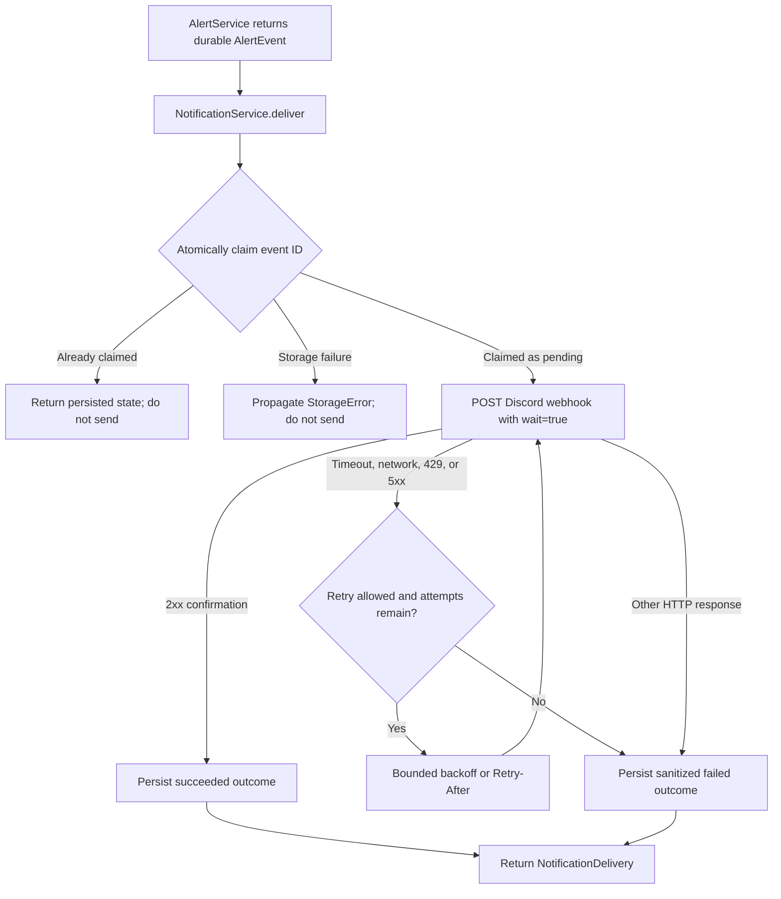

# NotificationService

`NotificationService` delivers an existing durable `AlertEvent` to one configured Discord
webhook and records the delivery outcome through `StorageService`. It is deliberately separate
from alert evaluation: `AlertService` decides whether an event exists; this module only claims,
formats, sends, and records that event.

V1 has one external channel and one destination. It does not analyze prices, fetch marketplaces,
schedule work, or create background workers.

## Delivery flow



## Source files

- [`models.py`](models.py) defines `DeliveryStatus`, `DeliveryFailureCode`, and the immutable
  `NotificationDelivery` outcome model.
- [`service.py`](service.py) defines `NotificationPolicy`, the injected `NotificationStorage`
  protocol, and `NotificationService`.
- [`__init__.py`](__init__.py) exposes the supported public API.
- [`../storage/models.py`](../storage/models.py) contains the private
  `NotificationDeliveryRecord` SQLAlchemy mapping.
- [`../storage/service.py`](../storage/service.py) implements delivery claiming, lookup, and
  completion.
- [`../config/settings.py`](../config/settings.py) loads the Discord webhook as a `SecretStr`.
- [`../../tests/test_notification_service.py`](../../tests/test_notification_service.py) contains
  mocked-provider, fake-storage, and real-SQLite tests.

## Public interface

`NotificationService.deliver(event)` is the only delivery operation. It accepts the existing
[`AlertEvent`](../alerts/models.py) model and returns a `NotificationDelivery`. A returned
`succeeded` or `failed` result has been persisted. Storage errors are propagated, so callers are
never told a result is durable when it is not.

`NotificationPolicy` controls:

- Maximum attempts, defaulting to 3.
- Per-request timeout, defaulting to 10 seconds.
- Exponential backoff, starting at 0.5 seconds and capped at 5 seconds.
- The longest accepted provider `Retry-After`, defaulting to 60 seconds.

The caller creates and owns one shared `httpx.AsyncClient`. The service neither creates a client
per event nor closes the injected client.

## Delivery and retry semantics

The service sets Discord's `wait=true` query parameter. Discord documents that this makes the
endpoint wait for server confirmation; without it, a message that was not saved might not produce
an error. Any HTTP 2xx response is treated as confirmed success.

The following failures are retried inline while the attempt budget remains:

| Failure | Retry delay |
|---|---|
| `httpx.TimeoutException` | Bounded exponential backoff |
| Other `httpx.RequestError` | Bounded exponential backoff |
| HTTP 5xx | Bounded exponential backoff |
| HTTP 429 | `Retry-After` header, then JSON `retry_after`, then bounded backoff |

Other HTTP responses are non-retryable. Response bodies and raw exception messages are not stored.
If a 429 asks for a delay longer than `max_retry_after_seconds`, V1 records failure instead of
retrying before the provider's requested time.

Cancellation is not caught by a broad exception handler. It propagates immediately and leaves the
durable claim `pending`, accurately representing an unknown outcome rather than a false failure or
success.

## Persistence and delivery guarantees

`StorageService` owns a `notification_deliveries` table with one row per alert-event ID. Each row
contains the channel, status, attempt count, start and completion timestamps, and optional
sanitized failure code/detail. Its event ID references the existing durable `alert_events` row.

The storage methods used by the service are:

- `claim_notification_delivery()` atomically inserts the initial `pending` row. A primary-key
  conflict means another caller or earlier invocation already claimed the event.
- `get_notification_delivery()` reads the existing state for duplicate calls.
- `complete_notification_delivery()` changes a pending claim to `succeeded` or `failed`.

This prevents concurrent callers in the same database from intentionally sending the same event
twice. It does not provide exactly-once external delivery: SQLite and Discord cannot participate in
one transaction. If Discord accepts a message and the process stops before success is persisted,
the row remains `pending`; repeating delivery is suppressed because sending again might duplicate
the accepted message. A completion-storage failure is propagated for the same reason.

There is no durable retry scheduler. Bounded retries happen only inside the active `deliver()`
call, and a final failure remains queryable for future operational tooling.

## Security considerations

- `EngineSettings.discord_webhook_url` is optional and typed as Pydantic `SecretStr`.
- The service accepts only HTTPS URLs on `discord.com` whose path matches a Discord webhook.
- Query strings, fragments, user information, alternate hosts, and nonstandard ports are rejected.
- The URL and provider response body are never persisted or included in failure details.
- An `httpx` logging filter redacts Discord webhook tokens from the client's standard request log.
- Discord payloads disable all allowed mentions, preventing item text from notifying users or
  roles unexpectedly.
- The example environment file contains a placeholder, not a usable credential.

Treat the whole webhook URL as a credential. Configure `CS2_DISCORD_WEBHOOK_URL` through the
environment, `.env`, or the existing Docker Secrets settings source.

## Design reasoning

The service uses a small structural storage protocol instead of a channel manager or factory.
Discord-specific formatting and HTTP behavior stay local to the module while fake storage and
mocked transports remain easy to inject in tests.

The delivery claim is written before the external request. This ensures a database outage cannot
cause an untracked send and gives duplicate calls one durable coordination point. Final provider
failures are values rather than exceptions because they are expected, persisted outcomes; invalid
configuration and storage contract failures remain exceptions.

`AlertEvent` is consumed unchanged. Notification code does not re-evaluate its condition or look up
current prices, so the event remains the immutable record of what triggered the message.

## Example usage

```python
import httpx

from engine.config import EngineSettings
from engine.notifications import NotificationService
from engine.storage import StorageService

settings = EngineSettings()

async with StorageService(
    settings.database_path,
    busy_timeout_seconds=settings.database_busy_timeout_seconds,
) as storage:
    async with httpx.AsyncClient() as http_client:
        notifications = NotificationService(
            storage,
            http_client,
            discord_webhook_url=settings.discord_webhook_url,
        )
        for event in alert_events:
            outcome = await notifications.deliver(event)
            if outcome.status.value == "failed":
                # Surface the persisted, sanitized failure to the operator.
                report_delivery_failure(outcome)
```

Missing credentials or an invalid URL fail during service construction, before any event is
claimed or request is made.

## Testing

From `backend/`:

```bash
.venv/bin/python -m pytest -q tests/test_notification_service.py
.venv/bin/python -m pytest -q
```

The notification module has **21 passing tests**. The complete backend suite has **411 passing
tests**. Tests use `httpx.MockTransport`, fake storage, and temporary SQLite databases; they make no
real network requests and require no credentials.

Coverage includes confirmed success, destination validation, missing credentials, network failure,
timeouts, HTTP 429 delays, non-retryable errors, retry exhaustion, durable success/failure state,
claim and completion storage failures, duplicate suppression, cancellation, multiple independent
events, secret-safe logs, concurrent SQLite claims, and compatibility with existing `AlertEvent`
objects.

## Known limitations

- Discord is the only external V1 channel. Offline demo mode uses a simulated sender that writes a
  successful `demo` delivery without making a network request.
- Bootstrap wires notification delivery after persisted lowest-ask alert evaluation. There is no
  independent event-dispatch worker for replaying older durable events.
- There is no automatic recovery, lease, operator acknowledgement, dead-letter queue, or dashboard
  for `pending` and `failed` records.
- A network failure can be ambiguous: Discord may accept a request even if the client does not
  receive the response. Inline retry can therefore still produce a duplicate message.
- Exactly-once external delivery is not claimed or achievable with the current storage/provider
  boundary.
- Tables use the repository's existing `create_all` lifecycle. A deployment that later adopts
  schema migrations must include `notification_deliveries` in that migration system.
