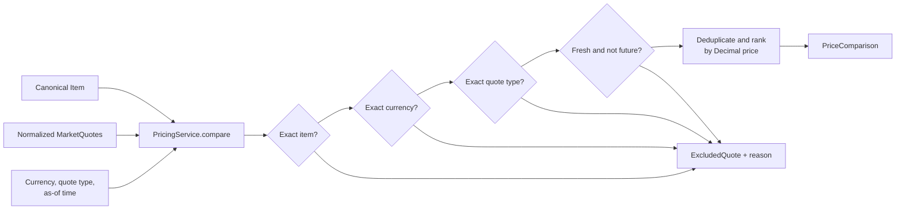

# Engine services

## CollectionService

`CollectionService` is the small orchestration boundary between fetch jobs and registered
marketplace adapters. It selects one marketplace, applies that provider's request policy, awaits
its `fetch()` operation, and returns the resulting `MarketQuote` objects unchanged.

```text
FetchMarketJob -> CollectionService -> MarketplaceRegistry -> Marketplace.fetch(Item)
```

The service does not create marketplace implementations, normalize source payloads, store quotes,
rank prices, schedule recurring work, or create another worker pool. `JobHandler` remains responsible
for overall engine concurrency; collection policies govern only provider-specific requests.

### CollectionService public interface

```python
from engine.services import CollectionPolicy, CollectionService

service = CollectionService(
    marketplace_registry,
    policies={
        "documented-provider-id": CollectionPolicy(
            max_concurrency=2,
            minimum_interval_seconds=0.5,
        )
    },
)

quotes = await service.collect("documented-provider-id", item)
```

The registry is injected and looked up for every collection call. The service never constructs a
concrete adapter. Registry lookup errors propagate unchanged, and an empty list is a successful
marketplace response rather than an error.

One long-lived service instance should be shared by all collection jobs in an engine process. Its
per-provider semaphores, admission times, and retry delays are then shared across those calls.
Constructing a separate service per job would intentionally create separate controls.

### Provider policies

`CollectionPolicy` is immutable and can be supplied independently for each registry identifier.

| Field | Default | Meaning |
|---|---:|---|
| `max_concurrency` | `None` | Maximum in-flight requests for this provider; `None` adds no assumed quota |
| `minimum_interval_seconds` | `0` | Minimum spacing between request starts for this provider |
| `max_attempts` | `3` | Total attempts, including the initial request |
| `initial_backoff_seconds` | `0.25` | Delay after the first retryable failure |
| `backoff_multiplier` | `2` | Exponential backoff factor |
| `max_backoff_seconds` | `5` | Maximum local retry delay |
| `retryable_exceptions` | connection and timeout errors | Failures eligible for retry |

There are no built-in marketplace quotas. Concurrency is unlimited and request spacing is disabled
unless configuration supplies documented restrictions. A semaphore limits simultaneous requests;
the monotonic admission gate separately implements request spacing. Controls are independent, so a
limited provider never holds a global lock or prevents another provider from running.

The mapping is constructor configuration rather than part of `EngineSettings` because provider
quotas and exception types belong to marketplace integration/bootstrap configuration. No shared
configuration files or interfaces are changed by this module.

### Failures, retries, and `Retry-After`

Only configured retryable exception classes are retried. Authentication, invalid input, parsing,
and other failures therefore propagate immediately unless a caller explicitly misclassifies them.
Retries are bounded and use capped exponential backoff. When a retryable exception exposes a valid
non-negative `retry_after` or `retry_after_seconds` value, the provider's shared admission time is
deferred so subsequent requests respect it. Invalid retry metadata is ignored rather than masking
the original provider failure.

After the final attempt, the final provider exception is re-raised with its original type and
traceback. The service never turns a failure into an empty list.

HTTP-client timeouts remain owned by marketplace adapters. CollectionService does not add an outer
timeout that could conflict with connect/read/pool timeout behavior. Built-in `TimeoutError` is
retryable by default; marketplace-specific timeout types can be included in that provider's policy.

`asyncio.CancelledError` is not caught or retried. Cancellation while waiting for a permit, request
spacing, retry delay, or `fetch()` propagates to the job system. Async context managers release any
acquired semaphore permit on cancellation and on ordinary failures.

### CollectionService testing

Collection tests register fake async marketplaces through the concrete `MarketplaceRegistry`. They
cover unchanged and empty results, lookup errors, retry classification and exhaustion, timeout and
retry-delay handling, cancellation, per-provider concurrency and spacing, cross-provider isolation,
and resource release. Clocks and sleep are injected in timing tests, so no network, credentials,
database, scheduler, job handler, or wall-clock delays are involved.

Run from `backend/`:

```bash
python -m pytest -q tests/test_collection_service.py
python -m pytest -q
```

## MarketplaceComparisonService

[`MarketplaceComparisonService`](comparison.py) is the compatibility orchestration used by the
existing React UI. It resolves an exact catalog item, concurrently fetches Steam and Skinport
aggregate snapshots, and asks `PricingService` to compare their GBP `LOWEST_ASK` quotes. It returns
provider statistics alongside the strict pricing result; FastAPI alone maps that value to the
frontend's numeric JSON shape.

The service does not persist these on-demand snapshots. Scheduled watchlist collection uses the
same registered Steam and Skinport providers through `CollectionService` and `FetchMarketJob`, and
that separate path persists quotes. A missing catalog/Skinport item raises
`ComparisonNotFoundError`; normalized marketplace errors propagate to the API's `502` mapping.

## PricingService

[`PricingService`](pricing.py) turns normalized [`MarketQuote`](../models/quote.py) objects into a
deterministic, pre-fee [`PriceComparison`](pricing.py). It performs no fetching, persistence,
scheduling, currency conversion, or marketplace-specific processing.



### Files

```text
backend/
├── engine/services/
│   ├── __init__.py
│   ├── collection.py
│   ├── pricing.py
│   └── README.md
└── tests/
    ├── test_collection_service.py
    └── test_pricing_service.py
```

- [`pricing.py`](pricing.py) contains the service, result models, and exclusion reasons.
- [`__init__.py`](__init__.py) exposes the supported public interface.
- [`test_pricing_service.py`](../../tests/test_pricing_service.py) contains deterministic unit and
  domain-model integration tests.

### PricingService public interface

Construct the service with the maximum acceptable age for an observation, then call its only
operation:

```python
from datetime import UTC, datetime, timedelta

from engine.models import Item, QuoteType
from engine.services import PricingService

service = PricingService(max_quote_age=timedelta(minutes=5))
comparison = service.compare(
    Item(market_hash_name="AK-47 | Redline (Field-Tested)"),
    quotes,
    currency="GBP",
    quote_type=QuoteType.LOWEST_ASK,
    as_of=datetime.now(UTC),
)
```

`compare()` is synchronous and has no hidden clock: the caller supplies `as_of`, making the same
input produce the same result. [`PriceComparison`](pricing.py) contains:

| Field | Meaning |
|---|---|
| `item`, `currency`, `quote_type` | Exact comparison group requested by the caller |
| `as_of`, `max_quote_age` | Freshness policy used for this result |
| `quotes` | Eligible quotes ordered from lowest to highest price |
| `excluded_quotes` | Rejected quotes and their first incompatibility reason |
| `lowest_price`, `highest_price`, `spread` | Exact `Decimal` summary values, or `None` when empty |
| `best_quote` | Convenience property returning the first ranked quote, or `None` |

An empty or wholly incompatible input returns a valid empty comparison. Invalid request types,
currency syntax, naive `as_of` timestamps, or non-positive freshness windows raise `TypeError` or
`ValueError` at the service boundary.

### Comparison rules

Comparability is deliberately strict:

1. `market_hash_name` must exactly equal the supplied `Item` identity. Wear, StatTrak, and other
   variants therefore remain separate.
2. Currency must exactly match the requested uppercase ISO-style three-letter code. No implicit
   exchange rate is used.
3. Quote type must exactly match the requested `QuoteType`. An individual listing, lowest-ask
   aggregate, and median statistic are never mixed in one ranking.
4. A quote is fresh when `0 <= as_of - observed_at <= max_quote_age`. The boundary is inclusive;
   older and future-dated observations are reported separately.
5. Exact repeated observations are included once. The repeated copies are marked `DUPLICATE`.
   A listing observed at two different times remains two observations.
6. Eligible prices are sorted ascending. Equal prices use marketplace, observation time, and
   listing ID as deterministic tie-breakers.

All calculations retain the original `Decimal` values. The service does not quantize or silently
round. `spread` is `highest_price - lowest_price`; it is not a claim of profit.

`LOWEST_ASK` identifies the cheapest marketplace-reported ask but does not guarantee the listing is
still available. Use a separate `INDIVIDUAL_LISTING` comparison when the caller specifically wants
listing-level observations. `MEDIAN_PRICE` can be ranked against other medians when explicitly
requested, but it is never described as purchasable.

### Currency and fees

V1 compares one currency at a time and preserves every quote's original currency. It accepts no
exchange-rate table and never calls an exchange-rate service.

Results are **pre-fee**. No marketplace percentages, payout assumptions, wallet-to-cash equivalence,
or sale proceeds are inferred. The current `QuoteType` model has no bid quote, so the service does
not expose a sell-price or arbitrage operation.

### Representative scenarios

- Three fresh GBP lowest asks for the same exact item are ordered by price and summarized with an
  exact spread.
- A USD quote in a GBP comparison appears in `excluded_quotes` as `DIFFERENT_CURRENCY`.
- A median alongside lowest asks is marked `DIFFERENT_QUOTE_TYPE`, preventing a historical or
  aggregate statistic from becoming the apparent best buy.
- A quote just inside the configured age is eligible; one microsecond beyond it is `STALE`.
- If every quote is incompatible, `quotes` is empty and all summary prices are `None`.

### Design tradeoffs

Requiring one quote type per call is more explicit than trying to assign marketplace-specific
confidence scores. Returning exclusions makes data loss observable while keeping the result small.
Supplying `as_of` and the freshness duration on opposite sides of the service boundary makes the
policy configurable without adding settings or a clock abstraction. Exact duplicate detection is
conservative: the service does not guess that two similar quotes without listing IDs are the same
listing.

### PricingService testing

From `backend/`, run:

```bash
python -m pytest -q tests/test_pricing_service.py
python -m pytest -q
```

The implementation was verified with Python 3.12 as part of the **406-test** backend suite. Pricing
tests use synthetic data and require no network, database, credentials, or running marketplace.

### Known limitations and extension points

- Availability can change after observation; ranking does not reserve or validate a listing.
- Tax, deposit, withdrawal, network, conversion, and marketplace fees are absent.
- There is no currency conversion, sell-side quote type, profit calculation, recommendation, or
  historical forecasting.
- Canonical identity is only as detailed as `market_hash_name`; sticker, paint-seed, and float
  distinctions are unavailable unless already encoded in that identifier.

Future pricing rules should remain explicit inputs. A reliable exchange-rate mapping could be
supplied to a separate conversion step that preserves original values. Verified fee schedules and
sell-side comparisons should be added only after the domain model can distinguish gross asks,
bids, buyer cost, wallet proceeds, and withdrawable proceeds. New exclusion rules can extend
[`QuoteExclusionReason`](pricing.py) and `_exclusion_reason()` with focused test cases.
