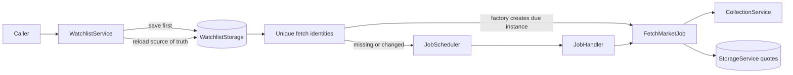
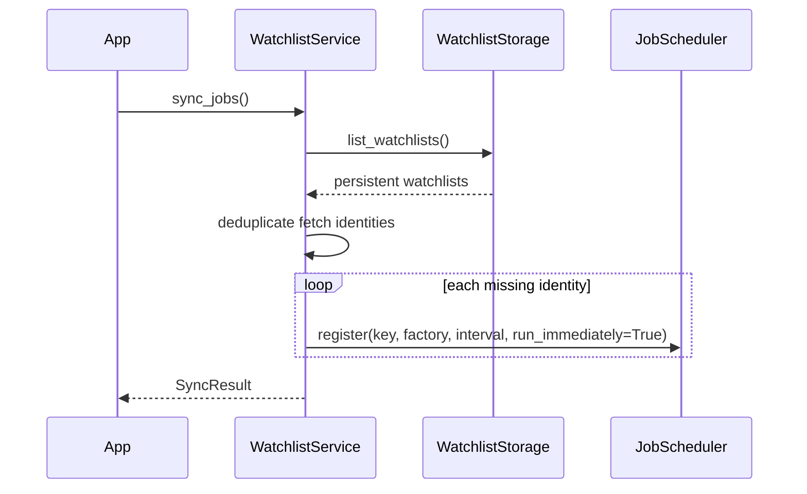

# Watchlist service

`WatchlistService` owns persistent monitoring configuration and keeps recurring market-fetch
schedules consistent with it. It does not fetch marketplace data, execute jobs, or persist database
rows itself.

The service exists because a watchlist and a running schedule have different lifetimes. Watchlists
must survive application restarts, while scheduler registrations are temporary process state that
can always be reconstructed.

## Problems it solves

- Creates and deletes named watchlists.
- Adds and removes monitored CS2 items.
- Associates each item with one or more registered marketplaces.
- Deduplicates equivalent marketplace/item fetches across watchlists.
- Selects the shortest requested interval when watchlists share a fetch.
- Reconciles schedules after changes and restores them at startup.
- Leaves saved configuration recoverable when scheduling partially fails.
- Does not cancel a fetch that is already queued or running.

## Watchlist-to-job flow



The V1 fetch identity is the marketplace identifier plus the exact Steam market hash name. Its key
matches the fetch-job convention:

```text
fetch-market:{URL-encoded marketplace}:{URL-encoded market_hash_name}
```

The current [`Marketplace.fetch()` contract](../marketplaces/base.py) accepts only an
[`Item`](../models/item.py), so there are no additional request parameters in V1. If that contract
gains material query parameters, they must become part of the fetch identity before watchlists use
them.

## Startup restoration

Call `sync_jobs()` after durable storage is ready and before or during scheduler startup. New
registrations use `run_immediately=True`, allowing the engine to populate quotes promptly.



## Source structure

| File | Responsibility |
|---|---|
| [`models.py`](models.py) | Immutable `Watchlist` and `WatchlistItem` configuration models |
| [`service.py`](service.py) | Storage contract, mutations, validation, and schedule reconciliation |
| [`__init__.py`](__init__.py) | Public package exports |
| [`test_watchlist_service.py`](../../tests/test_watchlist_service.py) | Isolated behavior and failure-recovery tests |

The package composes the existing [`EngineJob`](../jobs/base.py),
[`JobScheduler`](../jobs/scheduler.py), [`JobHandler`](../jobs/handler.py),
[`MarketplaceRegistry`](../marketplaces/registry.py), and [`Item`](../models/item.py) APIs without
changing them.

## Public models and service methods

`Watchlist` contains:

- `id: UUID`
- `name: str`
- `interval_seconds: float`
- `items: tuple[WatchlistItem, ...]`

`WatchlistItem` contains one immutable `Item` and a non-empty `frozenset[str]` of marketplaces.
Models reject blank names, non-positive intervals, empty marketplace sets, and duplicate items.

`WatchlistService` exposes:

| Method | Behavior |
|---|---|
| `create_watchlist(name, interval_seconds=...)` | Saves an empty watchlist |
| `list_watchlists()` | Returns persistent configuration |
| `delete_watchlist(id)` | Deletes configuration, then reconciles jobs |
| `add_item(id, item, marketplaces)` | Adds an item or unions marketplaces idempotently |
| `remove_item(id, item)` | Removes the item and all its marketplace associations |
| `set_item_marketplaces(id, item, marketplaces)` | Replaces associations for an existing item |
| `set_interval(id, seconds)` | Changes the requested interval |
| `sync_jobs()` | Restores or reconciles schedules from storage |

`SyncResult` reports registration, interval-update, unregistration, and unchanged counts.
`WatchlistSyncError.failures` reports each scheduler operation that failed after reconciliation made
as much progress as possible.

## Deduplication and synchronization

The service always derives desired schedules from all stored watchlists rather than incrementing and
decrementing reference counts:

1. Load every persistent watchlist.
2. Build unique marketplace/item fetch identities.
3. For shared identities, retain the shortest requested interval.
4. Register identities not currently owned by this service.
5. Replace owned registrations whose interval changed.
6. Unregister owned identities that are no longer required.

Repeated synchronization is idempotent. Removing one of two shared entries keeps the common job.
Removing the last entry unregisters it. Marketplace identifiers are checked through
`MarketplaceRegistry` before a caller's mutation is saved, and persisted data is checked again while
restoring schedules.

The service tracks only registrations it successfully created. It therefore never removes an
unrelated scheduler registration. This works with the scheduler's existing public interface, but a
new `WatchlistService` attached to an already populated scheduler cannot inspect or adopt those
registrations. Normal startup creates a fresh scheduler and restores into it.

## Database versus scheduler responsibilities

| Persistent database | In-memory scheduler |
|---|---|
| Source of truth | Reconstructable execution state |
| Watchlist identity and name | Job factories |
| Requested interval | Monotonic next-run times |
| Items and marketplace associations | Awaiting/running state |
| Survives restart | Discarded at shutdown |

Every mutation saves before touching the scheduler. A storage failure therefore leaves schedules
unchanged. A later scheduler failure leaves the newly saved configuration available for another
`sync_jobs()` call.

## Failure and recovery

| Failure | Result | Recovery |
|---|---|---|
| Marketplace identifier is unknown | Mutation is rejected before persistence | Register or correct the marketplace |
| Storage save/delete fails | Scheduler is not reconciled | Retry the persistent mutation |
| Loading watchlists fails | No reconciliation begins | Restore storage and call `sync_jobs()` |
| One registration fails | Other independent registrations still proceed | Call `sync_jobs()` again |
| Interval replacement fails after unregister | Saved configuration remains authoritative | A later sync registers the missing schedule |
| Unregistration fails | Ownership is retained for retry | A later sync retries removal |
| Item is removed during an active fetch | Future submissions stop; active work continues | No action required |

`JobScheduler.unregister()` deliberately does not cancel accepted work. The handler's stable-key
deduplication also prevents a changed registration from overlapping an already active fetch.

## Storage integration

[`StorageService`](../storage/service.py) implements the `WatchlistStorage` protocol with these
operations:

```python
async def list_watchlists() -> list[Watchlist]: ...
async def get_watchlist(watchlist_id: UUID) -> Watchlist | None: ...
async def save_watchlist(watchlist: Watchlist) -> None: ...
async def delete_watchlist(watchlist_id: UUID) -> bool: ...
```

`save_watchlist()` atomically creates or replaces the watchlist, its items, and its marketplace
associations. `delete_watchlist()` atomically removes the aggregate. Database errors use the
existing `StorageError` hierarchy. [`MarketEngine`](../market_engine.py) calls `sync_jobs()` after
storage and workers are ready and before starting the scheduler.

`FetchMarketJob` is supplied through the `FetchJobFactory` dependency. Application composition can
provide a lambda that constructs the concrete job with its shared `CollectionService` and
`StorageService`; the watchlist service never invokes that factory itself.

## Architectural tradeoffs

- Whole-aggregate persistence keeps the V1 storage contract and service small. Multiple processes
  editing the same watchlist would require optimistic concurrency or transactional mutation methods.
- The shortest shared interval favors freshness and preserves deduplication, at the cost of fetching
  more often than slower watchlists individually require.
- Internal schedule ownership avoids scheduler changes and protects unrelated jobs. It cannot detect
  external tampering with registrations during the service's lifetime.
- Fetch-job construction is injected because execution and HTTP behavior belong outside this module.

## Tests

From `backend/`, with the project dependencies installed:

```bash
python -m pytest -q tests/test_watchlist_service.py
python -m pytest -q
```

Latest implementation run:

- Watchlist module: **24 passed**
- Complete backend suite: **374 passed**

The suite uses fake storage, scheduler, jobs, and marketplaces. It also uses the real scheduler and
handler for the active-fetch removal case. No live marketplace API is called.
