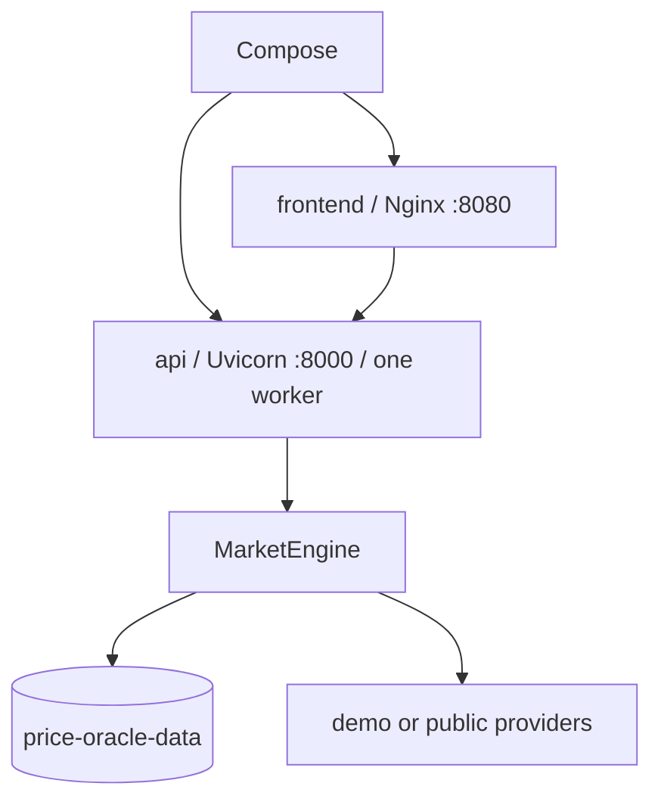

# Docker deployment

The supported deployment is the root [`compose.yaml`](../../compose.yaml). It starts:

- `api`: one non-root FastAPI process owning one `MarketEngine`, scheduler, worker pool, and SQLite
  connection boundary;
- `frontend`: the production React bundle served by Nginx, with `/api` proxied to `api`;
- `price-oracle-data`: the persistent named volume containing SQLite and provider caches.

No `.env`, Docker Secret, API key, marketplace account, or webhook is required.

```bash
docker compose up --build -d
docker compose ps
curl --fail http://127.0.0.1:8000/api/health
```

Open <http://127.0.0.1:5173>. Both published ports bind to loopback by default. Override them with
`CS2_FRONTEND_PORT` and `CS2_API_PORT` when necessary.

## Lifecycle and persistence



The API health check gates frontend startup. `init: true` forwards termination, and FastAPI's
lifespan stops the scheduler, drains bounded jobs, closes HTTP clients, and disposes SQLite.

```bash
docker compose logs -f api frontend
docker compose restart api            # database remains
docker compose down                   # volume remains
docker compose down --volumes         # destructive reset
```

The default demo database is `/var/lib/price-oracle/demo.sqlite3`. WAL and SHM files share the
volume. The image directory is owned by UID/GID 10001 and the API runs as that unprivileged user.

## Modes

Offline demo is the default and does not construct live provider or remote catalog clients:

```dotenv
CS2_OPERATING_MODE=demo
CS2_DEMO_SEED_ENABLED=true
CS2_DATABASE_PATH=/var/lib/price-oracle/demo.sqlite3
```

Public mode is explicit. Use a separate file from demo data:

```bash
CS2_OPERATING_MODE=public \
CS2_DATABASE_PATH=/var/lib/price-oracle/public.sqlite3 \
docker compose up --build -d
```

Steam, Skinport, and CSFloat flags only affect public mode. None requires a placeholder key.
Failures stay attached to their scheduled provider job and do not terminate the scheduler.

## Optional secrets

Environment values and ignored dotenv files work, but Docker Secrets avoid exposing values in
container environment inspection. Copy [`compose.secrets.yaml.example`](../../compose.secrets.yaml.example),
delete entries you do not use, and create only the referenced ignored files:

```bash
mkdir -p secrets
chmod 700 secrets
# Populate secrets/CS2_CSFLOAT_API_KEY and/or secrets/CS2_DISCORD_WEBHOOK_URL safely.
chmod 600 secrets/CS2_*
docker compose -f compose.yaml -f compose.secrets.yaml up --build -d
```

The base file mounts no secrets. Pydantic reads matching `CS2_` files from `/run/secrets`; normal
environment and dotenv values have higher precedence. Secret values use `SecretStr`, and provider
errors/logs do not contain them.

## Validation

```bash
docker compose config
docker compose build
python3 scripts/smoke_test.py --mode demo
```

The smoke script uses a unique Compose project and alternate ports, verifies the complete scheduled
collection/persistence/pricing/alert/notification workflow, restarts `api`, confirms persistence,
then removes only its own volume. Add `--keep` to retain it for debugging.

The API must remain a single Uvicorn worker. Multiple workers or Compose replicas would create
competing in-process schedulers and are unsupported with this SQLite architecture.
