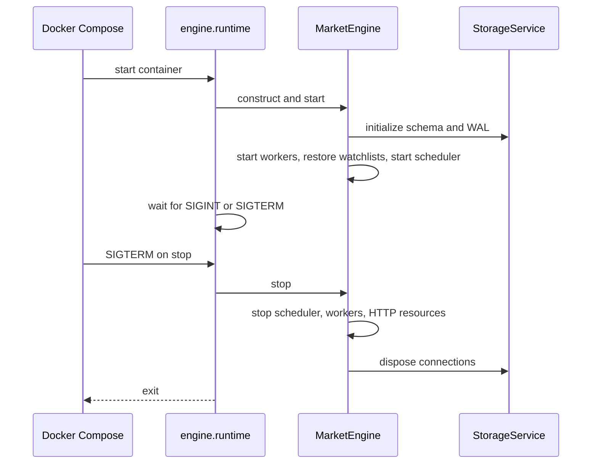

# Docker deployment

## Purpose

This module runs the existing self-hosted `MarketEngine` as one Docker Compose
service. It starts the scheduler, marketplace integrations, watchlists, alerts,
notifications, and SQLite storage. It adds no API, dashboard, or second engine.

[`backend/app`](../../backend/app) is a separate FastAPI comparison application
and is intentionally not run by this engine-only deployment.

## Architecture

```mermaid
flowchart TD
    Compose[Docker Compose] --> Engine[engine: engine.runtime]
    Env[CS2_* environment] --> Settings[EngineSettings]
    Secrets[/run/secrets/CS2_*] --> Settings
    Settings --> Engine
    Engine --> Jobs[JobHandler and JobScheduler]
    Engine --> Markets[CSFloat marketplace]
    Engine --> Services[Collection, watchlists, alerts, notifications]
    Engine --> Storage[StorageService]
    Storage --> SQLite[(engine-data volume: SQLite and WAL)]
    Markets --> CSFloat[CSFloat API]
    Services --> Discord[Discord webhook, optional]
```

The entrypoint is [`runtime.py`](../../backend/engine/runtime.py), which uses
[`create_market_engine`](../../backend/engine/bootstrap.py). Lifecycle ordering,
rollback, and resource closure remain owned by
[`MarketEngine`](../../backend/engine/market_engine.py).

## Files

| File | Responsibility |
|---|---|
| [`Dockerfile`](../../Dockerfile) | Python 3.12 image and non-root engine process. |
| [`compose.yaml`](../../compose.yaml) | One service, configuration, graceful stop, named volume. |
| [`compose.secrets.yaml.example`](../../compose.secrets.yaml.example) | Optional Docker Secrets override. |
| [`requirements-runtime.txt`](../../backend/requirements-runtime.txt) | Engine dependencies without tests or HTTP server. |
| [`runtime.py`](../../backend/engine/runtime.py) | Signal-aware process runner. |
| [`settings.py`](../../backend/engine/config/settings.py) | Validated configuration and Docker Secrets source. |
| [`service.py`](../../backend/engine/storage/service.py) | SQLite initialization and WAL mode. |

## Lifecycle



The service uses `init: true`, `stop_grace_period: 30s`, and
`restart: unless-stopped`. Startup and shutdown errors are logged and return a
non-zero status. SIGINT and SIGTERM request normal graceful shutdown.

## Configuration and secrets

All engine settings use the `CS2_` prefix declared in
[`EngineSettings`](../../backend/engine/config/settings.py). Compose defaults
are in [`compose.yaml`](../../compose.yaml). Override non-secret values with an
env file:

```dotenv
# deployment.env -- do not store credentials here
CS2_WORKER_COUNT=5
CS2_CSFLOAT_CURRENCY=GBP
CS2_CSFLOAT_ENABLED=true
CS2_DATABASE_BUSY_TIMEOUT_SECONDS=5
```

Compose fixes `CS2_DATABASE_PATH` to
`/var/lib/price-oracle/engine.sqlite3`, backed by the `engine-data` volume. Do
not change it to a container-local path.

`CS2_CSFLOAT_API_KEY` and `CS2_DISCORD_WEBHOOK_URL` are optional `SecretStr`
settings. Their repr is masked; bootstrap unwraps them only to construct the
marketplace or notification client. CSFloat may run without an API key when its
public endpoint is sufficient, so no credential is needed merely to start.

To use Docker Secrets, copy the example override, remove each secret block you
do not need, create only the remaining secret files, and include it when
starting:

```bash
cp compose.secrets.yaml.example compose.secrets.yaml
mkdir -p secrets
chmod 700 secrets
# Obtain values from a secret manager; do not paste them into shell history.
chmod 600 secrets/CS2_CSFLOAT_API_KEY secrets/CS2_DISCORD_WEBHOOK_URL
docker compose -f compose.yaml -f compose.secrets.yaml up -d --build
```

The override maps files to `/run/secrets/CS2_CSFLOAT_API_KEY` and
`/run/secrets/CS2_DISCORD_WEBHOOK_URL`. The `CS2_` prefix is required in the
filenames. Precedence is constructor values, environment, `.env`, Docker Secret
files, then defaults. Invalid values stop startup; no secret file is required by
the base Compose file.

## Operations

```bash
# Build and start
docker compose --env-file deployment.env build
docker compose --env-file deployment.env up -d

# Status, logs, stop, restart
docker compose ps
docker compose logs -f engine
docker compose stop
docker compose restart engine
docker compose down

# Recreate after configuration changes
docker compose --env-file deployment.env up -d --force-recreate
```

For a safe SQLite backup, stop the only writer first and copy every volume file,
including WAL and SHM files when present:

```bash
docker compose stop engine
docker volume ls --format '{{.Name}}' | grep '_engine-data$'
# Substitute the actual volume name shown above.
docker run --rm -v actual_engine-data:/source:ro -v "$PWD:/backup" \
  alpine sh -c 'cp -a /source/. /backup/price-oracle-backup'
docker compose start engine
```

For a live backup, use SQLite's online-backup tooling instead of copying a
database file while it is changing.

## SQLite persistence and permissions

`StorageService.initialize()` creates the parent directory, schema, and WAL
mode. The database plus `-wal` and `-shm` files live in `engine-data` and survive
container recreation. The image creates `/var/lib/price-oracle` with UID/GID
10001 before Docker initializes the named volume, and the engine runs as that
non-root user. Bind mounts must be writable by UID 10001.

## Security and deliberate exclusions

The image excludes Git data, virtual environments, tests, local databases,
dotenv files, and the ignored `secrets/` directory. It contains no credentials
and exposes no network port. Prefer Docker Secrets for values that must not
appear in Compose environment inspection; protect database backups as data.

Redis, PostgreSQL, Celery, Kubernetes, a health endpoint, REST API, and a
dashboard are deliberately excluded. Existing SQLite storage and the in-process
scheduler meet the single-container V1 scope with fewer services.

## Testing

[`test_runtime.py`](../../backend/tests/test_runtime.py) covers normal start and
stop, startup failure, shutdown failure, and repeated signal handling. Existing
configuration tests cover environment precedence, Docker Secret filename mapping,
invalid secret values, and `SecretStr` masking; storage tests use temporary
SQLite databases.

```bash
# From backend/
python3 -m pytest -q

# From repository root
docker compose config
docker compose build
docker compose up -d
docker compose logs engine
docker compose down
```

The completion report records the actual results from this checkout.

Actual validation for this module completed with **373 passing backend tests**
under an isolated `python:3.12-slim` container. `docker compose config` passed
for both the base configuration and the Secrets override, the production image
built successfully, and an isolated Compose smoke test confirmed non-root
startup, clean SIGTERM shutdown/restart, and survival of `engine.sqlite3` across
that restart. The test volume was removed after validation.

## Known limitations

- This is an engine worker, not a watchlist-management interface. Watchlists
  must already exist in SQLite or be managed by a future application layer.
- It is a single-writer SQLite deployment; do not run multiple replicas against
  the same database volume.
- Marketplace availability, rate limits, and authentication are external
  operational concerns.
- Inspect the actual Compose volume name before running the backup command.
