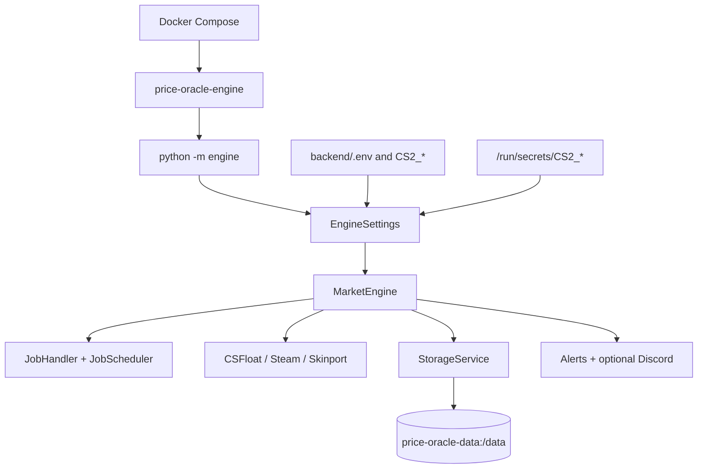
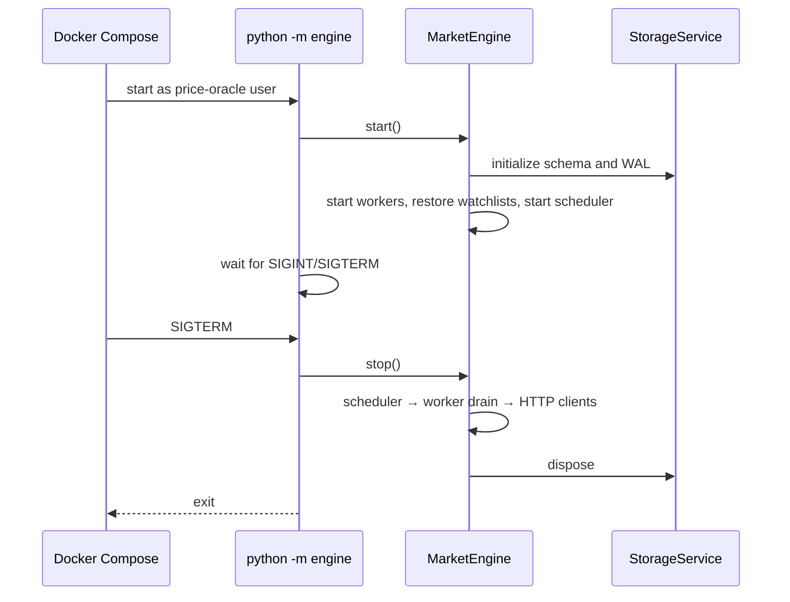

# Docker deployment

## Scope

[`compose.yaml`](../../compose.yaml) runs one engine-only service named
`price-oracle-engine`. It restores watchlists, schedules collection, stores quotes in SQLite,
evaluates alerts, and optionally delivers Discord notifications. It does not expose FastAPI or
serve the React frontend.

Do not run this daemon and `uvicorn app.main:app` against the same database: both processes would
restore persisted watchlists into independent schedulers. The supported deployment has one engine
owner and one SQLite writer process.

## Architecture



## Active deployment files

| File | Responsibility |
|---|---|
| [`compose.yaml`](../../compose.yaml) | Single service, optional env file, stop policy, persistent volume |
| [`backend/Dockerfile`](../../backend/Dockerfile) | Python 3.12 non-root engine image |
| [`backend/requirements-engine.txt`](../../backend/requirements-engine.txt) | Engine-only dependencies, including Brotli for Skinport |
| [`compose.secrets.yaml.example`](../../compose.secrets.yaml.example) | Optional secret-file override |
| [`backend/engine/__main__.py`](../../backend/engine/__main__.py) | Container process entry point |
| [`backend/engine/runtime.py`](../../backend/engine/runtime.py) | Signals and guaranteed cleanup |

The root `Dockerfile` and `backend/requirements-runtime.txt` belong to an earlier daemon packaging
variant and are not referenced by the active Compose file. They are retained pending explicit
removal approval.

## Lifecycle



Compose uses `init: true`, `restart: unless-stopped`, and a 20-second stop grace period. The job
handler's default drain budget is 10 seconds, leaving time for HTTP and database cleanup. Startup
or shutdown failure produces a non-zero process exit.

## Configuration

Copy the safe example and edit non-secret values:

```bash
cp backend/.env.example backend/.env
docker compose config
```

Compose reads `backend/.env` into the container and always overrides `CS2_DATABASE_PATH` with
`/data/engine.sqlite3`. All other `CS2_` values are defined by
[`EngineSettings`](../../backend/engine/config/settings.py). Invalid configuration stops startup.

Common values include:

```dotenv
CS2_WORKER_COUNT=5
CS2_JOB_QUEUE_CAPACITY=100
CS2_DATABASE_BUSY_TIMEOUT_SECONDS=5
CS2_CSFLOAT_ENABLED=true
CS2_CSFLOAT_CURRENCY=GBP
```

`CS2_CSFLOAT_API_KEY` and `CS2_DISCORD_WEBHOOK_URL` are optional `SecretStr` values. Prefer Docker
Secrets for production credentials:

```bash
cp compose.secrets.yaml.example compose.secrets.yaml
mkdir -p secrets
# Create only the files for enabled credentials and keep them out of Git.
chmod 700 secrets
chmod 600 secrets/CS2_CSFLOAT_API_KEY secrets/CS2_DISCORD_WEBHOOK_URL
docker compose -f compose.yaml -f compose.secrets.yaml config
docker compose -f compose.yaml -f compose.secrets.yaml up -d --build
```

The override mounts those files as `/run/secrets/CS2_CSFLOAT_API_KEY` and
`/run/secrets/CS2_DISCORD_WEBHOOK_URL`. Explicit settings, environment values, and `.env` values
take precedence over secret files.

## Operations

```bash
docker compose build
docker compose up -d
docker compose ps
docker compose logs -f price-oracle-engine
docker compose restart price-oracle-engine
docker compose stop
docker compose down
```

Normal `down` retains the named volume. `docker compose down --volumes` deletes the SQLite database
and is destructive.

For a consistent offline backup, stop the service, identify the actual project-prefixed volume with
`docker volume ls`, and copy the complete volume contents. Include SQLite `-wal` and `-shm` files if
present. For a live backup, use SQLite's online backup mechanism instead of copying one file during
writes.

## Persistence and permissions

`price-oracle-data` is mounted at `/data`; the configured database is
`/data/engine.sqlite3`. The image creates `/data` for the unprivileged `price-oracle` user before
declaring the volume. Named-volume data survives container replacement and restart. A bind mount,
if substituted locally, must be writable by the image user.

`StorageService.initialize()` enables WAL for file databases, foreign keys for every connection,
and a bounded busy timeout. SQLite remains a single-writer design; do not scale this service to
multiple replicas.

## Security

- The active image copies only engine source and runtime dependencies; tests, frontend, dotenv
  files, databases, Git data, and `secrets/` are excluded by `.dockerignore`.
- The container runs without root privileges and exposes no port.
- Webhook URLs and API keys are not embedded in the image or persisted in delivery rows.
- Protect the SQLite volume and backups: watchlists, alert rules, market history, and delivery state
  are application data.
- The daemon has no network health endpoint. Use container status and logs for this deployment.

## Validation completed on 2026-10-22

- `docker compose config`: passed.
- Base plus Docker-Secrets override configuration: passed with temporary placeholder secret files.
- `docker compose build`: passed.
- Runtime smoke: started as `price-oracle`, created SQLite, retained it across restart, and stopped
  cleanly on SIGTERM.
- External collection was disabled during the smoke test; no live marketplace or Discord request
  was made.
- The complete backend suite passed 406 tests; frontend build and dependency audits are reported in
  the [root README](../../README.md).

## Limitations

- The deployed daemon has no API, UI, readiness probe, or metrics endpoint.
- Watchlists must be seeded through an API process used at a different time/database ownership
  window, through an embedding application, or directly through supported Python services.
- There is no automated schema migration or notification recovery worker.
- Provider availability, credentials, rate limits, and response compatibility require operational
  monitoring and authorized smoke testing.
